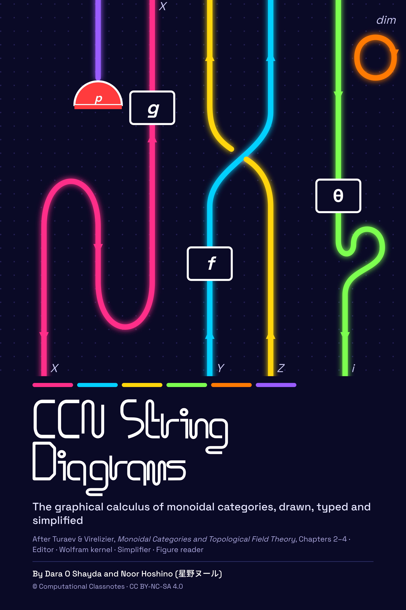

# CCN String Diagrams

An editor for the graphical calculus of monoidal categories, after Turaev & Virelizier, *Monoidal Categories and Topological Field Theory* (Progress in Mathematics 322, Springer 2017), Chapter 2, §2.1.

**Live page:** https://lossofgenerality.github.io/ccn-string-diagrams/

**Authors:** Dara O Shayda and Noor Hoshino (星野ヌール)

## Files

| File | What it is |
|---|---|
| `index.html` | The landing page |
| `string-diagram-editor.html` | The editor: a single self-contained page that runs offline |
| `kernel/GraphicalCalculusKernel-deploy.wl` | Deploys the Wolfram Cloud API behind the editor's “Wolfram kernel” engine |
| `kernel/graphical-calculus-2.1-simplify.nb` | Sections 0–19, the base engine: diagrams as data, the renderer, diagram → expression, the layered form, level exchange (`swap`, `normalize`, `makeAdjacent`), the rewriting loop and the rules of §2.1.1–2.1.2. Every other kernel file builds on it |
| `kernel/pivotal-2.1.3.wl` | Sections 20–27, §2.1.3 (pivotal categories): star duals, `renderP` with arrows, identity boxes, Figures 2.3 and 2.4 (`rulesP`) and ?*₂ |
| `kernel/graphical-calculus-2.1.3-pivotal.nb`, `-2.2-penrose.nb`, `-2.3-2.7.nb`, `-2.7-3.2.nb`, `-3.3.nb`, `-4.nb` | The teaching notebooks for §2.1.3 (with Exercise 2.1.5), §2.2, §2.3–2.7, §2.7.3–3.2, §3.3 and Chapter 4: each result checked by the rules and in a matrix model, with tests |
| `kernel/GraphicalCalculusKernel-deploy-2.2.wl`, `-2.3-2.7.wl`, `-2.7-3.2.wl`, `-3.3.wl`, `-4.wl` | The deploy file as it was after each stage (history); `-4.wl` is the same as `GraphicalCalculusKernel-deploy.wl` |
| `kernel/tests/editor-requests-*.json` | Every request the editor sends to the kernel for its examples, with the rule steps the JavaScript engine takes: 190 (§2.1–2.7), 244 (to §3.2), 296 (to §3.3) and 412 (to Chapter 4, 116 of them linear-combination terms). The kernel, the notebooks and `simplifier.wl` are tested against them |
| `kernel/tests/editor-text-layered.json` | The 148 example sides of the editor as text and as the layered form the editor computes, used by the expression-to-diagram and simplifier tests |
| `kernel/reading-diagrams-from-the-book.nb` | How a figure of the book is read by eye and checked: eight figures (Figure 2.1, (2.1), ∨f, Figures 2.2–2.3, θˡ, (4.7), (4.9)) shown beside their transcriptions, drawings and rule checks, with reading errors being caught |
| `kernel/automatic-figure-reading.nb` | The same done by the program: 13 equations of §2.1.1–2.1.3 read from the PDF by `figreader.py` and confirmed by the simplifier, with the statistics for Chapters 2–4 and a misreading the checks catch |
| `kernel/figure-reader.wl` and `tools/figure-reader/` | Diagrams read automatically from the book's PDF: `figreader.py` rebuilds each figure as a layered form from the PDF's drawing instructions (lines, curves, rectangles, arrow heads, positioned labels), and `figure-reader.wl` checks the readings with the simplifier. Figures 2.1–2.4, (2.1), (2.2) and ∨f are read and confirmed without human input |
| `tools/` | The scripts that made the generated files: `manuals/` (the three programmer's manuals and notebook 10), `chapter-4-docs/` and `introduction-docs/` (screenshots, pages, PDF), `tests/` (request capture, layered-form capture, linear-combination tests, UI smoke test). They were written for the build workspace, so paths at their top may need changing |
| `kernel/penrose-2.2.wl` | §2.2 in Wolfram: caps and cups on tensor products (`rulesT`), Exercise 2.2.5, signed objects, Penrose diagrams by strips, Figure 2.5 and Lemma 2.1 checks |
| `kernel/pivotal-2.3-2.7.wl` | §2.3–2.7 in Wolfram: ψ_X and Lemmas 2.2–2.4, ev_S and Ψ_S, a box turned through 360°, traces, dimensions, sphericity (`rulesD`, `rulesS`), and a weighted vector-space model (Example 2.7.2) for the matrix checks |
| `kernel/braided-2.7-3.2.wl` | §2.7.3 and §3.1–3.2 in Wolfram: Lemma 2.10 (proj_k), braidings τ and the rules (3.1)–(3.3), Reidemeister moves R2–R5, symmetries, the mirror braiding, and a graded vector-space model (Examples 3.1.4–3.1.6) for the matrix checks |
| `kernel/ribbon-3.3.wl` | §3.3.1–3.3.3 in Wolfram: twists θˡ, θʳ as curls, Lemma 3.2, Exercise 3.3.3, ribbon categories, Theorem 3.3 (R1), Corollary 3.4, Lemmas 3.5–3.6, and a graded, weighted vector-space model (ribbon exactly when the weights are ±1) |
| `kernel/fusion-4-rules.wl` | Chapter 4 in Wolfram, for the kernel: the enriched graphical calculus of a pivotal pre-fusion category (linear combinations, ∑ over simple objects, partition pairs) with the rules of §4.3.2, Lemma 4.2, (4.7)–(4.10), Lemmas 4.8–4.9 |
| `kernel/fusion-4.wl` | Chapter 4 in Wolfram, for the notebook: a pivotal fusion model of graded vector spaces (not spherical) in which Lemmas 4.2 and 4.6–4.10 and their proof steps are checked in matrices |
| `kernel/diagram-to-expression.wl` | The Wolfram translators from diagrams (boxes, lines, arrows) to expressions, in one self-contained package: `toExpression`, `toLayered`, `fromLayered`, `ldToExpression`, the Penrose strips, the kernel's JSON form and `toEditorText` |
| `kernel/diagram-to-expression-manual.nb` | The programmer's manual for that package: data structures, every function with its signature, arguments, return value, algorithm, limits, messages and examples, and tests |
| `kernel/expression-to-diagram.wl` | The other direction: the editor's syntax parsed in Wolfram (`parseExpression`, `parseSignature`), typing (`typeOf`), `expressionToLD` (the twin of the editor's `Core.toLayered`, identical on all 148 example sides), `idL`/`boxL`/`stackL`/`besideL`, Penrose strips from an expression, and the renderers `render`, `renderP` (arrows, caps, cups) and `show…` |
| `kernel/expression-to-diagram-manual.nb` | The programmer's manual for that package, in the same format as the other one, with 12 tests |
| `kernel/simplifier.wl` | Expression to expression: the simplifier behind the editor's Simplify button and the kernel, with a documented interface (`simplifyText`, `simplifyTextSteps`, `equationReport`, `simplifyLDTrace`, `simplifyTermTrace` for Chapter 4 terms, `ruleSet`/`ruleInfo`/`ruleCatalogue`, and the level-exchange machinery). It loads the engine from `graphical-calculus-2.1-simplify.nb`, `pivotal-2.1.3.wl` and the other kernel files in the same folder, and uses the same rules in the same order as the editor on all 412 recorded requests |
| `kernel/simplifier-manual.nb` | The programmer's manual for the simplifier: the loop, the rule kinds, the rule set of each mode, a catalogue of all 49 rules with their sources in the book, the options, the limits, and the tests |
| `docs/cover/ccn-string-diagrams-cover.png` | The project's cover art, 3600 × 5400 portrait PNG (title set in Icklips, freeware by Apostrophic Laboratories) |
| `docs/chapter-4/` | One page per result of Chapter 4 (§4.3.2, Lemma 4.2, §4.6.1–4.6.4, Lemmas 4.6–4.10): the statement, and the proof as a chain of editor steps, each with a link that opens it in the editor (`string-diagram-editor.html#ex=N`) |
| `docs/introduction-to-ccn-string-diagrams.md` (and `.pdf`) | Introduction to CCN String Diagrams: every example in the editor, with its expression, its diagram and what Simplify does. The `.md` is self-contained (all images embedded); `docs/README.md` is the same text with linked images, for reading on GitHub |

All Wolfram files expect to sit together in one folder. The notebooks and the deploy file look for it at `~/Desktop/Research/Monoidal Graphical Calculus/` (`gcDir`); copy the contents of `kernel/` there, or change that path. `simplifier.wl`, `diagram-to-expression.wl` and `expression-to-diagram.wl` find their companions in their own folder. The book itself is not included; the two book-reading notebooks show short excerpts of its figures, © Springer International Publishing AG 2017, for study beside the book.

## The editor

- A box-and-arcs canvas with boxes, boxes with source or target 𝟙, dots, arc ends and “=” signs. It has undo, save and open, and SVG export.
- A maths keypad: ⊗, ∘, 𝟙, ∨, id, ev, coev, ω, Ω, Ω′, Greek letters and subscripts.
- **Expression → Diagram** and **Diagram → Expression**. Equations are written with `=` between the sides.
- **Simplify**, which applies the rules of §2.1 in priority order and shows every step: level exchange (Figure 2.1), the (2.1) left and right zigzags, the definition of ∨f, and the (2.2) slides through ev and coev. When an equation is entered, the two sides are compared by their normal forms.
- **Pivotal categories (§2.1.3)**, with the “duals: X*” setting: oriented arcs (an X arc points down, an X* arc points up), ev and ẽv drawn as caps, coev and c̃oev drawn as cups, and the rules for the duality identities (Figure 2.2), the two expressions for f* (Figure 2.3) and the dual morphism identities (Figure 2.4). Type ẽv and c̃oev as `ev~_X` and `coev~_X`, and duals as `X*` and `f*`.
- **Penrose diagrams (§2.2)**, also with “duals: X*”: caps and cups on a tensor product split into nested caps and cups, ev_(Y⊗X) = ev_X(id_X* ⊗ ev_Y ⊗ id_X) and the same for coev, ẽv and c̃oev. Type them as `ev_{Y⊗X}`. The examples include Exercise 2.2.5 ((?*₂)⁻¹ ?*₂ = id), Figure 2.5 typed in strip by strip as on p. 38, and Lemma 2.1 (Figure 2.5 with its zigzag straightened gives the same morphism).
- **Double duals, traces and sphericity (§2.3–2.7)**, also with “duals: X*”. The editor identifies X** with X, so ψ_X (typed `ψ_X`, inverse `ψ⁻¹_X`) is the identity, and Lemma 2.3 reads ev_X* = ẽv_X, coev_X* = c̃oev_X. Loops are traces: `ev_X(id_X* ⊗ f)coev~_X` is tr_l(f) and `ev~_X(f ⊗ id_X*)coev_X` is tr_r(f); the rule *trace symmetry* turns a loop so that tr(pq) = tr(qp). A signature line `inverse u u′` lets inverse boxes cancel. Tick **spherical** to add the rule tr_r = tr_l of §2.7.1.
- **Braidings and Reidemeister diagrams (§3.1–3.2)**, in either duals mode. Type the braiding as `τ_{X,Y}` (X over Y) and the other crossing as `τ⁻¹_{Y,X}`; both are drawn as crossings (Figure 3.1). The rules split crossings of tensor products ((3.1)–(3.3)) and apply the Reidemeister moves R2 (a crossing and its inverse cancel), R3 (Yang–Baxter) and R4, R5 (a box slides through a crossing). Tick **symmetric** for a symmetry (§3.1.2, Remark 3.2.3). A signature line `retract p j` declares p j = id (Lemma 2.10).
- **Twists and ribbon categories (§3.3)**, in X* mode. The twists `θˡ_X`, `θʳ_X` and their inverses `θˡ⁻¹_X`, `θʳ⁻¹_X` are built in. A curl drawn with a cup, a crossing and a cap folds to a twist (also when other layers sit between its parts); twists cancel with their inverses, slide through boxes (Lemma 3.2) and split on tensor products (Exercise 3.3.3). Tick **ribbon** for θʳ = θˡ (§3.3.2); R1 (Theorem 3.3) and sphericity (Corollary 3.4) then follow.
- **Pre-fusion categories (Chapter 4)**, in X* mode with **pre-fusion** ticked. Expressions are linear combinations with scalars (`dim_l(i)`, `dim_r(i)`, `N^i_X`, `δ_{i,j}`, `a_i`) and sums `∑_i`. Signature lines `simple i j`, `partition α : X → i` (a semi-disk `p_α` and a compressed rectangle `q_α`, drawn as in §4.6.1) and `scalar a`. The rules are (4.7)–(4.10), Lemma 4.2(b), (4.2), Lemma 4.9(a)–(d), turning ω_S (§4.3.2), straightening, and δ. See [docs/chapter-4](docs/chapter-4/README.md).

It uses the book's conventions. Diagrams read bottom to top (sources at the bottom, so in `gf` the box `f` sits below `g`), composition is written by juxtaposition (`gf`) and binds tighter than ⊗, and the unit is 𝟙.

## Two engines

- **JavaScript (offline):** a port of the rule engine in the Wolfram notebook `graphical-calculus-2.1-simplify.nb`, with the same layered form and the same functions: `swap`, `normalize`, `bubble`, `makeAdjacent` and the rules.
- **Wolfram kernel (notebook):** the page POSTs `payload_b64`, the base64 of the JSON `{src, ls:[{a,name,ins,outs}], pairings, rightFirst, pivotal}`, to `https://www.wolframcloud.com/obj/ccn2/GraphicalCalculusKernel`. The reply is `steps_b64`, the base64 of the JSON `[[rule, {src, ls}]]`. The API only applies the rewrite rules to the data it is sent; it evaluates no code.

Every Wolfram result is also worked out in JavaScript, and the page reports any difference between the two engines.

### Redeploying the kernel

The “Wolfram kernel” option sends the diagram's layered form to `GraphicalCalculusKernel`, a Wolfram Cloud API that runs the rules of the notebook `graphical-calculus-2.1-simplify.nb`. To redeploy it, evaluate [`kernel/GraphicalCalculusKernel-deploy.wl`](kernel/GraphicalCalculusKernel-deploy.wl) in a signed-in Wolfram session.

Put `graphical-calculus-2.1-simplify.nb` (sections 0–19), `pivotal-2.1.3.wl` (sections 20–27, which define `rulesP`), `penrose-2.2.wl` (sections 30–35, which define `rulesT`) `pivotal-2.3-2.7.wl` (sections 40–47, which define `rulesD` and `rulesS`) `braided-2.7-3.2.wl` (sections 50–55, which define `rulesB`, `rulesDB`, `rulesSB`) and `ribbon-3.3.wl` (sections 60–64, which define `twistRules`, `ribbonRules`, `withTwists`; copies of the last four are in `kernel/`) in one folder, `~/Desktop/Research/Monoidal Graphical Calculus`, together with the deploy file, or edit `gcDir` at the top of the `.wl` file. For requests with `pivotal: true` the kernel uses `rulesD`: `rulesP`, the §2.2 rules for caps and cups on a tensor product, and the §2.3–2.6 rules (Lemma 2.3, ψ, trace symmetry, inverse boxes); with `spherical: true` it uses `rulesS`, which adds sphericity. Every set includes the braiding rules of §3.1–3.2; pivotal sets also get the twist rules of §3.3, `ribbon: true` adds θʳ = θˡ and sphericity, and `symmetric: true` adds the symmetry rules. Requests also carry `inverses` and `retracts`, the declared pairs of inverse boxes and retractions. The editor's `ev~_X` and `coev~_X` become `Subscript[OverTilde["ev"], X]` and `Subscript[OverTilde["coev"], X]` there. CloudDeploy runs only when all nine checks pass. Then evaluate the whole file in a signed-in Wolfram session. It loads the notebook's engine, runs a check and calls `CloudDeploy`. Deploying under the same name keeps the URL.

---

© Computational Classnotes · CC BY-NC-SA 4.0
