# Introduction to CCN String Diagrams

**Dara O Shayda and Noor Hoshino (星野ヌール)**

*A guided tour of the examples in the CCN String Diagrams editor, after Turaev & Virelizier, “Monoidal Categories and Topological Field Theory”, Chapter 2, §2.1–2.7 (pp. 31–50).*

© Computational Classnotes · CC BY-NC-SA 4.0

Editor: <https://lossofgenerality.github.io/ccn-string-diagrams/string-diagram-editor.html> · Source: <https://github.com/lossofgenerality/ccn-string-diagrams>

## Contents

1. The editor
2. Conventions and typing
3. How the simplifier works
4. §2.1.1–2.1.2 Categories and monoidal categories
5. §2.1.2 Pairings and the zigzag identities (2.1)
6. §2.1.2 Left duals: ∨f and the identities (2.2)
7. §2.1.3 Pivotal categories: Figures 2.2–2.4
8. Exercise 2.1.5 Pairings and anti-isomorphisms
9. §2.2 Penrose diagrams
10. §2.3 Double duals and generalized evaluations
11. §2.4–2.6 Isotopy, traces and dimensions
12. §2.7 Spherical categories
13. The two engines

## 1. The editor

CCN String Diagrams is a box-and-arrow editor for the graphical calculus of monoidal categories. It runs in one HTML page, online or offline. The canvas on the left holds the diagram; the panel on the right holds the expression, a keypad of the book's symbols, the three main buttons and the result.

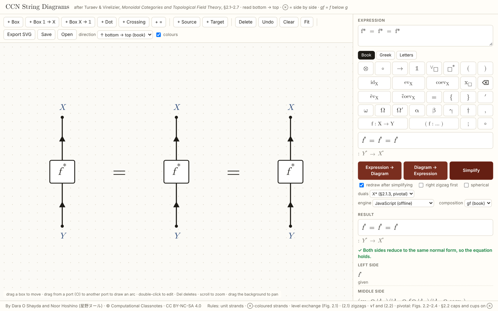

- **Expression → Diagram** draws the typed expression.
- **Diagram → Expression** reads the drawn diagram back as an expression, in the book's notation.
- **Simplify** rewrites the diagram step by step with the rules of the book, shows every step with the name of the rule used, and, for an equation, says whether both sides reach the same normal form.

Every example in this document is in the editor's **Load an example…** menu. Loading one fills in the expression and the signature, sets the duals mode, and draws the diagram. Each section below shows the expression (symbolic), the diagram the editor draws (graphical), and what Simplify does with it. The pictures are screenshots of the editor itself.

## 2. Conventions and typing

The editor follows the book:

- **Diagrams read bottom to top.** Sources are at the bottom and targets at the top, so in $gf$ the box $f$ sits below $g$. (The direction can be flipped in the toolbar.)
- **Composition is juxtaposition:** `g f` is $gf$. It binds tighter than $\otimes$; `g ∘ f` and `f ; g` are also accepted.
- **$\otimes$ is side by side**, left to right. Type `⊗` (or `(x)`).
- **The unit** $\mathbb 1$ is typed `𝟙`, `I` or `1`, and is never drawn.
- **Identities** are `id_X`; tensor colours are written in braces, `id_{X⊗Y}` or `ev_{Y⊗X}`.
- **Duals.** With *duals: ∨X* (§2.1.2) the left dual is `∨X`, and `ev_X`, `coev_X`, `∨f` are built in. With *duals: X\** (§2.1.3, pivotal) the dual is `X*`, arcs carry arrows ($X$ points down, $X^*$ points up), and `ev_X`, `ev~_X` ($\widetilde{\mathrm{ev}}_X$), `coev_X`, `coev~_X` ($\widetilde{\mathrm{coev}}_X$) and `f*` are built in.

The **signature** box declares the boxes, one per line:

```
f : X → Y
g : Y → Z
ω : X ⊗ Y → 𝟙
Ω : 𝟙 → Y ⊗ X
pairing ω Ω
```

`pairing ω Ω` says that $\Omega$ is the inverse of the pairing $\omega$, so the zigzag rules may cancel them. The keypad (tabs *Book*, *Greek*, *Letters*) types every symbol, and the preview under the expression typesets it as in the book.

## 3. How the simplifier works

The simplifier works on the **layered form** of a diagram: the source colours, then one box per layer, each with the number of arcs to its left. **Level exchange** (Figure 2.1) lets two layers swap when their boxes do not touch, and every diagram is brought to a normal form in which boxes sit as low and as far left as they can. The rules are then tried in this order, and the first one that applies is used:

| Rule | Book | What it does |
|---|---|---|
| unit strands, ⊗-coloured strands | §2.1.2 | erase arcs coloured $\mathbb 1$; split an arc coloured $X\otimes Y$ into two |
| caps and cups on ⊗ (pivotal) | §2.2 | $\mathrm{ev}_{Y\otimes X}=\mathrm{ev}_X(\mathrm{id}_{X^*}\otimes\mathrm{ev}_Y\otimes\mathrm{id}_X)$ and the same for coev, ẽv, c̃oev |
| (2.1) left zigzag, (2.1) right zigzag | (2.1), Fig. 2.2 | cancel a pairing and its inverse that form a zigzag |
| definition of ∨f / Fig. 2.3 fold (left) | §2.1.2, Fig. 2.3 | fold cup–box–cap into the dual box |
| Fig. 2.3 fold (right) | Fig. 2.3 | the same with ẽv and c̃oev |
| (2.2) slide through ev / coev, Fig. 2.4 slides | (2.2), Fig. 2.4 | move a dual box across a cap or cup |
| Lemma 2.3 (X\*\* = X), ψ = id (X\*\* = X) | §2.3.1 | with $X^{**}=X$: $\mathrm{ev}_{X^*}=\widetilde{\mathrm{ev}}_X$, $\mathrm{coev}_{X^*}=\widetilde{\mathrm{coev}}_X$ and the reverse, and $\psi_X=\mathrm{id}_X$ |
| trace symmetry (§2.6.1) | §2.6.1 | turn a loop so that its boxes start at the first name in code-point order |
| inverse boxes | §2.6.2 | cancel $u'u$ and $uu'$ for a declared pair `inverse u u′` |
| sphericity (§2.7.1) | §2.7.1 | spherical only: a right loop becomes a left loop |

Each step is shown with its rule name. An equation holds when all its sides reach the same normal form. Every rule makes the diagram smaller, so Simplify always stops.

## 4. §2.1.1–2.1.2 Categories and monoidal categories

### §2.1.1  id_X

§2.1.1 draws the identity of an object $X$ as a plain vertical arc coloured $X$, with no box. Every arc in the editor is an identity.

**Type it.** Signature and expression:

```
f : X → Y
g : Y → Z
```

```
id_X
```

**Symbolic.** The editor typesets it as

$$
\mathrm{id}_{X}
$$

a morphism from $X$ to $X$.

**Graphical.** Expression → Diagram draws:

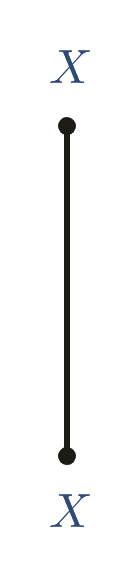

**Simplify.** Type `id_X`. The two dots are the free ends: the source $X$ at the bottom and the target $X$ at the top.

No rewriting rule applies: the diagram is already in normal form.

### §2.1.1  f : X → Y

A morphism $f\colon X\to Y$ is a box with its source arc coming in from below and its target arc leaving at the top.

**Type it.** Signature and expression:

```
f : X → Y
g : Y → Z
```

```
f
```

**Symbolic.** The editor typesets it as

$$
f
$$

a morphism from $X$ to $Y$.

**Graphical.** Expression → Diagram draws:

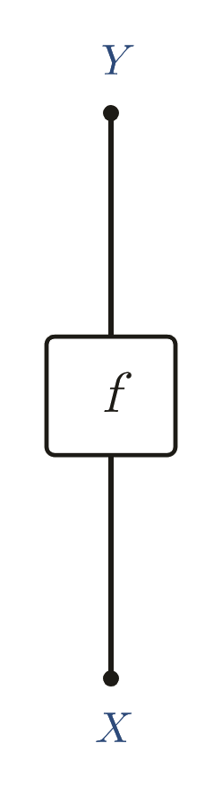

**Simplify.** The signature line `f : X → Y` declares the box; the expression `f` then draws it. Diagram → Expression reads it back as $f$.

No rewriting rule applies: the diagram is already in normal form.

### §2.1.1  composition gf

The composition $gf$ is drawn by stacking: $f$ below $g$, joined by the arc $Y$. The book writes composition by juxtaposition, and so does the editor.

**Type it.** Signature and expression:

```
f : X → Y
g : Y → Z
```

```
g f
```

**Symbolic.** The editor typesets it as

$$
g f
$$

a morphism from $X$ to $Z$.

**Graphical.** Expression → Diagram draws:

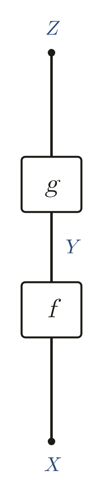

**Simplify.** Type `g f`. Juxtaposition binds tighter than $\otimes$, so `g f ⊗ h` means $(gf)\otimes h$. `g ∘ f` and `f ; g` are accepted too.

No rewriting rule applies: the diagram is already in normal form.

### §2.1.2  f ⊗ g

§2.1.2: the monoidal product $f\otimes g$ is drawn by placing the boxes side by side, $f$ on the left.

**Type it.** Signature and expression:

```
f : X → Y
g : U → V
```

```
f ⊗ g
```

**Symbolic.** The editor typesets it as

$$
f \otimes g
$$

a morphism from $X \otimes U$ to $Y \otimes V$.

**Graphical.** Expression → Diagram draws:

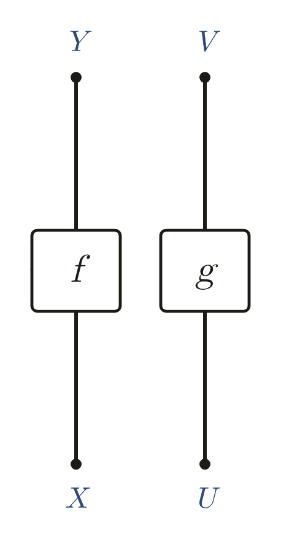

**Simplify.** `f ⊗ g` with `f : X → Y` and `g : U → V`. The source $X\otimes U$ is read left to right along the bottom.

No rewriting rule applies: the diagram is already in normal form.

### §2.1.2  f : X ⊗ Y → A ⊗ B ⊗ C

A box may have several arcs on each side; their colours are read left to right.

**Type it.** Signature and expression:

```
f : X ⊗ Y → A ⊗ B ⊗ C
```

```
f
```

**Symbolic.** The editor typesets it as

$$
f
$$

a morphism from $X \otimes Y$ to $A \otimes B \otimes C$.

**Graphical.** Expression → Diagram draws:

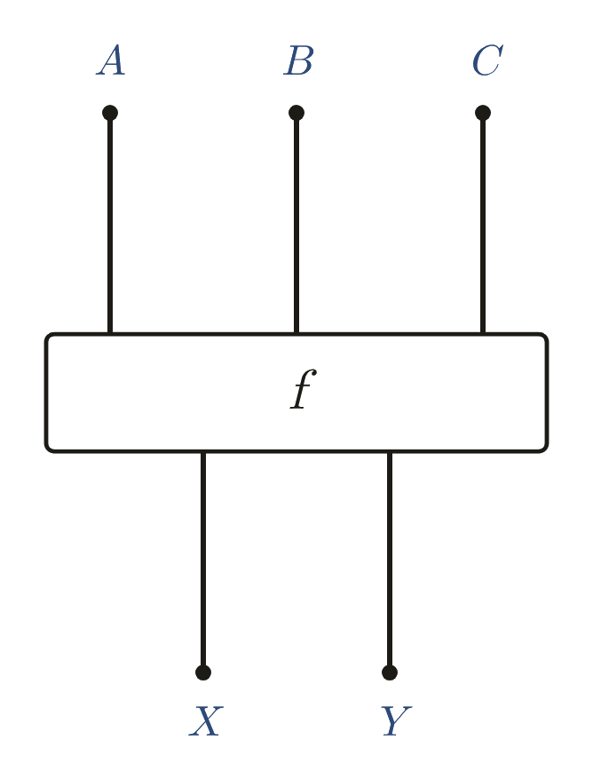

**Simplify.** `f : X ⊗ Y → A ⊗ B ⊗ C` gives a box with two inputs and three outputs.

No rewriting rule applies: the diagram is already in normal form.

### §2.1.2  boxes with source or target 𝟙: α, β, γ

The unit object $\mathbb 1$ is never drawn. A morphism $\mathbb 1\to\mathbb 1$ is a box with no arcs, $\mathbb 1\to X$ has no arc below, and $X\to\mathbb 1$ has none above.

**Type it.** Signature and expression:

```
α : 𝟙 → 𝟙
β : 𝟙 → X
γ : X → 𝟙
```

```
α ⊗ β ⊗ γ
```

**Symbolic.** The editor typesets it as

$$
\alpha \otimes \beta \otimes \gamma
$$

a morphism from $X$ to $X$.

**Graphical.** Expression → Diagram draws:

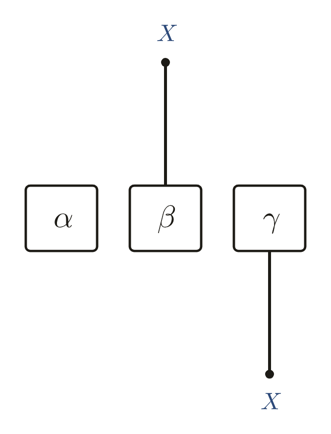

**Simplify.** Type the unit as `𝟙` (also `I` or `1`). Simplify erases strands coloured $\mathbb 1$.

No rewriting rule applies: the diagram is already in normal form.

### Figure 2.1  level-exchange property

Figure 2.1, the level-exchange property: boxes on different arcs can slide past each other, so $f\otimes g = (\mathrm{id}_Y\otimes g)(f\otimes\mathrm{id}_U) = (f\otimes \mathrm{id}_V)(\mathrm{id}_X\otimes g)$.

**Type it.** Signature and expression:

```
f : X → Y
g : U → V
```

```
f ⊗ g = (id_Y ⊗ g)(f ⊗ id_U) = (f ⊗ id_V)(id_X ⊗ g)
```

**Symbolic.** The editor typesets it as

$$
f \otimes g
$$

$$=$$

$$
(\mathrm{id}_{Y} \otimes g) (f \otimes \mathrm{id}_{U})
$$

$$=$$

$$
(f \otimes \mathrm{id}_{V}) (\mathrm{id}_{X} \otimes g)
$$

a morphism from $X \otimes U$ to $Y \otimes V$.

**Graphical.** Expression → Diagram draws:

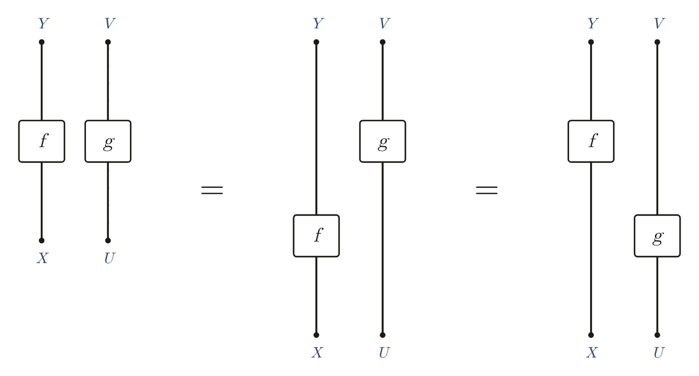

**Simplify.** Simplify puts each side in its level-exchange normal form (one box per layer, boxes pushed down and to the left). All three sides reach the same normal form, so the verdict says the equation holds, without any other rule.

No rewriting rule applies: the diagram is already in normal form, and all sides have the same normal form.

The editor reports: *✓ Both sides reduce to the same normal form, so the equation holds.*

## 5. §2.1.2 Pairings and the zigzag identities (2.1)

### (2.1) left: (id_Y ⊗ ω)(Ω ⊗ id_Y) = id_Y

Formula (2.1), left: for a non-degenerate pairing $\omega\colon X\otimes Y\to\mathbb 1$ with inverse $\Omega\colon\mathbb 1\to Y\otimes X$, the zigzag on $Y$ straightens: $(\mathrm{id}_Y\otimes\omega)(\Omega\otimes\mathrm{id}_Y)=\mathrm{id}_Y$.

**Type it.** Signature and expression:

```
ω : X ⊗ Y → 𝟙
Ω : 𝟙 → Y ⊗ X
Ω′ : 𝟙 → Y ⊗ X
pairing ω Ω
pairing ω Ω′
α : T → Z ⊗ X
β : T ⊗ Y → Z
```

```
(id_Y ⊗ ω)(Ω ⊗ id_Y) = id_Y
```

**Symbolic.** The editor typesets it as

$$
(\mathrm{id}_{Y} \otimes \omega) (\Omega \otimes \mathrm{id}_{Y}) \;=\; \mathrm{id}_{Y}
$$

a morphism from $Y$ to $Y$.

**Graphical.** Expression → Diagram draws:

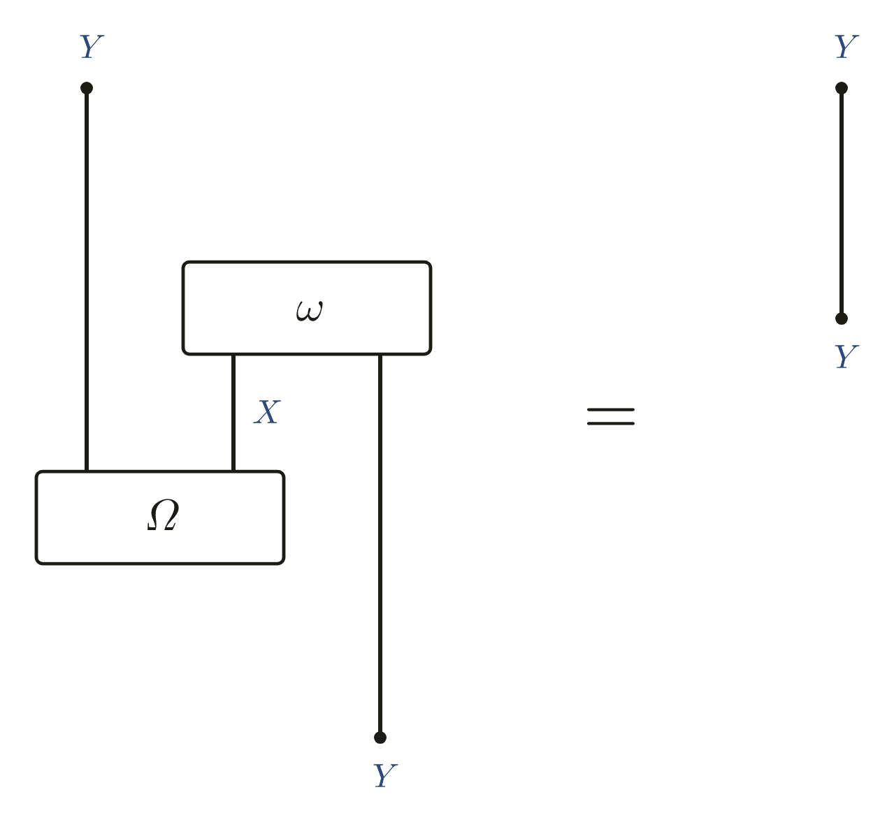

**Simplify.** The signature line `pairing ω Ω` tells the simplifier that $\omega$ and $\Omega$ are paired. The rule **(2.1) left zigzag** removes the cup $\Omega$ and the cap $\omega$ together.

Steps, side by side: side 1: (2.1) left zigzag; side 2: already in normal form.

Normal form:

$$
\mathrm{id}_{Y}
$$

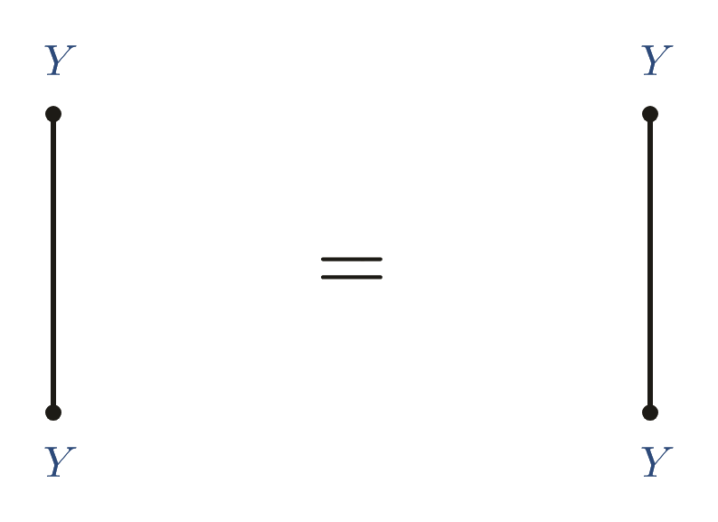

The editor reports: *✓ Both sides reduce to the same normal form, so the equation holds.*

### (2.1) right: (ω ⊗ id_X)(id_X ⊗ Ω) = id_X

Formula (2.1), right: $(\omega\otimes\mathrm{id}_X)(\mathrm{id}_X\otimes\Omega)=\mathrm{id}_X$.

**Type it.** Signature and expression:

```
ω : X ⊗ Y → 𝟙
Ω : 𝟙 → Y ⊗ X
Ω′ : 𝟙 → Y ⊗ X
pairing ω Ω
pairing ω Ω′
α : T → Z ⊗ X
β : T ⊗ Y → Z
```

```
(ω ⊗ id_X)(id_X ⊗ Ω) = id_X
```

**Symbolic.** The editor typesets it as

$$
(\omega \otimes \mathrm{id}_{X}) (\mathrm{id}_{X} \otimes \Omega) \;=\; \mathrm{id}_{X}
$$

a morphism from $X$ to $X$.

**Graphical.** Expression → Diagram draws:

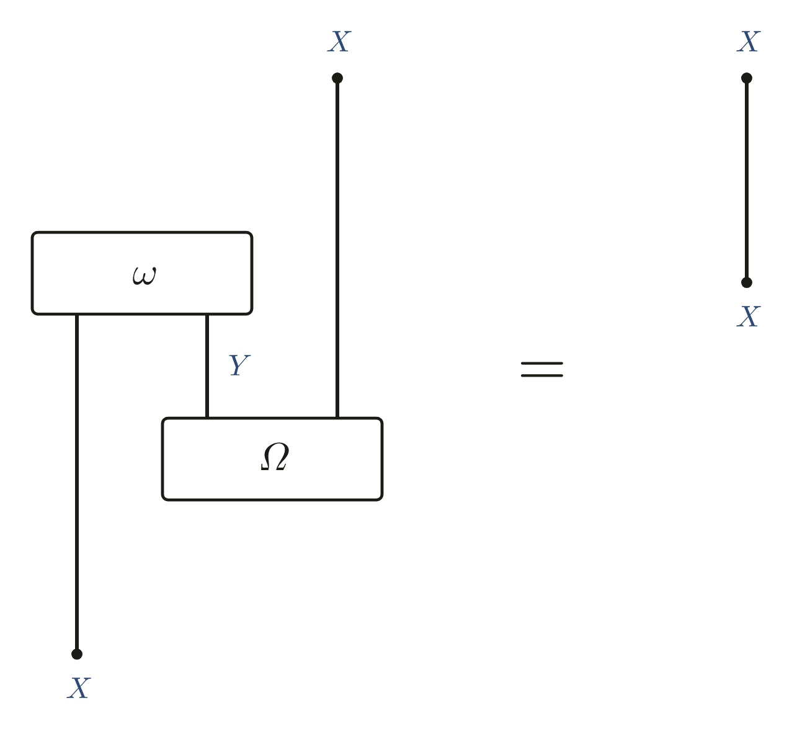

**Simplify.** The rule **(2.1) right zigzag** straightens the zigzag on $X$.

Steps, side by side: side 1: (2.1) right zigzag; side 2: already in normal form.

Normal form:

$$
\mathrm{id}_{X}
$$

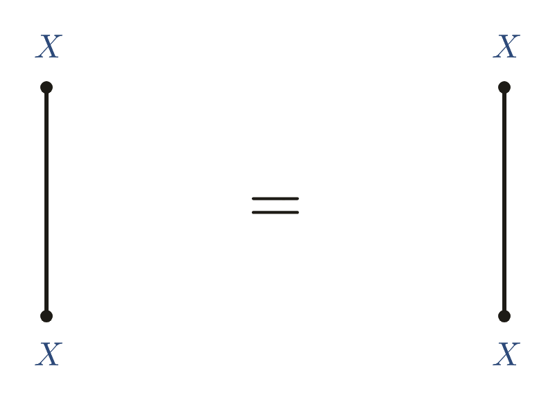

The editor reports: *✓ Both sides reduce to the same normal form, so the equation holds.*

### Uniqueness of the inverse (try “right zigzag first”)

The inverse of a pairing is unique. If $\Omega$ and $\Omega'$ are both inverses of $\omega$, the diagram $(\mathrm{id}_Y\otimes\omega\otimes\mathrm{id}_X)(\Omega'\otimes\Omega)$ equals $\Omega$ by one zigzag and $\Omega'$ by the other.

**Type it.** Signature and expression:

```
ω : X ⊗ Y → 𝟙
Ω : 𝟙 → Y ⊗ X
Ω′ : 𝟙 → Y ⊗ X
pairing ω Ω
pairing ω Ω′
α : T → Z ⊗ X
β : T ⊗ Y → Z
```

```
(id_Y ⊗ ω ⊗ id_X)(Ω′ ⊗ Ω)
```

**Symbolic.** The editor typesets it as

$$
(\mathrm{id}_{Y} \otimes \omega \otimes \mathrm{id}_{X}) (\Omega ' \otimes \Omega)
$$

a morphism from $\mathbb{1}$ to $Y \otimes X$.

**Graphical.** Expression → Diagram draws:

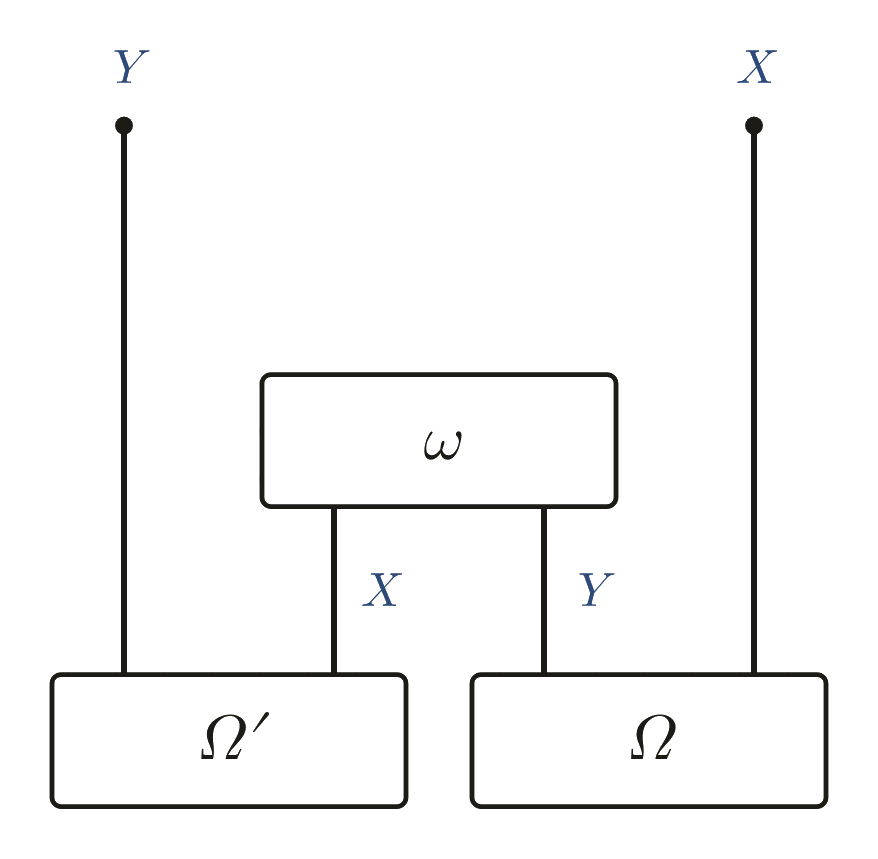

**Simplify.** With the default order the left zigzag fires first and the result is $\Omega$. Tick **right zigzag first** and Simplify gives $\Omega'$ instead: the two answers together prove $\Omega=\Omega'$.

Steps: (2.1) left zigzag.

Normal form:

$$
\Omega
$$

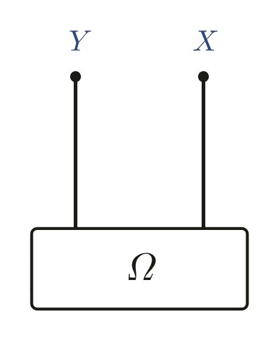

### (1.10)  backward ∘ forward = id

The bijection (1.10) $\mathrm{Hom}(T, Z\otimes X)\cong\mathrm{Hom}(T\otimes Y, Z)$ sends $\alpha$ to $(\mathrm{id}_Z\otimes\omega)(\alpha\otimes\mathrm{id}_Y)$; the way back sends $\beta$ to $(\beta\otimes\mathrm{id}_X)(\mathrm{id}_T\otimes\Omega)$. Going there and back gives $\alpha$ again.

**Type it.** Signature and expression:

```
ω : X ⊗ Y → 𝟙
Ω : 𝟙 → Y ⊗ X
Ω′ : 𝟙 → Y ⊗ X
pairing ω Ω
pairing ω Ω′
α : T → Z ⊗ X
β : T ⊗ Y → Z
```

```
((id_Z ⊗ ω)(α ⊗ id_Y) ⊗ id_X)(id_T ⊗ Ω) = α
```

**Symbolic.** The editor typesets it as

$$
\begin{aligned}
&(((\mathrm{id}_{Z} \otimes \omega) (\alpha \otimes \mathrm{id}_{Y})) \otimes \mathrm{id}_{X}) \\
&\;(\mathrm{id}_{T} \otimes \Omega)
\end{aligned}
$$

$$=$$

$$
\alpha
$$

a morphism from $T$ to $Z \otimes X$.

**Graphical.** Expression → Diagram draws:

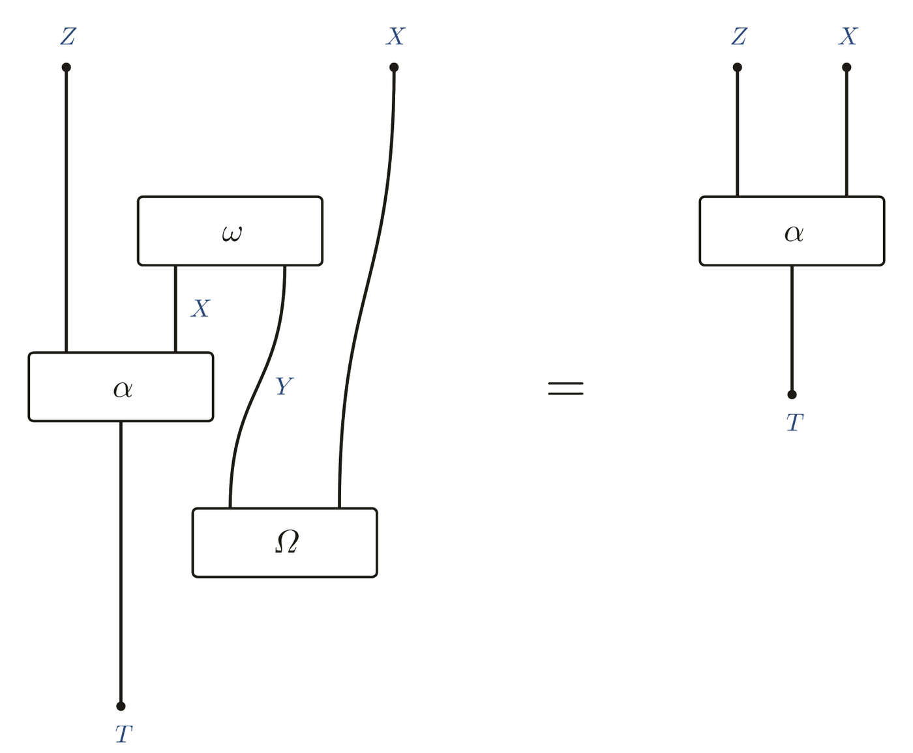

**Simplify.** After level exchange the cup $\Omega$ and the cap $\omega$ form a zigzag, and **(2.1) right zigzag** removes it, leaving the box $\alpha$.

Steps, side by side: side 1: (2.1) right zigzag; side 2: already in normal form.

Normal form:

$$
\alpha
$$

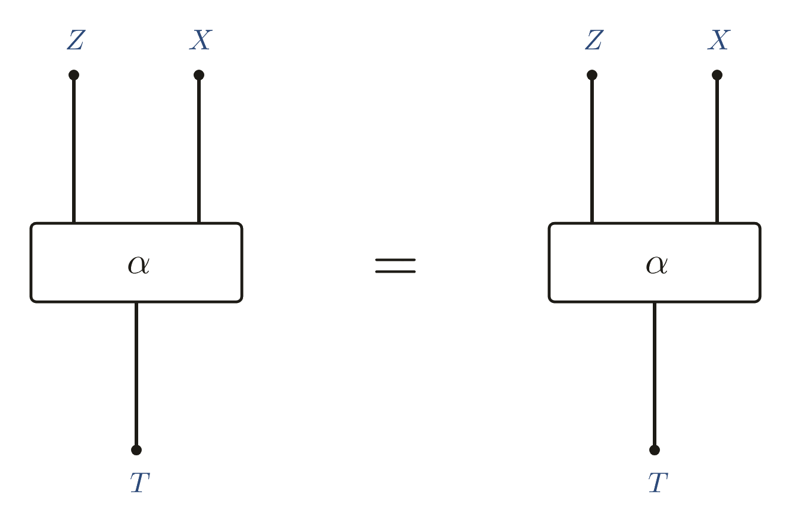

The editor reports: *✓ Both sides reduce to the same normal form, so the equation holds.*

### (1.10)  forward ∘ backward = id

The other composite of (1.10): starting from $\beta\colon T\otimes Y\to Z$ and going back and forth gives $\beta$.

**Type it.** Signature and expression:

```
ω : X ⊗ Y → 𝟙
Ω : 𝟙 → Y ⊗ X
Ω′ : 𝟙 → Y ⊗ X
pairing ω Ω
pairing ω Ω′
α : T → Z ⊗ X
β : T ⊗ Y → Z
```

```
(id_Z ⊗ ω)((β ⊗ id_X)(id_T ⊗ Ω) ⊗ id_Y) = β
```

**Symbolic.** The editor typesets it as

$$
\begin{aligned}
&(\mathrm{id}_{Z} \otimes \omega) \\
&\;(((\beta \otimes \mathrm{id}_{X}) (\mathrm{id}_{T} \otimes \Omega)) \otimes \mathrm{id}_{Y})
\end{aligned}
$$

$$=$$

$$
\beta
$$

a morphism from $T \otimes Y$ to $Z$.

**Graphical.** Expression → Diagram draws:

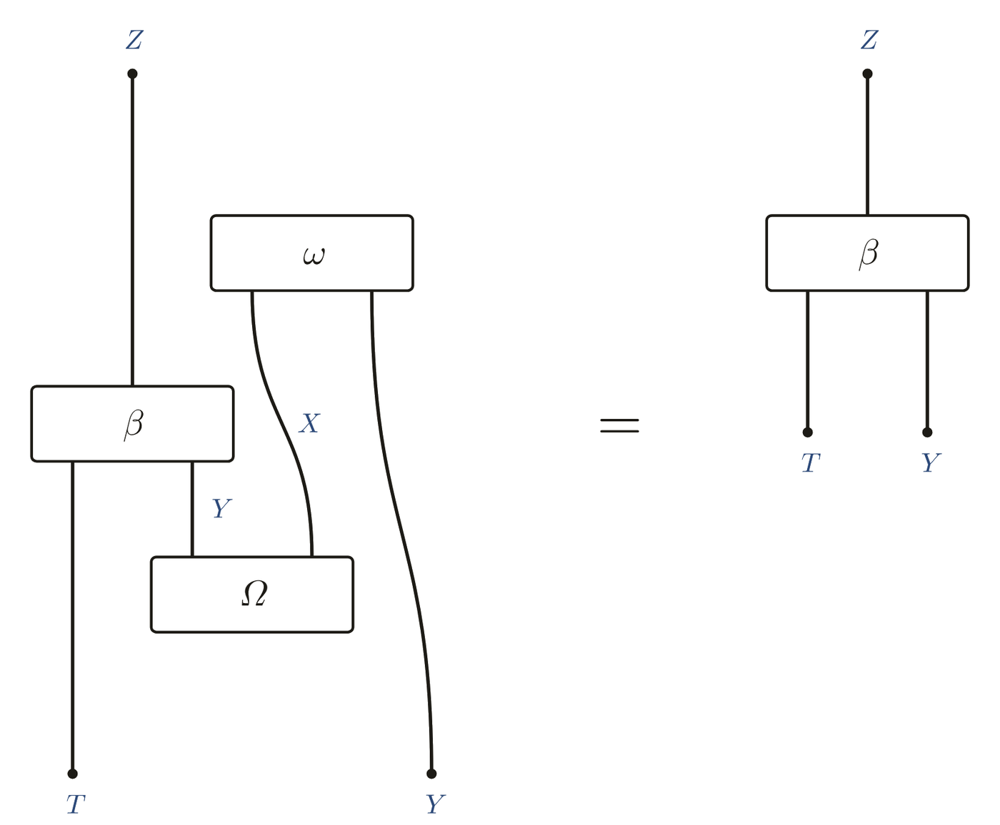

**Simplify.** This time the **(2.1) left zigzag** does the work.

Steps, side by side: side 1: (2.1) left zigzag; side 2: already in normal form.

Normal form:

$$
\beta
$$

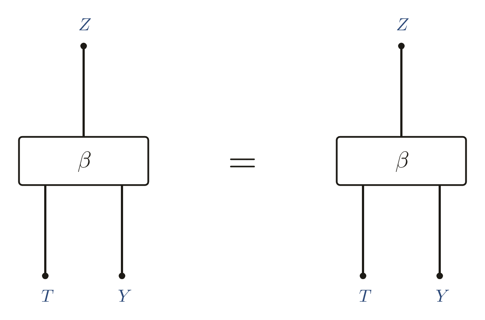

The editor reports: *✓ Both sides reduce to the same normal form, so the equation holds.*

## 6. §2.1.2 Left duals: ∨f and the identities (2.2)

### §2.1.2  definition of ∨f

§2.1.2: with left duals, $\mathrm{ev}_X\colon {}^{\vee}X\otimes X\to\mathbb 1$ is a cap and $\mathrm{coev}_X\colon\mathbb 1\to X\otimes{}^{\vee}X$ is a cup. The dual of $f\colon X\to Y$ is ${}^{\vee}f = (\mathrm{ev}_Y\otimes\mathrm{id}_{{}^{\vee}X})(\mathrm{id}_{{}^{\vee}Y}\otimes f\otimes\mathrm{id}_{{}^{\vee}X})(\mathrm{id}_{{}^{\vee}Y}\otimes\mathrm{coev}_X)$.

**Type it.** Signature and expression:

```
f : X → Y
```

```
∨f = (ev_Y ⊗ id_∨X)(id_∨Y ⊗ f ⊗ id_∨X)(id_∨Y ⊗ coev_X)
```

**Symbolic.** The editor typesets it as

$$
{}^{\vee}f
$$

$$=$$

$$
\begin{aligned}
&(\mathrm{ev}_{Y} \otimes \mathrm{id}_{{}^{\vee}X}) \\
&\;(\mathrm{id}_{{}^{\vee}Y} \otimes f \otimes \mathrm{id}_{{}^{\vee}X}) \\
&\;(\mathrm{id}_{{}^{\vee}Y} \otimes \mathrm{coev}_{X})
\end{aligned}
$$

a morphism from ${}^{\vee}Y$ to ${}^{\vee}X$.

**Graphical.** Expression → Diagram draws:

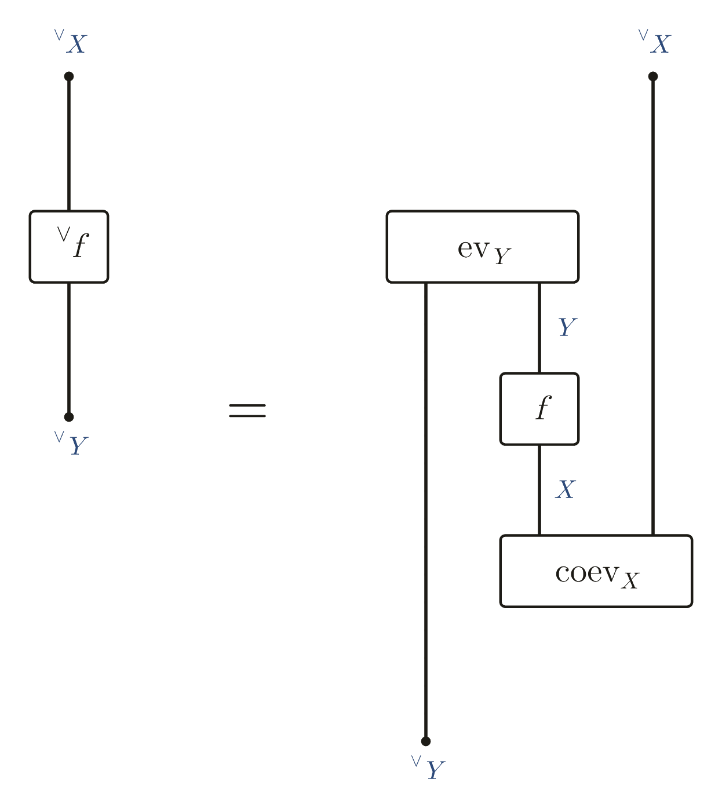

**Simplify.** With **duals: ∨X**, `ev_X`, `coev_X` and `∨f` are built in for every declared box. The rule **definition of ∨f** folds the three-layer picture into the single box ${}^{\vee}f$.

Steps, side by side: side 1: already in normal form; side 2: definition of ∨f.

Normal form:

$$
{}^{\vee}f
$$

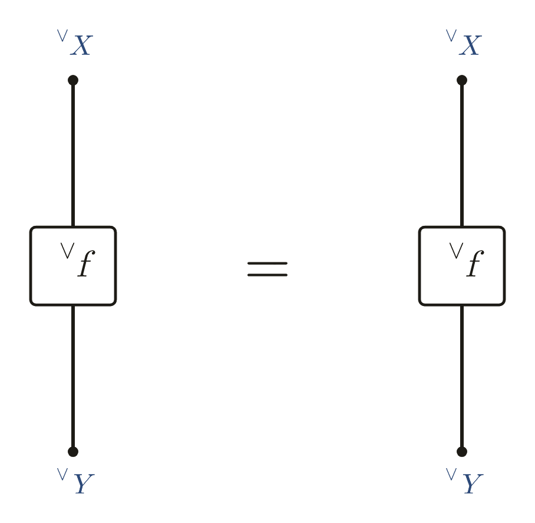

The editor reports: *✓ Both sides reduce to the same normal form, so the equation holds.*

### (2.2) left: slide through ev

Formula (2.2), left: a dual box slides through a cap, $\mathrm{ev}_X({}^{\vee}f\otimes\mathrm{id}_X)=\mathrm{ev}_Y(\mathrm{id}_{{}^{\vee}Y}\otimes f)$.

**Type it.** Signature and expression:

```
f : X → Y
```

```
ev_X(∨f ⊗ id_X) = ev_Y(id_∨Y ⊗ f)
```

**Symbolic.** The editor typesets it as

$$
\mathrm{ev}_{X} ({}^{\vee}f \otimes \mathrm{id}_{X}) \;=\; \mathrm{ev}_{Y} (\mathrm{id}_{{}^{\vee}Y} \otimes f)
$$

a morphism from ${}^{\vee}Y \otimes X$ to $\mathbb{1}$.

**Graphical.** Expression → Diagram draws:

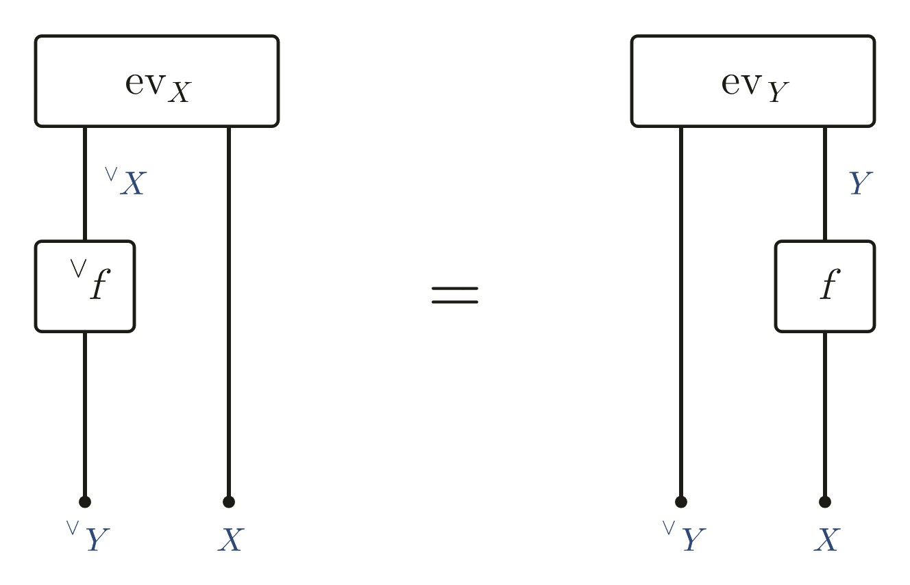

**Simplify.** The rule **(2.2) slide through ev** moves the box from the left leg of the cap to the right leg, turning ${}^{\vee}f$ into $f$.

Steps, side by side: side 1: (2.2) slide through ev; side 2: already in normal form.

Normal form:

$$
\mathrm{ev}_{Y} (\mathrm{id}_{{}^{\vee}Y} \otimes f)
$$

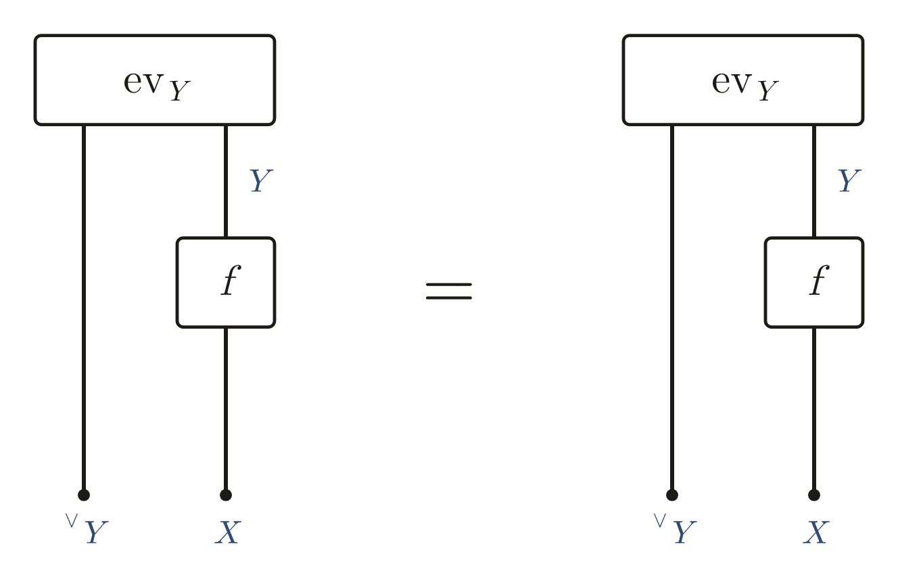

The editor reports: *✓ Both sides reduce to the same normal form, so the equation holds.*

### (2.2) right: slide through coev

Formula (2.2), right: $(\mathrm{id}_Y\otimes{}^{\vee}f)\mathrm{coev}_Y=(f\otimes\mathrm{id}_{{}^{\vee}X})\mathrm{coev}_X$.

**Type it.** Signature and expression:

```
f : X → Y
```

```
(id_Y ⊗ ∨f)coev_Y = (f ⊗ id_∨X)coev_X
```

**Symbolic.** The editor typesets it as

$$
(\mathrm{id}_{Y} \otimes {}^{\vee}f) \mathrm{coev}_{Y} \;=\; (f \otimes \mathrm{id}_{{}^{\vee}X}) \mathrm{coev}_{X}
$$

a morphism from $\mathbb{1}$ to $Y \otimes {}^{\vee}X$.

**Graphical.** Expression → Diagram draws:

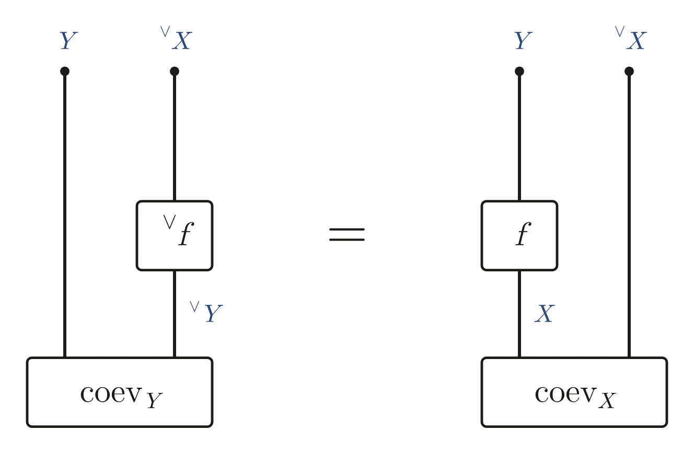

**Simplify.** The rule **(2.2) slide through coev** does the same through a cup.

Steps, side by side: side 1: (2.2) slide through coev; side 2: already in normal form.

Normal form:

$$
(f \otimes \mathrm{id}_{{}^{\vee}X}) \mathrm{coev}_{X}
$$

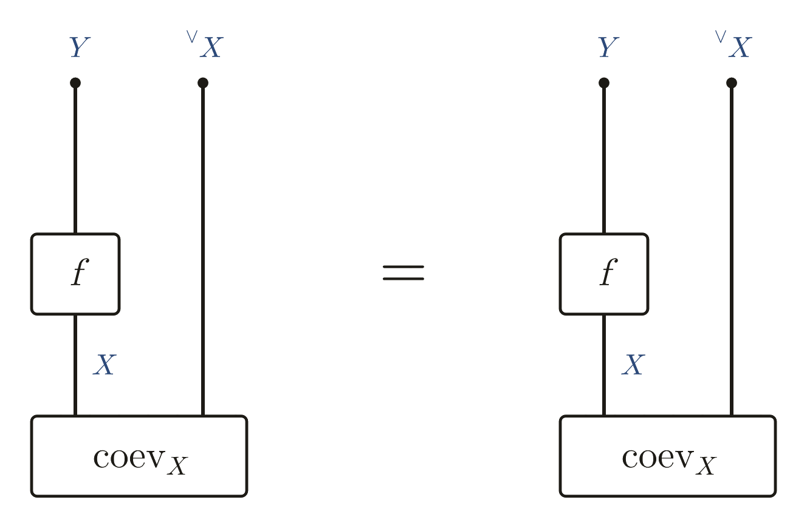

The editor reports: *✓ Both sides reduce to the same normal form, so the equation holds.*

### Zigzag for ev/coev

The duality identity $(\mathrm{id}_X\otimes\mathrm{ev}_X)(\mathrm{coev}_X\otimes\mathrm{id}_X)=\mathrm{id}_X$: ev and coev form a non-degenerate pairing.

**Type it.** Signature and expression:

```
f : X → Y
```

```
(id_X ⊗ ev_X)(coev_X ⊗ id_X)
```

**Symbolic.** The editor typesets it as

$$
(\mathrm{id}_{X} \otimes \mathrm{ev}_{X}) (\mathrm{coev}_{X} \otimes \mathrm{id}_{X})
$$

a morphism from $X$ to $X$.

**Graphical.** Expression → Diagram draws:

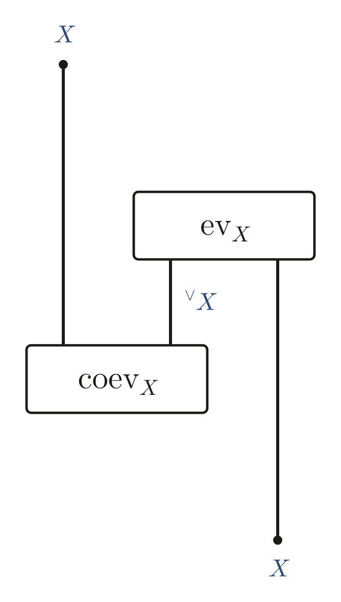

**Simplify.** No `pairing` line is needed: ev and coev are paired automatically, and **(2.1) left zigzag** straightens the arc.

Steps: (2.1) left zigzag.

Normal form:

$$
\mathrm{id}_{X}
$$


## 7. §2.1.3 Pivotal categories: Figures 2.2–2.4

### §2.1.3  id_X*: an arc pointing up

§2.1.3, pivotal categories: every arc carries an orientation. An arc coloured $X$ points down, and $\mathrm{id}_{X^*}$ is the same arc pointing up, so it can be labelled $X^*$ or $X$.

**Type it.** Signature and expression:

```
f : X → Y
```

```
id_X*
```

**Symbolic.** The editor typesets it as

$$
\mathrm{id}_{X^{*}}
$$

a morphism from $X^{*}$ to $X^{*}$.

**Graphical.** Expression → Diagram draws:

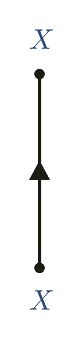

**Simplify.** Switch **duals** to **X\* (§2.1.3, pivotal)**. The examples from here on set it themselves. The editor labels the up arc $X$ and draws its arrow, as on p. 34.

No rewriting rule applies: the diagram is already in normal form.

### §2.1.3  f : X* ⊗ Y → U ⊗ V* ⊗ W

A morphism $f\colon X^*\otimes Y\to U\otimes V^*\otimes W$ in a pivotal category: each arc's arrow shows whether its colour is starred.

**Type it.** Signature and expression:

```
f : X* ⊗ Y → U ⊗ V* ⊗ W
```

```
f
```

**Symbolic.** The editor typesets it as

$$
f
$$

a morphism from $X^{*} \otimes Y$ to $U \otimes V^{*} \otimes W$.

**Graphical.** Expression → Diagram draws:

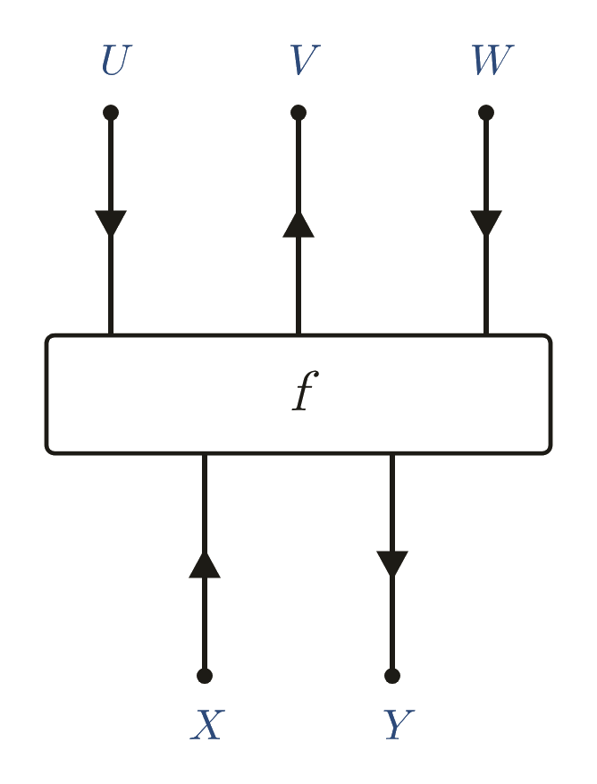

**Simplify.** Starred colours point up, plain colours point down, on both sides of the box.

No rewriting rule applies: the diagram is already in normal form.

### §2.1.3  caps ev_X, ẽv_X and cups coev_X, c̃oev_X

The four duality morphisms: $\mathrm{ev}_X\colon X^*\otimes X\to\mathbb 1$ and $\widetilde{\mathrm{ev}}_X\colon X\otimes X^*\to\mathbb 1$ are caps, $\mathrm{coev}_X\colon\mathbb 1\to X\otimes X^*$ and $\widetilde{\mathrm{coev}}_X\colon\mathbb 1\to X^*\otimes X$ are cups.

**Type it.** Signature and expression:

```
f : X → Y
```

```
ev_X ⊗ ev~_X ⊗ coev_X ⊗ coev~_X
```

**Symbolic.** The editor typesets it as

$$
\mathrm{ev}_{X} \otimes \widetilde{\mathrm{ev}}_{X} \otimes \mathrm{coev}_{X} \otimes \widetilde{\mathrm{coev}}_{X}
$$

a morphism from $X^{*} \otimes X \otimes X \otimes X^{*}$ to $X \otimes X^{*} \otimes X^{*} \otimes X$.

**Graphical.** Expression → Diagram draws:

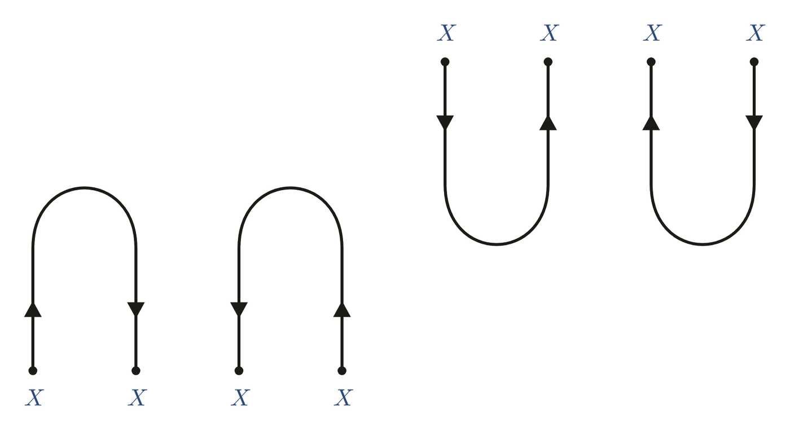

**Simplify.** Type $\widetilde{\mathrm{ev}}$ and $\widetilde{\mathrm{coev}}$ as `ev~_X` and `coev~_X`, or use the keypad buttons. The direction of the arrow around each cap or cup tells which one it is.

No rewriting rule applies: the diagram is already in normal form.

### Figure 2.2  duality identities (1.12)

Figure 2.2, the duality identities (1.12): $(\mathrm{id}_X\otimes\mathrm{ev}_X)(\mathrm{coev}_X\otimes\mathrm{id}_X)=\mathrm{id}_X=(\widetilde{\mathrm{ev}}_X\otimes\mathrm{id}_X)(\mathrm{id}_X\otimes\widetilde{\mathrm{coev}}_X)$.

**Type it.** Signature and expression:

```
f : X → Y
```

```
(id_X ⊗ ev_X)(coev_X ⊗ id_X) = id_X = (ev~_X ⊗ id_X)(id_X ⊗ coev~_X)
```

**Symbolic.** The editor typesets it as

$$
(\mathrm{id}_{X} \otimes \mathrm{ev}_{X}) (\mathrm{coev}_{X} \otimes \mathrm{id}_{X})
$$

$$=$$

$$
\mathrm{id}_{X}
$$

$$=$$

$$
(\widetilde{\mathrm{ev}}_{X} \otimes \mathrm{id}_{X}) (\mathrm{id}_{X} \otimes \widetilde{\mathrm{coev}}_{X})
$$

a morphism from $X$ to $X$.

**Graphical.** Expression → Diagram draws:

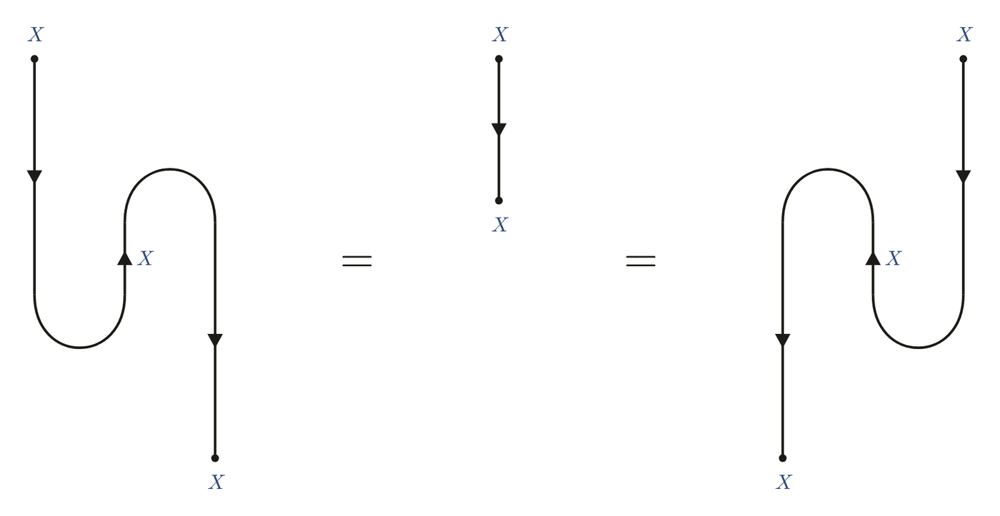

**Simplify.** Both zigzags straighten to the arc $X$: the left one by **(2.1) left zigzag**, the right one by **(2.1) right zigzag** (ẽv and c̃oev are paired automatically too).

Steps, side by side: side 1: (2.1) left zigzag; side 2: already in normal form; side 3: (2.1) right zigzag.

Normal form:

$$
\mathrm{id}_{X}
$$


The editor reports: *✓ Both sides reduce to the same normal form, so the equation holds.*

### Figure 2.2  duality identities (1.13)

Figure 2.2, the duality identities (1.13), the same on the arc $X^*$.

**Type it.** Signature and expression:

```
f : X → Y
```

```
(ev_X ⊗ id_X*)(id_X* ⊗ coev_X) = id_X* = (id_X* ⊗ ev~_X)(coev~_X ⊗ id_X*)
```

**Symbolic.** The editor typesets it as

$$
(\mathrm{ev}_{X} \otimes \mathrm{id}_{X^{*}}) (\mathrm{id}_{X^{*}} \otimes \mathrm{coev}_{X})
$$

$$=$$

$$
\mathrm{id}_{X^{*}}
$$

$$=$$

$$
\begin{aligned}
&(\mathrm{id}_{X^{*}} \otimes \widetilde{\mathrm{ev}}_{X}) \\
&\;(\widetilde{\mathrm{coev}}_{X} \otimes \mathrm{id}_{X^{*}})
\end{aligned}
$$

a morphism from $X^{*}$ to $X^{*}$.

**Graphical.** Expression → Diagram draws:

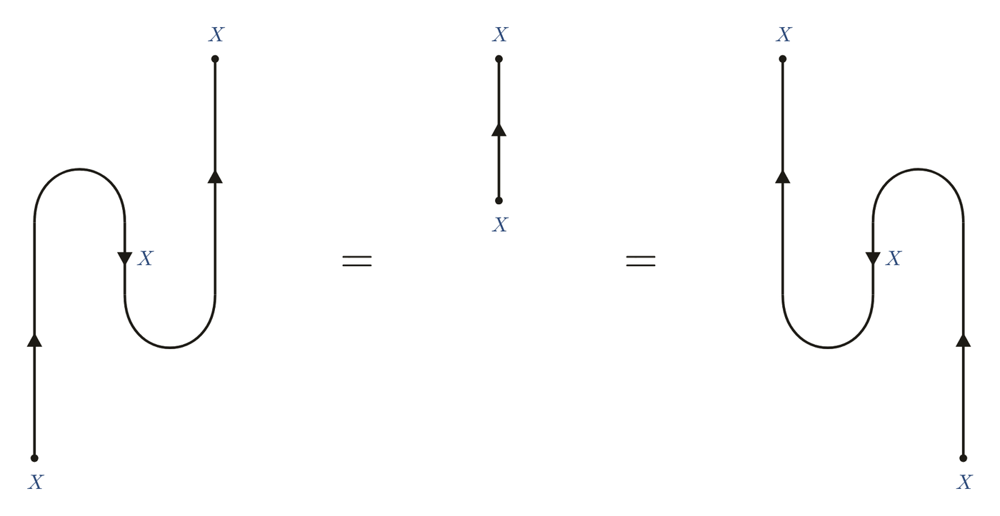

**Simplify.** Both zigzags straighten to the upward arc $X^*$.

Steps, side by side: side 1: (2.1) right zigzag; side 2: already in normal form; side 3: (2.1) left zigzag.

Normal form:

$$
\mathrm{id}_{X^{*}}
$$

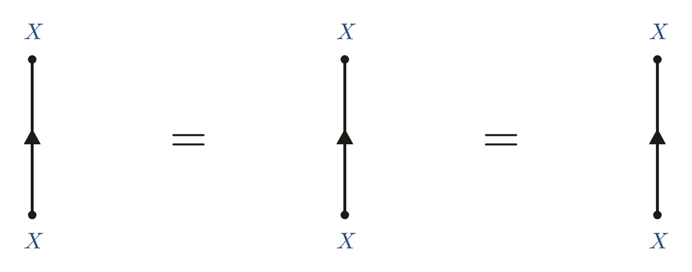

The editor reports: *✓ Both sides reduce to the same normal form, so the equation holds.*

### Figure 2.3  two expressions for f*

Figure 2.3: the dual morphism $f^*\colon Y^*\to X^*$ has two expressions, one with $\mathrm{ev}$, $\mathrm{coev}$ and one with $\widetilde{\mathrm{ev}}$, $\widetilde{\mathrm{coev}}$. That they agree is what makes the category pivotal.

**Type it.** Signature and expression:

```
f : X → Y
```

```
f* = (ev_Y ⊗ id_X*)(id_Y* ⊗ f ⊗ id_X*)(id_Y* ⊗ coev_X) = (id_X* ⊗ ev~_Y)(id_X* ⊗ f ⊗ id_Y*)(coev~_X ⊗ id_Y*)
```

**Symbolic.** The editor typesets it as

$$
f^{*}
$$

$$=$$

$$
\begin{aligned}
&(\mathrm{ev}_{Y} \otimes \mathrm{id}_{X^{*}}) \\
&\;(\mathrm{id}_{Y^{*}} \otimes f \otimes \mathrm{id}_{X^{*}}) \\
&\;(\mathrm{id}_{Y^{*}} \otimes \mathrm{coev}_{X})
\end{aligned}
$$

$$=$$

$$
\begin{aligned}
&(\mathrm{id}_{X^{*}} \otimes \widetilde{\mathrm{ev}}_{Y}) \\
&\;(\mathrm{id}_{X^{*}} \otimes f \otimes \mathrm{id}_{Y^{*}}) \\
&\;(\widetilde{\mathrm{coev}}_{X} \otimes \mathrm{id}_{Y^{*}})
\end{aligned}
$$

a morphism from $Y^{*}$ to $X^{*}$.

**Graphical.** Expression → Diagram draws:

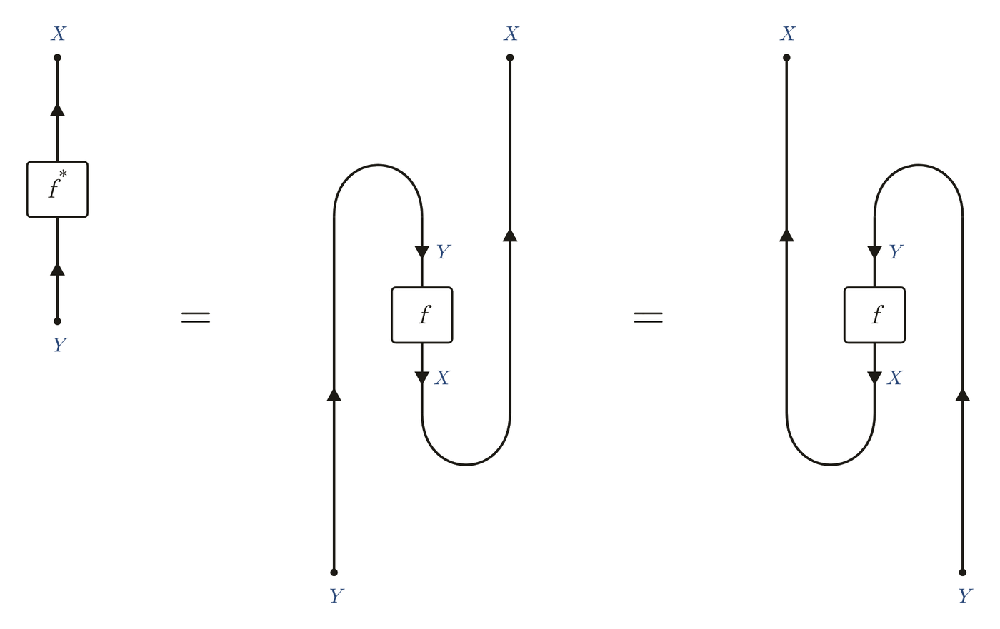

**Simplify.** The rules **Fig. 2.3 fold (left)** and **Fig. 2.3 fold (right)** turn each picture into the single box $f^*$, so all three sides have the same normal form.

Steps, side by side: side 1: already in normal form; side 2: Fig. 2.3 fold (left); side 3: Fig. 2.3 fold (right).

Normal form:

$$
f^{*}
$$

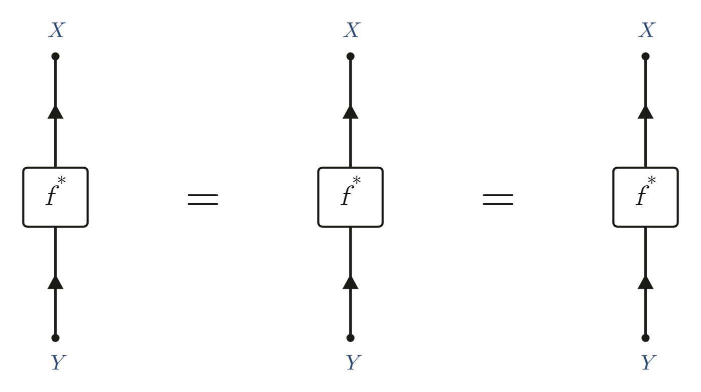

The editor reports: *✓ Both sides reduce to the same normal form, so the equation holds.*

### Figure 2.4  ev_X(f* ⊗ id_X) = ev_Y(id_Y* ⊗ f)

Figure 2.4, first identity: $\mathrm{ev}_X(f^*\otimes\mathrm{id}_X)=\mathrm{ev}_Y(\mathrm{id}_{Y^*}\otimes f)$, the pivotal form of (2.2).

**Type it.** Signature and expression:

```
f : X → Y
```

```
ev_X(f* ⊗ id_X) = ev_Y(id_Y* ⊗ f)
```

**Symbolic.** The editor typesets it as

$$
\mathrm{ev}_{X} (f^{*} \otimes \mathrm{id}_{X}) \;=\; \mathrm{ev}_{Y} (\mathrm{id}_{Y^{*}} \otimes f)
$$

a morphism from $Y^{*} \otimes X$ to $\mathbb{1}$.

**Graphical.** Expression → Diagram draws:

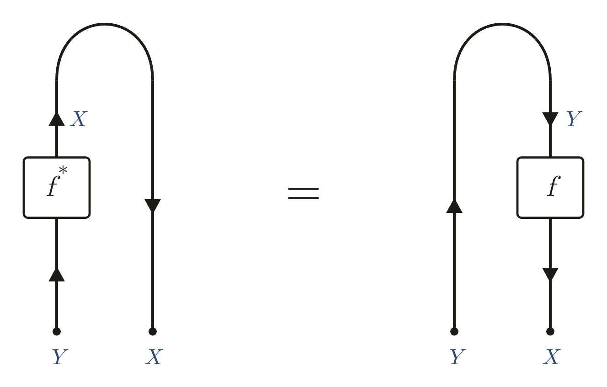

**Simplify.** **Fig. 2.4 slide through ev** moves the box across the cap.

Steps, side by side: side 1: Fig. 2.4 slide through ev; side 2: already in normal form.

Normal form:

$$
\mathrm{ev}_{Y} (\mathrm{id}_{Y^{*}} \otimes f)
$$

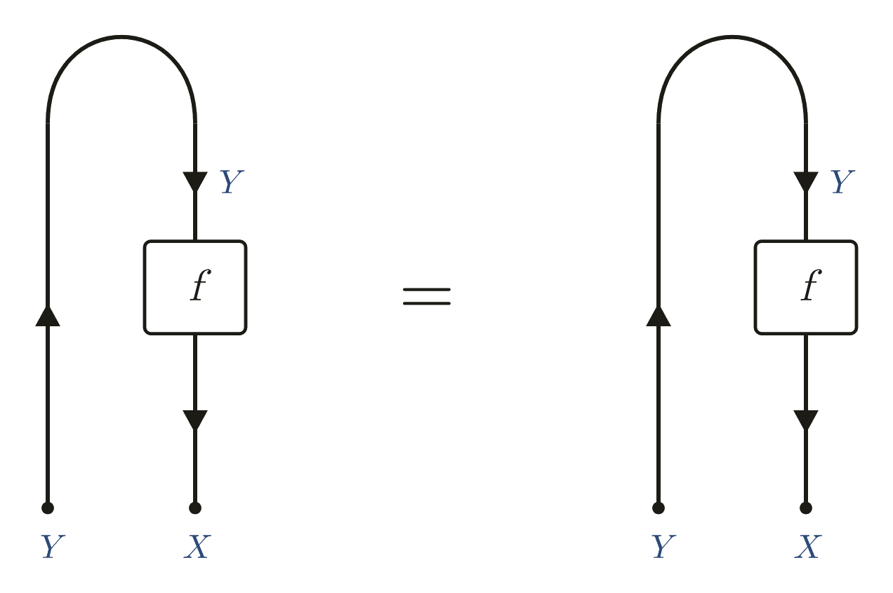

The editor reports: *✓ Both sides reduce to the same normal form, so the equation holds.*

### Figure 2.4  (id_Y ⊗ f*)coev_Y = (f ⊗ id_X*)coev_X

Figure 2.4: $(\mathrm{id}_Y\otimes f^*)\mathrm{coev}_Y=(f\otimes\mathrm{id}_{X^*})\mathrm{coev}_X$.

**Type it.** Signature and expression:

```
f : X → Y
```

```
(id_Y ⊗ f*)coev_Y = (f ⊗ id_X*)coev_X
```

**Symbolic.** The editor typesets it as

$$
(\mathrm{id}_{Y} \otimes f^{*}) \mathrm{coev}_{Y} \;=\; (f \otimes \mathrm{id}_{X^{*}}) \mathrm{coev}_{X}
$$

a morphism from $\mathbb{1}$ to $Y \otimes X^{*}$.

**Graphical.** Expression → Diagram draws:

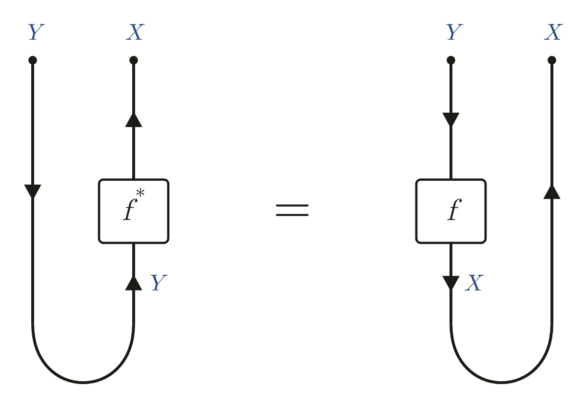

**Simplify.** **Fig. 2.4 slide through coev** moves the box across the cup.

Steps, side by side: side 1: Fig. 2.4 slide through coev; side 2: already in normal form.

Normal form:

$$
(f \otimes \mathrm{id}_{X^{*}}) \mathrm{coev}_{X}
$$

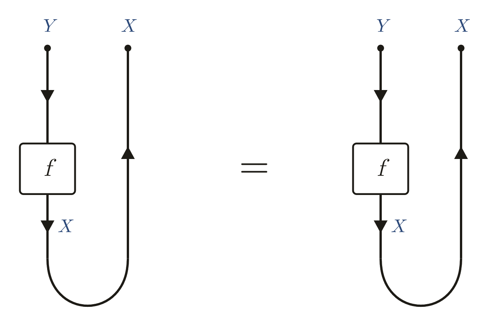

The editor reports: *✓ Both sides reduce to the same normal form, so the equation holds.*

### Figure 2.4  ẽv_X(id_X ⊗ f*) = ẽv_Y(f ⊗ id_Y*)

Figure 2.4, second line: $\widetilde{\mathrm{ev}}_X(\mathrm{id}_X\otimes f^*)=\widetilde{\mathrm{ev}}_Y(f\otimes\mathrm{id}_{Y^*})$.

**Type it.** Signature and expression:

```
f : X → Y
```

```
ev~_X(id_X ⊗ f*) = ev~_Y(f ⊗ id_Y*)
```

**Symbolic.** The editor typesets it as

$$
\widetilde{\mathrm{ev}}_{X} (\mathrm{id}_{X} \otimes f^{*})
$$

$$=$$

$$
\widetilde{\mathrm{ev}}_{Y} (f \otimes \mathrm{id}_{Y^{*}})
$$

a morphism from $X \otimes Y^{*}$ to $\mathbb{1}$.

**Graphical.** Expression → Diagram draws:

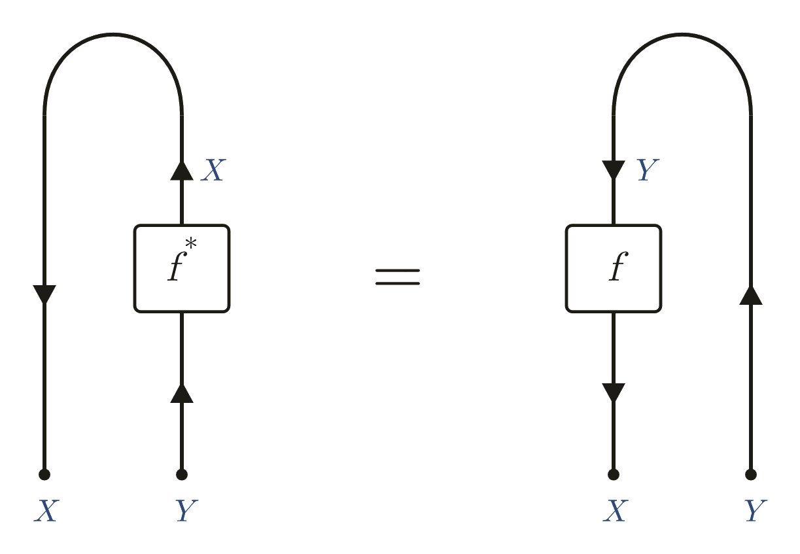

**Simplify.** **Fig. 2.4 slide through right ev**: the same slide through the right cap $\widetilde{\mathrm{ev}}$.

Steps, side by side: side 1: Fig. 2.4 slide through right ev; side 2: already in normal form.

Normal form:

$$
\widetilde{\mathrm{ev}}_{Y} (f \otimes \mathrm{id}_{Y^{*}})
$$

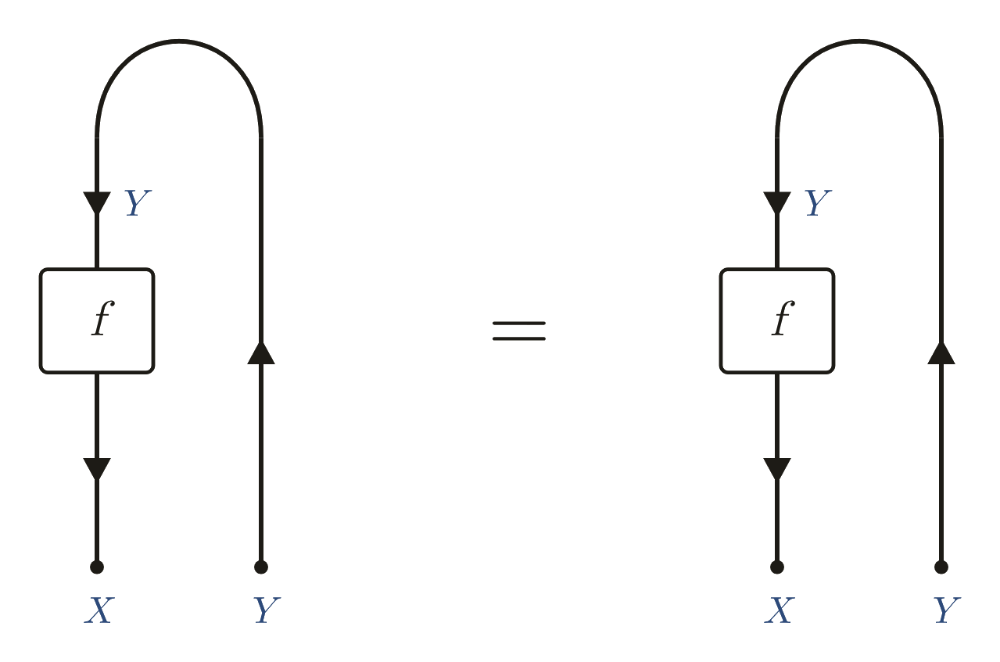

The editor reports: *✓ Both sides reduce to the same normal form, so the equation holds.*

### Figure 2.4  (f* ⊗ id_Y)c̃oev_Y = (id_X* ⊗ f)c̃oev_X

Figure 2.4: $(f^*\otimes\mathrm{id}_Y)\widetilde{\mathrm{coev}}_Y=(\mathrm{id}_{X^*}\otimes f)\widetilde{\mathrm{coev}}_X$.

**Type it.** Signature and expression:

```
f : X → Y
```

```
(f* ⊗ id_Y)coev~_Y = (id_X* ⊗ f)coev~_X
```

**Symbolic.** The editor typesets it as

$$
(f^{*} \otimes \mathrm{id}_{Y}) \widetilde{\mathrm{coev}}_{Y}
$$

$$=$$

$$
(\mathrm{id}_{X^{*}} \otimes f) \widetilde{\mathrm{coev}}_{X}
$$

a morphism from $\mathbb{1}$ to $X^{*} \otimes Y$.

**Graphical.** Expression → Diagram draws:

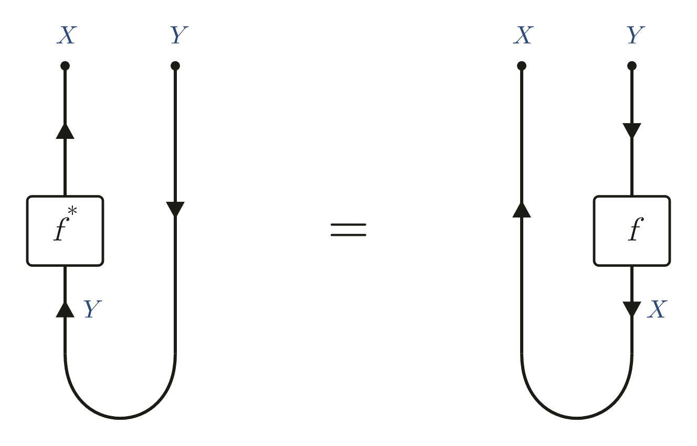

**Simplify.** **Fig. 2.4 slide through right coev**: the same slide through the right cup $\widetilde{\mathrm{coev}}$.

Steps, side by side: side 1: Fig. 2.4 slide through right coev; side 2: already in normal form.

Normal form:

$$
(\mathrm{id}_{X^{*}} \otimes f) \widetilde{\mathrm{coev}}_{X}
$$

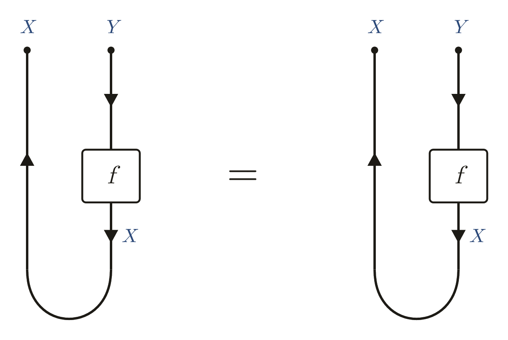

The editor reports: *✓ Both sides reduce to the same normal form, so the equation holds.*

## 8. Exercise 2.1.5 Pairings and anti-isomorphisms

### Exercise 2.1.5  ψ(φ(f)) = f

Exercise 2.1.5: a non-degenerate pairing $\omega$ with inverse $\Omega$ gives maps $\varphi(f)=(\mathrm{id}_Y\otimes\omega)(\mathrm{id}_Y\otimes f\otimes\mathrm{id}_Y)(\Omega\otimes\mathrm{id}_Y)$ from $\mathrm{End}(X)$ to $\mathrm{End}(Y)$, and $\psi$ back. The claim $\psi(\varphi(f))=f$ is typed with $\varphi(f)$ written out inside $\psi$.

**Type it.** Signature and expression:

```
ω : X ⊗ Y → 𝟙
Ω : 𝟙 → Y ⊗ X
pairing ω Ω
f : X → X
h : X → X
g : Y → Y
```

```
(ω ⊗ id_X)(id_X ⊗ ((id_Y ⊗ ω)(id_Y ⊗ f ⊗ id_Y)(Ω ⊗ id_Y)) ⊗ id_X)(id_X ⊗ Ω) = f
```

**Symbolic.** The editor typesets it as

$$
\begin{aligned}
&(\omega \otimes \mathrm{id}_{X}) \\
&\;(\mathrm{id}_{X} \otimes ((\mathrm{id}_{Y} \otimes \omega) (\mathrm{id}_{Y} \otimes f \otimes \mathrm{id}_{Y}) (\Omega \otimes \mathrm{id}_{Y})) \otimes \mathrm{id}_{X}) \\
&\;(\mathrm{id}_{X} \otimes \Omega)
\end{aligned}
$$

$$=$$

$$
f
$$

a morphism from $X$ to $X$.

**Graphical.** Expression → Diagram draws:

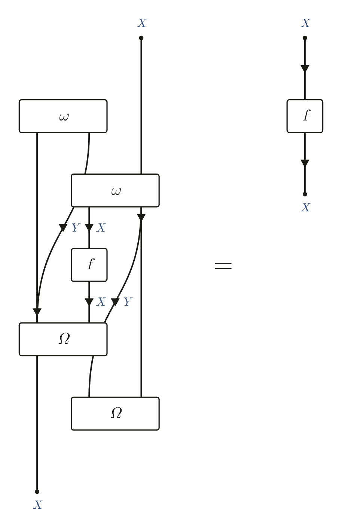

**Simplify.** Two right zigzags straighten the doubled arc, and the box $f$ is left on its own.

Steps, side by side: side 1: (2.1) right zigzag → (2.1) right zigzag; side 2: already in normal form.

Normal form:

$$
f
$$

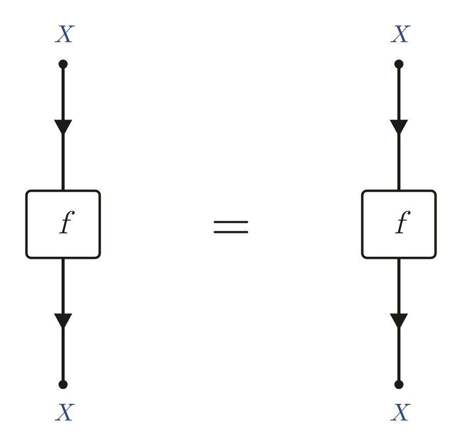

The editor reports: *✓ Both sides reduce to the same normal form, so the equation holds.*

### Exercise 2.1.5  φ(hf) = φ(f) φ(h)

Exercise 2.1.5: $\varphi$ reverses composition, $\varphi(hf)=\varphi(f)\varphi(h)$.

**Type it.** Signature and expression:

```
ω : X ⊗ Y → 𝟙
Ω : 𝟙 → Y ⊗ X
pairing ω Ω
f : X → X
h : X → X
g : Y → Y
```

```
(id_Y ⊗ ω)(id_Y ⊗ h f ⊗ id_Y)(Ω ⊗ id_Y) = ((id_Y ⊗ ω)(id_Y ⊗ f ⊗ id_Y)(Ω ⊗ id_Y))((id_Y ⊗ ω)(id_Y ⊗ h ⊗ id_Y)(Ω ⊗ id_Y))
```

**Symbolic.** The editor typesets it as

$$
\begin{aligned}
&(\mathrm{id}_{Y} \otimes \omega) \\
&\;(\mathrm{id}_{Y} \otimes (h f) \otimes \mathrm{id}_{Y}) \\
&\;(\Omega \otimes \mathrm{id}_{Y})
\end{aligned}
$$

$$=$$

$$
\begin{aligned}
&(\mathrm{id}_{Y} \otimes \omega) \\
&\;(\mathrm{id}_{Y} \otimes f \otimes \mathrm{id}_{Y}) \\
&\;(\Omega \otimes \mathrm{id}_{Y}) \\
&\;(\mathrm{id}_{Y} \otimes \omega) \\
&\;(\mathrm{id}_{Y} \otimes h \otimes \mathrm{id}_{Y}) \\
&\;(\Omega \otimes \mathrm{id}_{Y})
\end{aligned}
$$

a morphism from $Y$ to $Y$.

**Graphical.** Expression → Diagram draws:

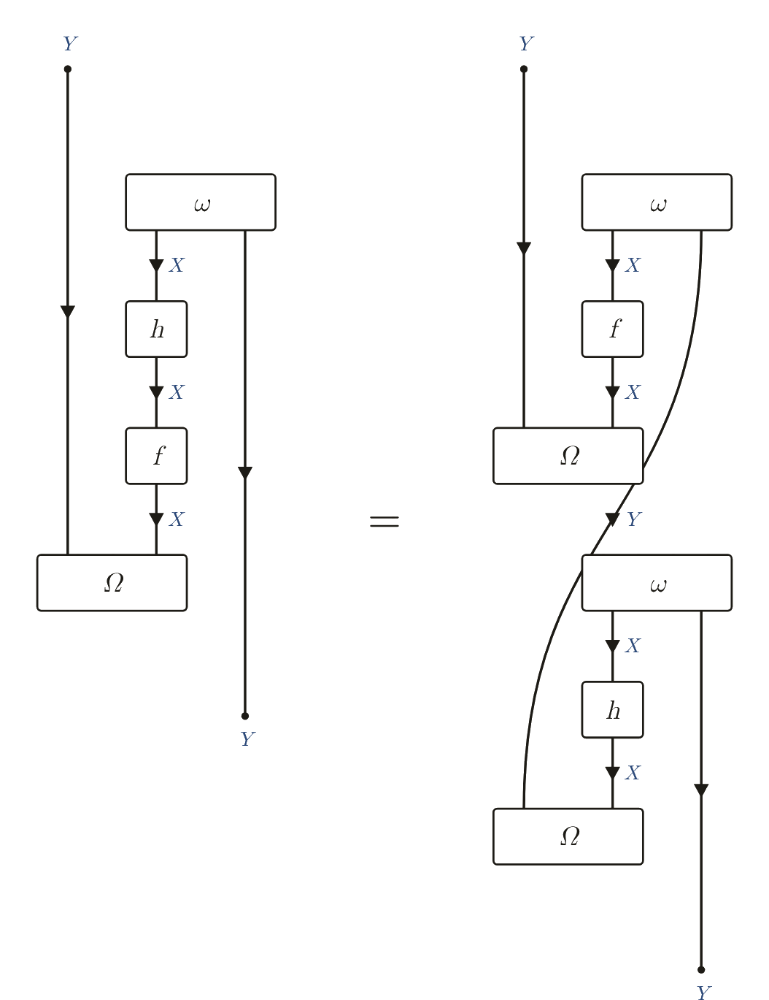

**Simplify.** The left side is already in normal form. On the right side, the cap of $\varphi(h)$ and the cup of $\varphi(f)$ above it form a zigzag, which **(2.1) right zigzag** removes. What is left is the left side: $h$ and $f$ on one bent arc, in the order that $\varphi(hf)$ has.

Steps, side by side: side 1: already in normal form; side 2: (2.1) right zigzag.

Normal form:

$$
(\mathrm{id}_{Y} \otimes (\omega ((h f) \otimes \mathrm{id}_{Y}))) (\Omega \otimes \mathrm{id}_{Y})
$$

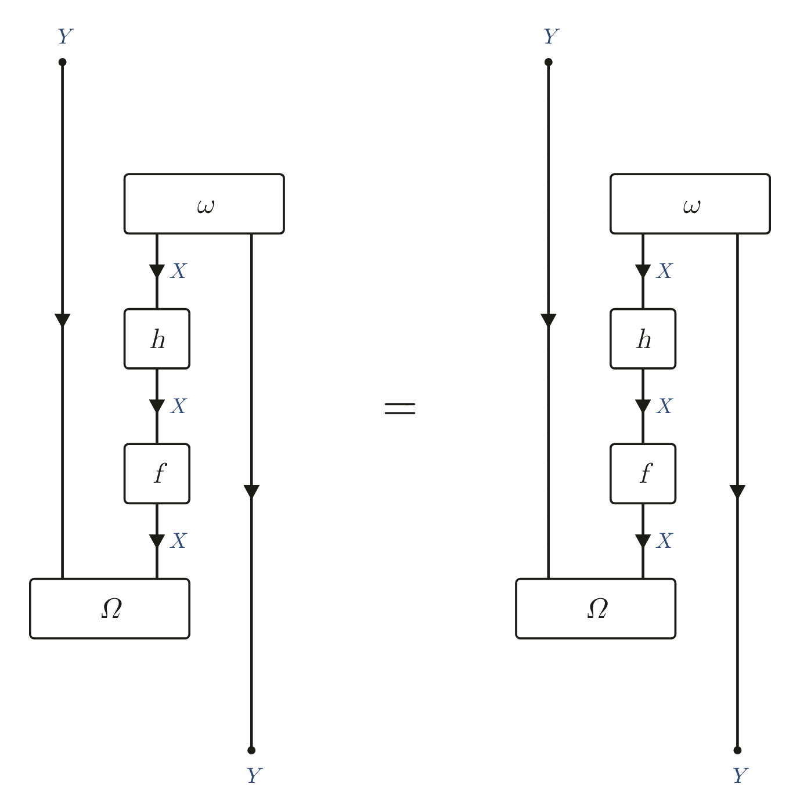

The editor reports: *✓ Both sides reduce to the same normal form, so the equation holds.*

## 9. §2.2 Penrose diagrams

### §2.2  caps and cups on ⊗: ev_(Y⊗X) = ev_X(id_X* ⊗ ev_Y ⊗ id_X)

§2.2: a cap on a tensor product is two nested caps, $\mathrm{ev}_{Y\otimes X}=\mathrm{ev}_X(\mathrm{id}_{X^*}\otimes\mathrm{ev}_Y\otimes\mathrm{id}_X)$. The arc $(Y\otimes X)^*$ is the pair of arcs $X^*, Y^*$, in reversed order.

**Type it.** Signature and expression:

```
f : X → Y
```

```
ev_{Y⊗X} = ev_X(id_X* ⊗ ev_Y ⊗ id_X)
```

**Symbolic.** The editor typesets it as

$$
\mathrm{ev}_{Y \otimes X}
$$

$$=$$

$$
\mathrm{ev}_{X} (\mathrm{id}_{X^{*}} \otimes \mathrm{ev}_{Y} \otimes \mathrm{id}_{X})
$$

a morphism from $X^{*} \otimes Y^{*} \otimes Y \otimes X$ to $\mathbb{1}$.

**Graphical.** Expression → Diagram draws:

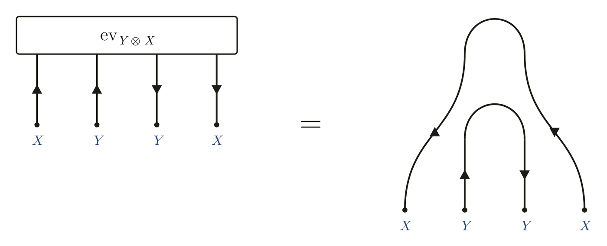

**Simplify.** Type `ev_{Y⊗X}`. The rule **caps and cups on ⊗** splits it into the nested pair.

Steps, side by side: side 1: caps and cups on ⊗; side 2: already in normal form.

Normal form:

$$
\mathrm{ev}_{X} (\mathrm{id}_{X^{*}} \otimes \mathrm{ev}_{Y} \otimes \mathrm{id}_{X})
$$

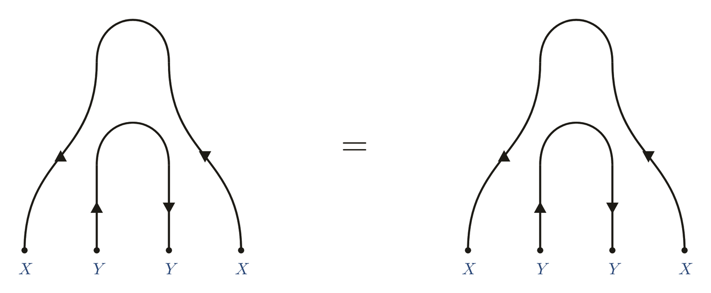

The editor reports: *✓ Both sides reduce to the same normal form, so the equation holds.*

### §2.2  caps and cups on ⊗: coev_(Y⊗X) = (id_Y ⊗ coev_X ⊗ id_Y*)coev_Y

The same for a cup: $\mathrm{coev}_{Y\otimes X}=(\mathrm{id}_Y\otimes\mathrm{coev}_X\otimes\mathrm{id}_{Y^*})\mathrm{coev}_Y$.

**Type it.** Signature and expression:

```
f : X → Y
```

```
coev_{Y⊗X} = (id_Y ⊗ coev_X ⊗ id_Y*)coev_Y
```

**Symbolic.** The editor typesets it as

$$
\mathrm{coev}_{Y \otimes X}
$$

$$=$$

$$
(\mathrm{id}_{Y} \otimes \mathrm{coev}_{X} \otimes \mathrm{id}_{Y^{*}}) \mathrm{coev}_{Y}
$$

a morphism from $\mathbb{1}$ to $Y \otimes X \otimes X^{*} \otimes Y^{*}$.

**Graphical.** Expression → Diagram draws:

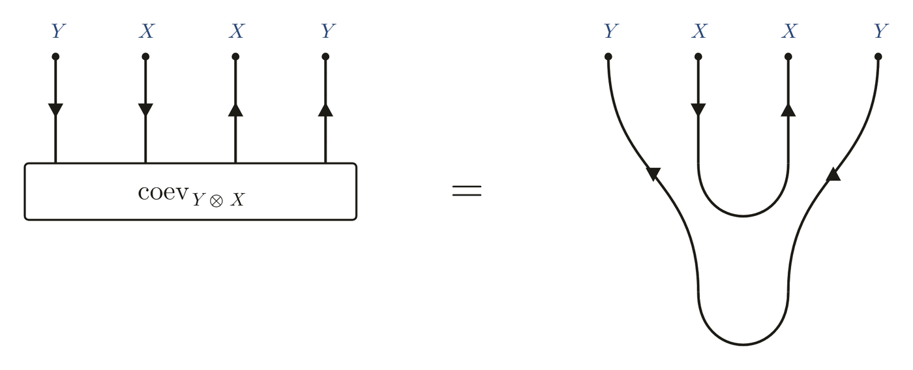

**Simplify.** **caps and cups on ⊗** again.

Steps, side by side: side 1: caps and cups on ⊗; side 2: already in normal form.

Normal form:

$$
(\mathrm{id}_{Y} \otimes \mathrm{coev}_{X} \otimes \mathrm{id}_{Y^{*}}) \mathrm{coev}_{Y}
$$

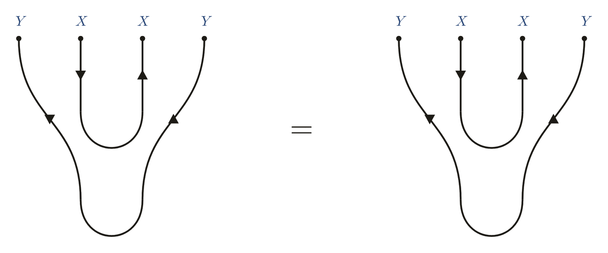

The editor reports: *✓ Both sides reduce to the same normal form, so the equation holds.*

### §2.2  caps and cups on ⊗: ẽv and c̃oev

And for the right cap and cup: $\widetilde{\mathrm{ev}}_{Y\otimes X}=\widetilde{\mathrm{ev}}_Y(\mathrm{id}_Y\otimes\widetilde{\mathrm{ev}}_X\otimes\mathrm{id}_{Y^*})$ and $\widetilde{\mathrm{coev}}_{Y\otimes X}=(\mathrm{id}_{X^*}\otimes\widetilde{\mathrm{coev}}_Y\otimes\mathrm{id}_X)\widetilde{\mathrm{coev}}_X$, side by side.

**Type it.** Signature and expression:

```
f : X → Y
```

```
ev~_{Y⊗X} ⊗ coev~_{Y⊗X} = ev~_Y(id_Y ⊗ ev~_X ⊗ id_Y*) ⊗ (id_X* ⊗ coev~_Y ⊗ id_X)coev~_X
```

**Symbolic.** The editor typesets it as

$$
\widetilde{\mathrm{ev}}_{Y \otimes X} \otimes \widetilde{\mathrm{coev}}_{Y \otimes X}
$$

$$=$$

$$
\footnotesize (\widetilde{\mathrm{ev}}_{Y} (\mathrm{id}_{Y} \otimes \widetilde{\mathrm{ev}}_{X} \otimes \mathrm{id}_{Y^{*}})) \otimes ((\mathrm{id}_{X^{*}} \otimes \widetilde{\mathrm{coev}}_{Y} \otimes \mathrm{id}_{X}) \widetilde{\mathrm{coev}}_{X})
$$

a morphism from $Y \otimes X \otimes X^{*} \otimes Y^{*}$ to $X^{*} \otimes Y^{*} \otimes Y \otimes X$.

**Graphical.** Expression → Diagram draws:

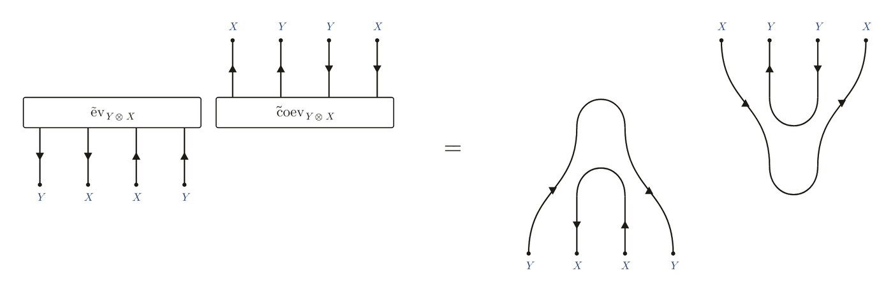

**Simplify.** The rule fires once for each of the two boxes.

Steps, side by side: side 1: caps and cups on ⊗ → caps and cups on ⊗; side 2: already in normal form.

Normal form:

$$
\footnotesize (\mathrm{id}_{X^{*}} \otimes \widetilde{\mathrm{coev}}_{Y} \otimes \mathrm{id}_{X}) \widetilde{\mathrm{coev}}_{X} \widetilde{\mathrm{ev}}_{Y} (\mathrm{id}_{Y} \otimes \widetilde{\mathrm{ev}}_{X} \otimes \mathrm{id}_{Y^{*}})
$$


The editor reports: *✓ Both sides reduce to the same normal form, so the equation holds.*

### Exercise 2.2.5  (?*₂)⁻¹ ?*₂ = id

Exercise 2.2.5: the isomorphism $?^*_2(X,Y)\colon X^*\otimes Y^*\to(Y\otimes X)^*$ of §1.7.1 (the symbol is printed as “?” in our copy of the book) and its inverse, drawn as in §2.1.3, compose to the identity. Here the left picture of the inverse is stacked on the left picture of $?^*_2$, with the arcs coloured $(Y\otimes X)^*$ already written as $X^*, Y^*$.

**Type it.** Signature and expression:

```
f : X → Y
```

```
(ev_X ⊗ ev_{Y⊗X} ⊗ id_X* ⊗ id_Y*)(id_X* ⊗ ev_Y ⊗ id_X ⊗ id_X* ⊗ id_Y* ⊗ id_Y ⊗ id_X ⊗ id_X* ⊗ id_Y*)(id_X* ⊗ id_Y* ⊗ id_Y ⊗ id_X ⊗ id_X* ⊗ id_Y* ⊗ id_Y ⊗ coev_X ⊗ id_Y*)(id_X* ⊗ id_Y* ⊗ coev_{Y⊗X} ⊗ coev_Y) = id_X* ⊗ id_Y*
```

**Symbolic.** The editor typesets it as

$$
\begin{aligned}
&(\mathrm{ev}_{X} \otimes \mathrm{ev}_{Y \otimes X} \otimes \mathrm{id}_{X^{*}} \otimes \mathrm{id}_{Y^{*}}) \\
&\;(\mathrm{id}_{X^{*}} \otimes \mathrm{ev}_{Y} \otimes \mathrm{id}_{X} \otimes \mathrm{id}_{X^{*}} \otimes \mathrm{id}_{Y^{*}} \otimes \mathrm{id}_{Y} \otimes \mathrm{id}_{X} \otimes \mathrm{id}_{X^{*}} \otimes \mathrm{id}_{Y^{*}}) \\
&\;(\mathrm{id}_{X^{*}} \otimes \mathrm{id}_{Y^{*}} \otimes \mathrm{id}_{Y} \otimes \mathrm{id}_{X} \otimes \mathrm{id}_{X^{*}} \otimes \mathrm{id}_{Y^{*}} \otimes \mathrm{id}_{Y} \otimes \mathrm{coev}_{X} \otimes \mathrm{id}_{Y^{*}}) \\
&\;(\mathrm{id}_{X^{*}} \otimes \mathrm{id}_{Y^{*}} \otimes \mathrm{coev}_{Y \otimes X} \otimes \mathrm{coev}_{Y})
\end{aligned}
$$

$$=$$

$$
\mathrm{id}_{X^{*}} \otimes \mathrm{id}_{Y^{*}}
$$

a morphism from $X^{*} \otimes Y^{*}$ to $X^{*} \otimes Y^{*}$.

**Graphical.** Expression → Diagram draws:


**Simplify.** Simplify first splits $\mathrm{coev}_{Y\otimes X}$ and $\mathrm{ev}_{Y\otimes X}$ into nested caps and cups, then four zigzags straighten the arcs, leaving $\mathrm{id}_{X^*\otimes Y^*}$.

Steps, side by side: side 1: caps and cups on ⊗ → caps and cups on ⊗ → (2.1) left zigzag → (2.1) left zigzag → (2.1) right zigzag → (2.1) right zigzag; side 2: already in normal form.

Normal form:

$$
\mathrm{id}_{X^{*} \otimes Y^{*}}
$$


The editor reports: *✓ Both sides reduce to the same normal form, so the equation holds.*

### Figure 2.5  a Penrose diagram, strip by strip (p. 38)

Figure 2.5, a Penrose diagram (§2.2.2–2.2.3) with boxes $g\colon X\otimes Z^*\to X\otimes V$, $h\colon A\to Y^*\otimes B$, $k\colon\mathbb 1\to Z^*\otimes Y$ and $l\colon\mathbb 1\to\mathbb 1$. Cutting it into horizontal strips gives the five-factor morphism of p. 38, from $P_\bullet=A^*\otimes A$ to $P^\bullet=U\otimes U^*\otimes A^*\otimes V\otimes B$. The expression is that formula, typed strip by strip, top strip first.

**Type it.** Signature and expression:

```
g : X ⊗ Z* → X ⊗ V
h : A → Y* ⊗ B
k : 𝟙 → Z* ⊗ Y
l : 𝟙 → 𝟙
```

```
(id_U ⊗ id_U* ⊗ id_A* ⊗ ev_X ⊗ id_V ⊗ id_B)(coev_U ⊗ id_A* ⊗ id_X* ⊗ g ⊗ ev~_Y ⊗ id_B)(id_A* ⊗ ev_X ⊗ coev~_X ⊗ id_Z* ⊗ id_Y ⊗ h ⊗ l)(id_A* ⊗ id_X* ⊗ ev~_X ⊗ id_X ⊗ k ⊗ id_A)(id_A* ⊗ coev~_X ⊗ coev~_X ⊗ id_A)
```

**Symbolic.** The editor typesets it as

$$
\begin{aligned}
&(\mathrm{id}_{U} \otimes \mathrm{id}_{U^{*}} \otimes \mathrm{id}_{A^{*}} \otimes \mathrm{ev}_{X} \otimes \mathrm{id}_{V} \otimes \mathrm{id}_{B}) \\
&\;(\mathrm{coev}_{U} \otimes \mathrm{id}_{A^{*}} \otimes \mathrm{id}_{X^{*}} \otimes g \otimes \widetilde{\mathrm{ev}}_{Y} \otimes \mathrm{id}_{B}) \\
&\;(\mathrm{id}_{A^{*}} \otimes \mathrm{ev}_{X} \otimes \widetilde{\mathrm{coev}}_{X} \otimes \mathrm{id}_{Z^{*}} \otimes \mathrm{id}_{Y} \otimes h \otimes l) \\
&\;(\mathrm{id}_{A^{*}} \otimes \mathrm{id}_{X^{*}} \otimes \widetilde{\mathrm{ev}}_{X} \otimes \mathrm{id}_{X} \otimes k \otimes \mathrm{id}_{A}) \\
&\;(\mathrm{id}_{A^{*}} \otimes \widetilde{\mathrm{coev}}_{X} \otimes \widetilde{\mathrm{coev}}_{X} \otimes \mathrm{id}_{A})
\end{aligned}
$$

a morphism from $A^{*} \otimes A$ to $U \otimes U^{*} \otimes A^{*} \otimes V \otimes B$.

**Graphical.** Expression → Diagram draws:


**Simplify.** Expression → Diagram rebuilds the picture from the formula (the layout differs from the book's drawing, but it is the same diagram up to isotopy). Simplify straightens the zigzag inside the W-shaped $X$ arc. What is left of it is a closed loop $\mathrm{ev}_X\widetilde{\mathrm{coev}}_X$, the dimension of $X$, which no rule of §2.1–2.2 removes.

Steps: (2.1) left zigzag.

Normal form:

$$
\footnotesize \mathrm{coev}_{U} \otimes \mathrm{id}_{A^{*}} \otimes (\mathrm{ev}_{X} \widetilde{\mathrm{coev}}_{X}) \otimes ((((\mathrm{ev}_{X} \otimes \mathrm{id}_{V}) (\mathrm{id}_{X^{*}} \otimes g)) \otimes ((\widetilde{\mathrm{ev}}_{Y} \otimes \mathrm{id}_{B}) (\mathrm{id}_{Y} \otimes h))) (\widetilde{\mathrm{coev}}_{X} \otimes k \otimes \mathrm{id}_{A})) \otimes l
$$


### Lemma 2.1  Figure 2.5 with its zigzag straightened

Lemma 2.1: the morphism of a Penrose diagram does not change under isotopy, under straightening a zigzag (Figure 2.2), or under pushing a cap, cup or box up or down. The right side is Figure 2.5 with the zigzag in the $X$ arc straightened, so its bottom two strips are simpler.

**Type it.** Signature and expression:

```
g : X ⊗ Z* → X ⊗ V
h : A → Y* ⊗ B
k : 𝟙 → Z* ⊗ Y
l : 𝟙 → 𝟙
```

```
(id_U ⊗ id_U* ⊗ id_A* ⊗ ev_X ⊗ id_V ⊗ id_B)(coev_U ⊗ id_A* ⊗ id_X* ⊗ g ⊗ ev~_Y ⊗ id_B)(id_A* ⊗ ev_X ⊗ coev~_X ⊗ id_Z* ⊗ id_Y ⊗ h ⊗ l)(id_A* ⊗ id_X* ⊗ ev~_X ⊗ id_X ⊗ k ⊗ id_A)(id_A* ⊗ coev~_X ⊗ coev~_X ⊗ id_A) = (id_U ⊗ id_U* ⊗ id_A* ⊗ ev_X ⊗ id_V ⊗ id_B)(coev_U ⊗ id_A* ⊗ id_X* ⊗ g ⊗ ev~_Y ⊗ id_B)(id_A* ⊗ ev_X ⊗ coev~_X ⊗ id_Z* ⊗ id_Y ⊗ h ⊗ l)(id_A* ⊗ id_X* ⊗ id_X ⊗ k ⊗ id_A)(id_A* ⊗ coev~_X ⊗ id_A)
```

**Symbolic.** The editor typesets it as

$$
\begin{aligned}
&(\mathrm{id}_{U} \otimes \mathrm{id}_{U^{*}} \otimes \mathrm{id}_{A^{*}} \otimes \mathrm{ev}_{X} \otimes \mathrm{id}_{V} \otimes \mathrm{id}_{B}) \\
&\;(\mathrm{coev}_{U} \otimes \mathrm{id}_{A^{*}} \otimes \mathrm{id}_{X^{*}} \otimes g \otimes \widetilde{\mathrm{ev}}_{Y} \otimes \mathrm{id}_{B}) \\
&\;(\mathrm{id}_{A^{*}} \otimes \mathrm{ev}_{X} \otimes \widetilde{\mathrm{coev}}_{X} \otimes \mathrm{id}_{Z^{*}} \otimes \mathrm{id}_{Y} \otimes h \otimes l) \\
&\;(\mathrm{id}_{A^{*}} \otimes \mathrm{id}_{X^{*}} \otimes \widetilde{\mathrm{ev}}_{X} \otimes \mathrm{id}_{X} \otimes k \otimes \mathrm{id}_{A}) \\
&\;(\mathrm{id}_{A^{*}} \otimes \widetilde{\mathrm{coev}}_{X} \otimes \widetilde{\mathrm{coev}}_{X} \otimes \mathrm{id}_{A})
\end{aligned}
$$

$$=$$

$$
\begin{aligned}
&(\mathrm{id}_{U} \otimes \mathrm{id}_{U^{*}} \otimes \mathrm{id}_{A^{*}} \otimes \mathrm{ev}_{X} \otimes \mathrm{id}_{V} \otimes \mathrm{id}_{B}) \\
&\;(\mathrm{coev}_{U} \otimes \mathrm{id}_{A^{*}} \otimes \mathrm{id}_{X^{*}} \otimes g \otimes \widetilde{\mathrm{ev}}_{Y} \otimes \mathrm{id}_{B}) \\
&\;(\mathrm{id}_{A^{*}} \otimes \mathrm{ev}_{X} \otimes \widetilde{\mathrm{coev}}_{X} \otimes \mathrm{id}_{Z^{*}} \otimes \mathrm{id}_{Y} \otimes h \otimes l) \\
&\;(\mathrm{id}_{A^{*}} \otimes \mathrm{id}_{X^{*}} \otimes \mathrm{id}_{X} \otimes k \otimes \mathrm{id}_{A}) \\
&\;(\mathrm{id}_{A^{*}} \otimes \widetilde{\mathrm{coev}}_{X} \otimes \mathrm{id}_{A})
\end{aligned}
$$

a morphism from $A^{*} \otimes A$ to $U \otimes U^{*} \otimes A^{*} \otimes V \otimes B$.

**Graphical.** Expression → Diagram draws:


**Simplify.** Both sides reach the same normal form, so the equation holds, as Lemma 2.1 says.

Steps, side by side: side 1: (2.1) left zigzag; side 2: already in normal form.

Normal form:

$$
\footnotesize \mathrm{coev}_{U} \otimes \mathrm{id}_{A^{*}} \otimes (\mathrm{ev}_{X} \widetilde{\mathrm{coev}}_{X}) \otimes ((((\mathrm{ev}_{X} \otimes \mathrm{id}_{V}) (\mathrm{id}_{X^{*}} \otimes g)) \otimes ((\widetilde{\mathrm{ev}}_{Y} \otimes \mathrm{id}_{B}) (\mathrm{id}_{Y} \otimes h))) (\widetilde{\mathrm{coev}}_{X} \otimes k \otimes \mathrm{id}_{A})) \otimes l
$$


The editor reports: *✓ Both sides reduce to the same normal form, so the equation holds.*

## 10. §2.3 Double duals and generalized evaluations

### §2.3.1  ψ_X = (ẽv_X ⊗ id_X**)(id_X ⊗ coev_X*) = id_X (X** = X)

§2.3.1 defines $\psi_X = (\widetilde{\mathrm{ev}}_X\otimes\mathrm{id}_{X^{**}})(\mathrm{id}_X\otimes\mathrm{coev}_{X^*})\colon X\to X^{**}$. The editor identifies $X^{**}$ with $X$ (a strict pivotal category), so $\psi_X$ should be the identity.

**Type it.** Signature and expression:

```
f : X → Y
```

```
(ev~_X ⊗ id_X)(id_X ⊗ coev_X*) = id_X
```

**Symbolic.** The editor typesets it as

$$
(\widetilde{\mathrm{ev}}_{X} \otimes \mathrm{id}_{X}) (\mathrm{id}_{X} \otimes \mathrm{coev}_{X}^{*})
$$

$$=$$

$$
\mathrm{id}_{X}
$$

a morphism from $X$ to $X$.

**Graphical.** Expression → Diagram draws:


**Simplify.** **Lemma 2.3 (X\*\* = X)** turns the cup $\mathrm{coev}_{X^*}$ into $\widetilde{\mathrm{coev}}_X$; then **(2.1) right zigzag** straightens the arc. The Wolfram notebook keeps $X^{**}$ apart from $X$ and reduces the same picture to a box $\psi_X$ instead.

Steps, side by side: side 1: Lemma 2.3 (X** = X) → (2.1) right zigzag; side 2: already in normal form.

Normal form:

$$
\mathrm{id}_{X}
$$


The editor reports: *✓ Both sides reduce to the same normal form, so the equation holds.*

### Lemma 2.2  ψ_X = φ_X

Lemma 2.2: $\psi_X$ can also be drawn the other way round, $\varphi_X = (\mathrm{id}_{X^{**}}\otimes\mathrm{ev}_X)(\widetilde{\mathrm{coev}}_{X^*}\otimes\mathrm{id}_X)$, and $\psi_X=\varphi_X$.

**Type it.** Signature and expression:

```
f : X → Y
```

```
(ev~_X ⊗ id_X)(id_X ⊗ coev_X*) = (id_X ⊗ ev_X)(coev~_X* ⊗ id_X)
```

**Symbolic.** The editor typesets it as

$$
(\widetilde{\mathrm{ev}}_{X} \otimes \mathrm{id}_{X}) (\mathrm{id}_{X} \otimes \mathrm{coev}_{X}^{*})
$$

$$=$$

$$
(\mathrm{id}_{X} \otimes \mathrm{ev}_{X}) (\widetilde{\mathrm{coev}}_{X}^{*} \otimes \mathrm{id}_{X})
$$

a morphism from $X$ to $X$.

**Graphical.** Expression → Diagram draws:


**Simplify.** Each side needs one rename by Lemma 2.3 and one zigzag, the left side a right zigzag and the right side a left one.

Steps, side by side: side 1: Lemma 2.3 (X** = X) → (2.1) right zigzag; side 2: Lemma 2.3 (X** = X) → (2.1) left zigzag.

Normal form:

$$
\mathrm{id}_{X}
$$


The editor reports: *✓ Both sides reduce to the same normal form, so the equation holds.*

### Lemma 2.2  ψ⁻¹_X = ϑ_X = ν_X

Lemma 2.2: the inverse $\psi_X^{-1}$ has two pictures, $\vartheta_X = (\mathrm{id}_X\otimes\widetilde{\mathrm{ev}}_{X^*})(\mathrm{coev}_X\otimes\mathrm{id}_{X^{**}})$ and $\nu_X = (\mathrm{ev}_{X^*}\otimes\mathrm{id}_X)(\mathrm{id}_{X^{**}}\otimes\widetilde{\mathrm{coev}}_X)$. Type $\psi_X^{-1}$ as `ψ⁻¹_X`.

**Type it.** Signature and expression:

```
f : X → Y
```

```
ψ⁻¹_X = (id_X ⊗ ev~_X*)(coev_X ⊗ id_X) = (ev_X* ⊗ id_X)(id_X ⊗ coev~_X)
```

**Symbolic.** The editor typesets it as

$$
\mathrm{\psi ⁻¹}_{X}
$$

$$=$$

$$
(\mathrm{id}_{X} \otimes \widetilde{\mathrm{ev}}_{X}^{*}) (\mathrm{coev}_{X} \otimes \mathrm{id}_{X})
$$

$$=$$

$$
(\mathrm{ev}_{X}^{*} \otimes \mathrm{id}_{X}) (\mathrm{id}_{X} \otimes \widetilde{\mathrm{coev}}_{X})
$$

a morphism from $X$ to $X$.

**Graphical.** Expression → Diagram draws:


**Simplify.** The box $\psi^{-1}_X$ is the identity when $X^{**}=X$ (**ψ = id (X\*\* = X)**); the two pictures straighten by Lemma 2.3 and a zigzag.

Steps, side by side: side 1: ψ = id (X** = X); side 2: Lemma 2.3 (X** = X) → (2.1) left zigzag; side 3: Lemma 2.3 (X** = X) → (2.1) right zigzag.

Normal form:

$$
\mathrm{id}_{X}
$$


The editor reports: *✓ Both sides reduce to the same normal form, so the equation holds.*

### Lemma 2.3  ẽv_X = ev_X*(ψ_X ⊗ id_X*)

Lemma 2.3, first formula: $\widetilde{\mathrm{ev}}_X = \mathrm{ev}_{X^*}(\psi_X\otimes\mathrm{id}_{X^*})$. The right evaluation is the left evaluation of $X^*$, corrected by $\psi_X$.

**Type it.** Signature and expression:

```
f : X → Y
```

```
ev~_X = ev_X*(ψ_X ⊗ id_X*)
```

**Symbolic.** The editor typesets it as

$$
\widetilde{\mathrm{ev}}_{X} \;=\; \mathrm{ev}_{X}^{*} (\psi_{X} \otimes \mathrm{id}_{X^{*}})
$$

a morphism from $X \otimes X^{*}$ to $\mathbb{1}$.

**Graphical.** Expression → Diagram draws:


**Simplify.** On the right side, Lemma 2.3 renames $\mathrm{ev}_{X^*}$ to $\widetilde{\mathrm{ev}}_X$ and the box $\psi_X$ disappears.

Steps, side by side: side 1: already in normal form; side 2: Lemma 2.3 (X** = X) → ψ = id (X** = X).

Normal form:

$$
\widetilde{\mathrm{ev}}_{X}
$$


The editor reports: *✓ Both sides reduce to the same normal form, so the equation holds.*

### Lemma 2.3  c̃oev_X = (id_X* ⊗ ψ⁻¹_X)coev_X*

Lemma 2.3, second formula: $\widetilde{\mathrm{coev}}_X = (\mathrm{id}_{X^*}\otimes\psi_X^{-1})\,\mathrm{coev}_{X^*}$.

**Type it.** Signature and expression:

```
f : X → Y
```

```
coev~_X = (id_X* ⊗ ψ⁻¹_X)coev_X*
```

**Symbolic.** The editor typesets it as

$$
\widetilde{\mathrm{coev}}_{X} \;=\; (\mathrm{id}_{X^{*}} \otimes \mathrm{\psi ⁻¹}_{X}) \mathrm{coev}_{X}^{*}
$$

a morphism from $\mathbb{1}$ to $X^{*} \otimes X$.

**Graphical.** Expression → Diagram draws:


**Simplify.** The same two steps on the cup. The other two formulas of Lemma 2.3 are in the Wolfram notebook, where $\psi_X$ is a real box.

Steps, side by side: side 1: already in normal form; side 2: Lemma 2.3 (X** = X) → ψ = id (X** = X).

Normal form:

$$
\widetilde{\mathrm{coev}}_{X}
$$


The editor reports: *✓ Both sides reduce to the same normal form, so the equation holds.*

### §2.3.2  ev_((X,−),(Y,+)) = ev_Y(id_Y* ⊗ ẽv_X ⊗ id_Y) (Lemma 2.4)

§2.3.2: a tuple of signed objects $S$ gives a generalized evaluation $\mathrm{ev}_S$, a nest of caps. The book's example is $\mathrm{ev}_{((X,-),(Y,+))}\colon (Y^*\otimes X)\otimes(X^*\otimes Y)\to\mathbb 1$, with $\widetilde{\mathrm{ev}}_X$ inside $\mathrm{ev}_Y$. Lemma 2.4 says $\mathrm{ev}_S = \mathrm{ev}_{X_S}(\Psi_{S^*}\otimes\mathrm{id})$, and with $X^{**}=X$ the isomorphism $\Psi_{S^*}$ is the identity, so $\mathrm{ev}_S$ is the cap $\mathrm{ev}_{X^*\otimes Y}$.

**Type it.** Signature and expression:

```
f : X → Y
```

```
ev_{X*⊗Y} = ev_Y(id_Y* ⊗ ev~_X ⊗ id_Y)
```

**Symbolic.** The editor typesets it as

$$
\mathrm{ev}_{X^{*} \otimes Y}
$$

$$=$$

$$
\mathrm{ev}_{Y} (\mathrm{id}_{Y^{*}} \otimes \widetilde{\mathrm{ev}}_{X} \otimes \mathrm{id}_{Y})
$$

a morphism from $Y^{*} \otimes X \otimes X^{*} \otimes Y$ to $\mathbb{1}$.

**Graphical.** Expression → Diagram draws:


**Simplify.** **caps and cups on ⊗** splits $\mathrm{ev}_{X^*\otimes Y}$ into $\mathrm{ev}_{X^*}$ inside $\mathrm{ev}_Y$, and Lemma 2.3 renames $\mathrm{ev}_{X^*}$ to $\widetilde{\mathrm{ev}}_X$.

Steps, side by side: side 1: caps and cups on ⊗ → Lemma 2.3 (X** = X); side 2: already in normal form.

Normal form:

$$
\mathrm{ev}_{Y} (\mathrm{id}_{Y^{*}} \otimes \widetilde{\mathrm{ev}}_{X} \otimes \mathrm{id}_{Y})
$$


The editor reports: *✓ Both sides reduce to the same normal form, so the equation holds.*

### (2.3)  (id_X_S ⊗ ev_S)(coev_S ⊗ id_X_S) = id_X_S, S = ((X,−),(Y,+))

Formula (2.3): $(\mathrm{id}_{X_S}\otimes\mathrm{ev}_S)(\mathrm{coev}_S\otimes\mathrm{id}_{X_S}) = \mathrm{id}_{X_S}$, so $\mathrm{ev}_S$ is a non-degenerate pairing with inverse $\mathrm{coev}_S$. Here $S = ((X,-),(Y,+))$ and $X_S = X^*\otimes Y$.

**Type it.** Signature and expression:

```
f : X → Y
```

```
(id_X* ⊗ id_Y ⊗ ev_{X*⊗Y})(coev_{X*⊗Y} ⊗ id_X* ⊗ id_Y) = id_X* ⊗ id_Y
```

**Symbolic.** The editor typesets it as

$$
\begin{aligned}
&(\mathrm{id}_{X^{*}} \otimes \mathrm{id}_{Y} \otimes \mathrm{ev}_{X^{*} \otimes Y}) \\
&\;(\mathrm{coev}_{X^{*} \otimes Y} \otimes \mathrm{id}_{X^{*}} \otimes \mathrm{id}_{Y})
\end{aligned}
$$

$$=$$

$$
\mathrm{id}_{X^{*}} \otimes \mathrm{id}_{Y}
$$

a morphism from $X^{*} \otimes Y$ to $X^{*} \otimes Y$.

**Graphical.** Expression → Diagram draws:


**Simplify.** The nested cap and cup are split, and two left zigzags straighten the two arcs.

Steps, side by side: side 1: caps and cups on ⊗ → caps and cups on ⊗ → (2.1) left zigzag → (2.1) left zigzag; side 2: already in normal form.

Normal form:

$$
\mathrm{id}_{X^{*} \otimes Y}
$$


The editor reports: *✓ Both sides reduce to the same normal form, so the equation holds.*

## 11. §2.4–2.6 Isotopy, traces and dimensions

### Lemma 2.5  a box turned through 360°

§2.4, Lemma 2.5 and the naturality of $\psi$ in §2.5.1: a box turned through 360°, with its arcs following it round, is the box itself. With $X^{**}=X$ the turned picture is $f^{**}$, written out as two nested copies of Figure 2.3.

**Type it.** Signature and expression:

```
f : X → Y
```

```
(ev_X* ⊗ id_Y)(id_X ⊗ (ev_Y ⊗ id_X*)(id_Y* ⊗ f ⊗ id_X*)(id_Y* ⊗ coev_X) ⊗ id_Y)(id_X ⊗ coev_Y*) = f
```

**Symbolic.** The editor typesets it as

$$
\begin{aligned}
&(\mathrm{ev}_{X}^{*} \otimes \mathrm{id}_{Y}) \\
&\;(\mathrm{id}_{X} \otimes ((\mathrm{ev}_{Y} \otimes \mathrm{id}_{X^{*}}) (\mathrm{id}_{Y^{*}} \otimes f \otimes \mathrm{id}_{X^{*}}) (\mathrm{id}_{Y^{*}} \otimes \mathrm{coev}_{X})) \otimes \mathrm{id}_{Y}) \\
&\;(\mathrm{id}_{X} \otimes \mathrm{coev}_{Y}^{*})
\end{aligned}
$$

$$=$$

$$
f
$$

a morphism from $X$ to $Y$.

**Graphical.** Expression → Diagram draws:


**Simplify.** The inner copy folds into $f^*$; the outer cup and cap are on starred colours, so Lemma 2.3 renames them, $f^*$ slides through the cup and becomes $f$, and a right zigzag straightens the rest.

Steps, side by side: side 1: Fig. 2.3 fold (left) → Lemma 2.3 (X** = X) → Fig. 2.4 slide through right coev → Lemma 2.3 (X** = X) → (2.1) right zigzag; side 2: already in normal form.

Normal form:

$$
f
$$


The editor reports: *✓ Both sides reduce to the same normal form, so the equation holds.*

### §2.6.1  tr_l(qp) = tr_l(pq)

§2.6.1: the left trace of $f\colon X\to X$ is the loop $\mathrm{tr}_l(f) = \mathrm{ev}_X(\mathrm{id}_{X^*}\otimes f)\widetilde{\mathrm{coev}}_X$. Traces are symmetric: for $p\colon X\to Y$ and $q\colon Y\to X$, $\mathrm{tr}_l(qp)=\mathrm{tr}_l(pq)$.

**Type it.** Signature and expression:

```
p : X → Y
q : Y → X
k : X → X
m : Y → Y
```

```
ev_X(id_X* ⊗ q p)coev~_X = ev_Y(id_Y* ⊗ p q)coev~_Y
```

**Symbolic.** The editor typesets it as

$$
\mathrm{ev}_{X} (\mathrm{id}_{X^{*}} \otimes (q p)) \widetilde{\mathrm{coev}}_{X}
$$

$$=$$

$$
\mathrm{ev}_{Y} (\mathrm{id}_{Y^{*}} \otimes (p q)) \widetilde{\mathrm{coev}}_{Y}
$$

a morphism from $\mathbb{1}$ to $\mathbb{1}$.

**Graphical.** Expression → Diagram draws:


**Simplify.** The rule **trace symmetry (§2.6.1)** turns a loop so that its boxes start at the first name in a fixed order. Both sides become the loop with $p$ then $q$ on it.

Steps, side by side: side 1: already in normal form; side 2: trace symmetry (§2.6.1).

Normal form:

$$
\mathrm{ev}_{X} (\mathrm{id}_{X^{*}} \otimes (q p)) \widetilde{\mathrm{coev}}_{X}
$$


The editor reports: *✓ Both sides reduce to the same normal form, so the equation holds.*

### §2.6.1  tr_r(qp) = tr_r(pq)

The right trace is the loop the other way round, $\mathrm{tr}_r(f) = \widetilde{\mathrm{ev}}_X(f\otimes\mathrm{id}_{X^*})\mathrm{coev}_X$, with the box on the left leg. It is symmetric too.

**Type it.** Signature and expression:

```
p : X → Y
q : Y → X
k : X → X
m : Y → Y
```

```
ev~_X(q p ⊗ id_X*)coev_X = ev~_Y(p q ⊗ id_Y*)coev_Y
```

**Symbolic.** The editor typesets it as

$$
\widetilde{\mathrm{ev}}_{X} ((q p) \otimes \mathrm{id}_{X^{*}}) \mathrm{coev}_{X}
$$

$$=$$

$$
\widetilde{\mathrm{ev}}_{Y} ((p q) \otimes \mathrm{id}_{Y^{*}}) \mathrm{coev}_{Y}
$$

a morphism from $\mathbb{1}$ to $\mathbb{1}$.

**Graphical.** Expression → Diagram draws:


**Simplify.** **trace symmetry** works on right loops as well.

Steps, side by side: side 1: already in normal form; side 2: trace symmetry (§2.6.1).

Normal form:

$$
\widetilde{\mathrm{ev}}_{X} ((q p) \otimes \mathrm{id}_{X^{*}}) \mathrm{coev}_{X}
$$


The editor reports: *✓ Both sides reduce to the same normal form, so the equation holds.*

### §2.6.1  tr_l(k) = tr_r(k*)

§2.6.1: $\mathrm{tr}_l(f) = \mathrm{tr}_r(f^*)$. The right trace of the dual box, on a loop coloured $X^*$, is the left trace of the box.

**Type it.** Signature and expression:

```
p : X → Y
q : Y → X
k : X → X
m : Y → Y
```

```
ev_X(id_X* ⊗ k)coev~_X = ev~_X*(k* ⊗ id_X)coev_X*
```

**Symbolic.** The editor typesets it as

$$
\mathrm{ev}_{X} (\mathrm{id}_{X^{*}} \otimes k) \widetilde{\mathrm{coev}}_{X}
$$

$$=$$

$$
\widetilde{\mathrm{ev}}_{X}^{*} (k^{*} \otimes \mathrm{id}_{X}) \mathrm{coev}_{X}^{*}
$$

a morphism from $\mathbb{1}$ to $\mathbb{1}$.

**Graphical.** Expression → Diagram draws:


**Simplify.** Lemma 2.3 renames the cup and the cap coloured $X^*$; in between, $f^*$ slides through the cup ($\widetilde{\mathrm{coev}}_X$) to become $f$ on the other leg.

Steps, side by side: side 1: already in normal form; side 2: Lemma 2.3 (X** = X) → Fig. 2.4 slide through right coev → Lemma 2.3 (X** = X).

Normal form:

$$
\mathrm{ev}_{X} (\mathrm{id}_{X^{*}} \otimes k) \widetilde{\mathrm{coev}}_{X}
$$


The editor reports: *✓ Both sides reduce to the same normal form, so the equation holds.*

### §2.6.1  tr_l(k ⊗ m) = tr_l(tr_l(k)·m)

§2.6.1: $\mathrm{tr}_l(f\otimes g) = \mathrm{tr}_l(\mathrm{tr}_l(f)\cdot g)$. The loop coloured $X\otimes Y$ is a loop on $Y$ with a loop on $X$ inside it.

**Type it.** Signature and expression:

```
p : X → Y
q : Y → X
k : X → X
m : Y → Y
```

```
ev_{X⊗Y}(id_Y* ⊗ id_X* ⊗ k ⊗ m)coev~_{X⊗Y} = ev_Y(id_Y* ⊗ (ev_X(id_X* ⊗ k)coev~_X ⊗ m))coev~_Y
```

**Symbolic.** The editor typesets it as

$$
\mathrm{ev}_{X \otimes Y} (\mathrm{id}_{Y^{*}} \otimes \mathrm{id}_{X^{*}} \otimes k \otimes m) \widetilde{\mathrm{coev}}_{X \otimes Y}
$$

$$=$$

$$
\footnotesize \mathrm{ev}_{Y} (\mathrm{id}_{Y^{*}} \otimes (\mathrm{ev}_{X} (\mathrm{id}_{X^{*}} \otimes k) \widetilde{\mathrm{coev}}_{X}) \otimes m) \widetilde{\mathrm{coev}}_{Y}
$$

a morphism from $\mathbb{1}$ to $\mathbb{1}$.

**Graphical.** Expression → Diagram draws:


**Simplify.** Splitting the cap and the cup on $X\otimes Y$ gives exactly the nested loops of the right side.

Steps, side by side: side 1: caps and cups on ⊗ → caps and cups on ⊗; side 2: already in normal form.

Normal form:

$$
\footnotesize \mathrm{ev}_{Y} (\mathrm{id}_{Y^{*}} \otimes (\mathrm{ev}_{X} (\mathrm{id}_{X^{*}} \otimes k) \widetilde{\mathrm{coev}}_{X}) \otimes m) \widetilde{\mathrm{coev}}_{Y}
$$


The editor reports: *✓ Both sides reduce to the same normal form, so the equation holds.*

### §2.6.2  dim_l(X) = dim_r(X*)

§2.6.2: $\dim_l(X) = \mathrm{ev}_X\widetilde{\mathrm{coev}}_X$ and $\dim_r(X) = \widetilde{\mathrm{ev}}_X\mathrm{coev}_X$ are the empty loops, and $\dim_l(X) = \dim_r(X^*)$.

**Type it.** Signature and expression:

```
p : X → Y
q : Y → X
k : X → X
m : Y → Y
```

```
ev_X coev~_X = ev~_X* coev_X*
```

**Symbolic.** The editor typesets it as

$$
\mathrm{ev}_{X} \widetilde{\mathrm{coev}}_{X} \;=\; \widetilde{\mathrm{ev}}_{X}^{*} \mathrm{coev}_{X}^{*}
$$

a morphism from $\mathbb{1}$ to $\mathbb{1}$.

**Graphical.** Expression → Diagram draws:


**Simplify.** Lemma 2.3 renames the cup and the cap of the right side, which turns the right loop on $X^*$ into the left loop on $X$.

Steps, side by side: side 1: already in normal form; side 2: Lemma 2.3 (X** = X) → Lemma 2.3 (X** = X).

Normal form:

$$
\mathrm{ev}_{X} \widetilde{\mathrm{coev}}_{X}
$$


The editor reports: *✓ Both sides reduce to the same normal form, so the equation holds.*

### §2.6.2  isomorphic objects have the same dimension

§2.6.2: isomorphic objects have the same dimensions. For an isomorphism $u\colon X\to Y$ with inverse $u'$, $\dim_l(X) = \mathrm{tr}_l(u'u) = \mathrm{tr}_l(uu') = \dim_l(Y)$. The signature line `inverse u u′` declares $u'$ the inverse of $u$.

**Type it.** Signature and expression:

```
u : X → Y
u′ : Y → X
inverse u u′
```

```
ev_X(id_X* ⊗ u′ u)coev~_X = ev_Y(id_Y* ⊗ u u′)coev~_Y
```

**Symbolic.** The editor typesets it as

$$
\mathrm{ev}_{X} (\mathrm{id}_{X^{*}} \otimes (u' u)) \widetilde{\mathrm{coev}}_{X}
$$

$$=$$

$$
\mathrm{ev}_{Y} (\mathrm{id}_{Y^{*}} \otimes (u u')) \widetilde{\mathrm{coev}}_{Y}
$$

a morphism from $\mathbb{1}$ to $\mathbb{1}$.

**Graphical.** Expression → Diagram draws:


**Simplify.** **trace symmetry** first turns the right side so that it starts at $u$, then **inverse boxes** cancels $u'u$ on both sides, leaving $\dim_l(X)$.

Steps, side by side: side 1: inverse boxes; side 2: trace symmetry (§2.6.1) → inverse boxes.

Normal form:

$$
\mathrm{ev}_{X} \widetilde{\mathrm{coev}}_{X}
$$


The editor reports: *✓ Both sides reduce to the same normal form, so the equation holds.*

## 12. §2.7 Spherical categories

### §2.7.1  spherical: tr_l(k) = tr_r(k)

§2.7.1: a spherical category is a pivotal category whose left and right traces agree, $\mathrm{tr}_l(f) = \mathrm{tr}_r(f)$. This example switches on **spherical** under the buttons.

**Type it.** Signature and expression:

```
p : X → Y
q : Y → X
k : X → X
m : Y → Y
```

```
ev_X(id_X* ⊗ k)coev~_X = ev~_X(k ⊗ id_X*)coev_X
```

**Symbolic.** The editor typesets it as

$$
\mathrm{ev}_{X} (\mathrm{id}_{X^{*}} \otimes k) \widetilde{\mathrm{coev}}_{X}
$$

$$=$$

$$
\widetilde{\mathrm{ev}}_{X} (k \otimes \mathrm{id}_{X^{*}}) \mathrm{coev}_{X}
$$

a morphism from $\mathbb{1}$ to $\mathbb{1}$.

**Graphical.** Expression → Diagram draws:


**Simplify.** With **spherical** on, the rule **sphericity (§2.7.1)** turns a right loop into a left loop. Without it the two traces stay apart, as they should: the Wolfram notebook gives a pivotal category of weighted vector spaces (Example 2.7.2) where they differ.

Steps, side by side: side 1: already in normal form; side 2: sphericity (§2.7.1).

Normal form:

$$
\mathrm{ev}_{X} (\mathrm{id}_{X^{*}} \otimes k) \widetilde{\mathrm{coev}}_{X}
$$


The editor reports: *✓ Both sides reduce to the same normal form, so the equation holds.*

### §2.7.1  spherical: dim_l(X) = dim_r(X)

In a spherical category the left and right dimensions agree, and $\dim(X)$ is the dimension of $X$.

**Type it.** Signature and expression:

```
p : X → Y
q : Y → X
k : X → X
m : Y → Y
```

```
ev_X coev~_X = ev~_X coev_X
```

**Symbolic.** The editor typesets it as

$$
\mathrm{ev}_{X} \widetilde{\mathrm{coev}}_{X} \;=\; \widetilde{\mathrm{ev}}_{X} \mathrm{coev}_{X}
$$

a morphism from $\mathbb{1}$ to $\mathbb{1}$.

**Graphical.** Expression → Diagram draws:


**Simplify.** **sphericity** turns the empty right loop into the empty left loop.

Steps, side by side: side 1: already in normal form; side 2: sphericity (§2.7.1).

Normal form:

$$
\mathrm{ev}_{X} \widetilde{\mathrm{coev}}_{X}
$$


The editor reports: *✓ Both sides reduce to the same normal form, so the equation holds.*

### Lemma 2.9  a loop pushed across ∞: tr_r(qp) = tr_l(pq)

Lemma 2.9: in a spherical category, a closed diagram may be moved on the sphere $S^2$. Pushing a strand across the point at infinity turns a right trace into a left trace; here $\mathrm{tr}_r(qp)$ on $X$ becomes $\mathrm{tr}_l(pq)$ on $Y$.

**Type it.** Signature and expression:

```
p : X → Y
q : Y → X
k : X → X
m : Y → Y
```

```
ev~_X(q p ⊗ id_X*)coev_X = ev_Y(id_Y* ⊗ p q)coev~_Y
```

**Symbolic.** The editor typesets it as

$$
\widetilde{\mathrm{ev}}_{X} ((q p) \otimes \mathrm{id}_{X^{*}}) \mathrm{coev}_{X}
$$

$$=$$

$$
\mathrm{ev}_{Y} (\mathrm{id}_{Y^{*}} \otimes (p q)) \widetilde{\mathrm{coev}}_{Y}
$$

a morphism from $\mathbb{1}$ to $\mathbb{1}$.

**Graphical.** Expression → Diagram draws:


**Simplify.** The left side goes through **sphericity**, the right side through **trace symmetry**, and both end as the left loop with $p$ then $q$ on it.

Steps, side by side: side 1: sphericity (§2.7.1); side 2: trace symmetry (§2.6.1).

Normal form:

$$
\mathrm{ev}_{X} (\mathrm{id}_{X^{*}} \otimes (q p)) \widetilde{\mathrm{coev}}_{X}
$$


The editor reports: *✓ Both sides reduce to the same normal form, so the equation holds.*

## 13. The two engines

Simplify can run on either of two engines, chosen with **engine** under the buttons:

- **JavaScript (offline):** a port of the Wolfram notebook engine, with the same layered form, the same level exchange and the same rules in the same order. It needs no network.
- **Wolfram kernel:** the page sends the layered form to the `GraphicalCalculusKernel` API in the Wolfram Cloud, which runs the rules of the Wolfram notebooks (`graphical-calculus-2.1-simplify.nb`, `pivotal-2.1.3.wl`, `penrose-2.2.wl`). The page then compares the kernel's answer with the JavaScript engine and reports any difference.

For §2.3–2.7 the editor works in a strict pivotal category: it identifies $X^{**}$ with $X$ and $\psi_X$ with $\mathrm{id}_X$. The Wolfram notebook `graphical-calculus-2.3-2.7.nb` keeps $X^{**}$ apart from $X$, draws $\psi_X$ as a box, and proves Lemmas 2.2–2.4, Exercise 2.3.3 and Theorem 2.7 (strand by strand) with it; for the editor's inputs the kernel uses the strict forms of the same rules.

On every example in this document, both engines give the same sequence of rules and the same result. In the Wolfram notebooks the same identities are also checked in vector spaces, where $\otimes$ is the Kronecker product and composition is the matrix product.

---

By Dara O Shayda and Noor Hoshino (星野ヌール) · © Computational Classnotes · CC BY-NC-SA 4.0
