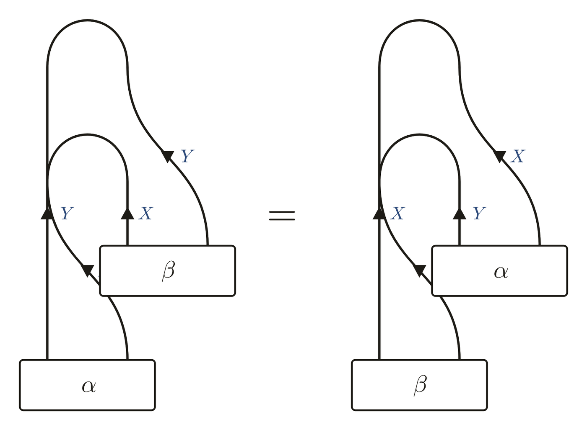

# §4.3.2 The pairings ω are symmetric

[← Chapter 4 index](README.md)

For a tuple $S$ of signed objects, the evaluation $\mathrm{ev}_S : X_{S^*}\otimes X_S\to\mathbb 1$ of §2.3.2 gives a pairing $\omega_S(\alpha\otimes\beta) = \mathrm{ev}_S(\alpha\otimes\beta)$ on $\mathrm{Hom}(\mathbb 1, X_{S^*})\otimes\mathrm{Hom}(\mathbb 1, X_S)$. By isotopy invariance (Theorem 2.6), $\omega_S(\alpha\otimes\beta) = \omega_{S^*}(\beta\otimes\alpha)$: the closed diagram can be turned through 180°. The book shows it for $S = ((X,-),(Y,+))$.

In the editor the rule **turning ω_S (§4.3.2, Theorem 2.6)** puts the box with the smaller name first. Here it turns the right side into the left side.

### §4.3.2  ω_((X,−),(Y,+))(α ⊗ β) = ω_((Y,−),(X,+))(β ⊗ α)

**Signature and expression** (duals: X\*, *pre-fusion* ticked):

```
α : 𝟙 → Y* ⊗ X
β : 𝟙 → X* ⊗ Y
```

```
ev_Y(id_Y* ⊗ ev~_X ⊗ id_Y)(α ⊗ β) = ev_X(id_X* ⊗ ev~_Y ⊗ id_X)(β ⊗ α)
```

$$
\mathrm{ev}_{Y} (\mathrm{id}_{Y^{*}} \otimes ((\widetilde{\mathrm{ev}}_{X} \otimes \mathrm{id}_{Y}) (\mathrm{id}_{X} \otimes \beta))) \alpha
$$

$$
=\;\mathrm{ev}_{X} (\mathrm{id}_{X^{*}} \otimes ((\widetilde{\mathrm{ev}}_{Y} \otimes \mathrm{id}_{X}) (\mathrm{id}_{Y} \otimes \alpha))) \beta
$$



| side | expression | rules Simplify uses |
|---|---|---|
| 1 | $\mathrm{ev}_{Y} (\mathrm{id}_{Y^{*}} \otimes ((\widetilde{\mathrm{ev}}_{X} \otimes \mathrm{id}_{Y}) (\mathrm{id}_{X} \otimes \beta))) \alpha$ | already in normal form |
| 2 | $\mathrm{ev}_{X} (\mathrm{id}_{X^{*}} \otimes ((\widetilde{\mathrm{ev}}_{Y} \otimes \mathrm{id}_{X}) (\mathrm{id}_{Y} \otimes \alpha))) \beta$ | turning ω\_S (§4.3.2, Theorem 2.6) |

Normal form:

$$
\mathrm{ev}_{Y} (\mathrm{id}_{Y^{*}} \otimes ((\widetilde{\mathrm{ev}}_{X} \otimes \mathrm{id}_{Y}) (\mathrm{id}_{X} \otimes \beta))) \alpha
$$


The editor reports: *✓ Both sides reduce to the same normal form, so the equation holds.* · [Open this step in the editor](../../string-diagram-editor.html#ex=78)

In the Wolfram notebook `graphical-calculus-4.nb` (sections 70–79, code in `fusion-4.wl`) the two sides are also equal as matrices in a pivotal category that is not spherical (section 73, `omega432`).

---

By Dara O Shayda and Noor Hoshino (星野ヌール) · © Computational Classnotes · CC BY-NC-SA 4.0
