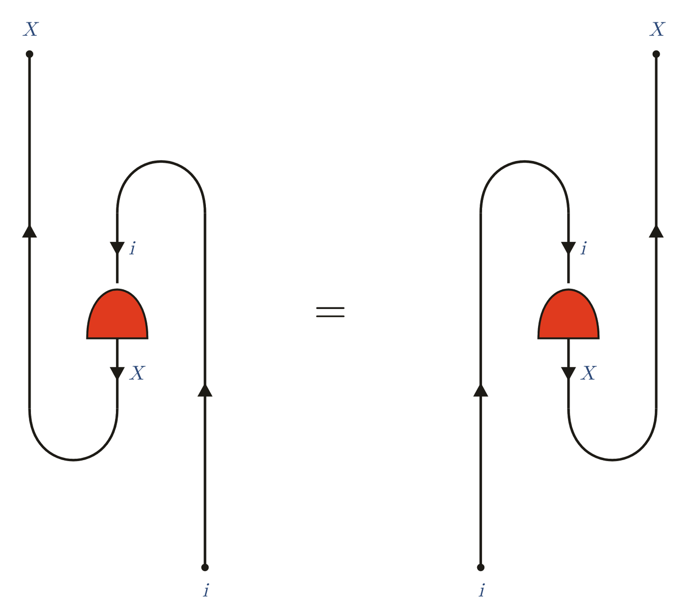
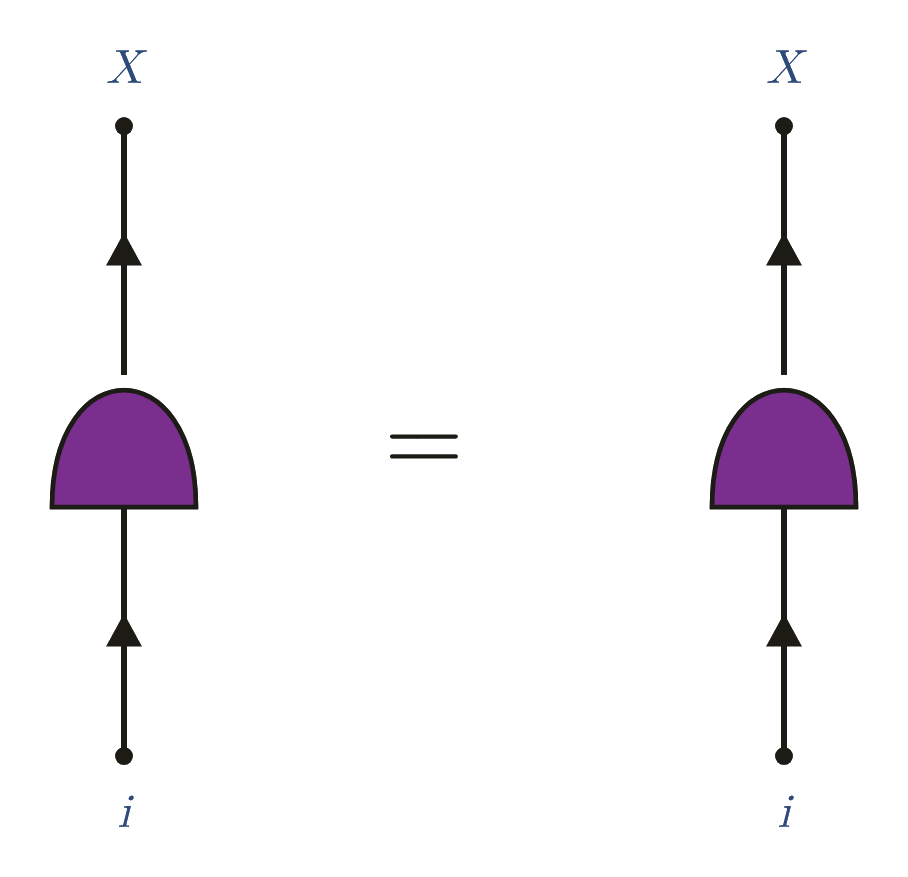
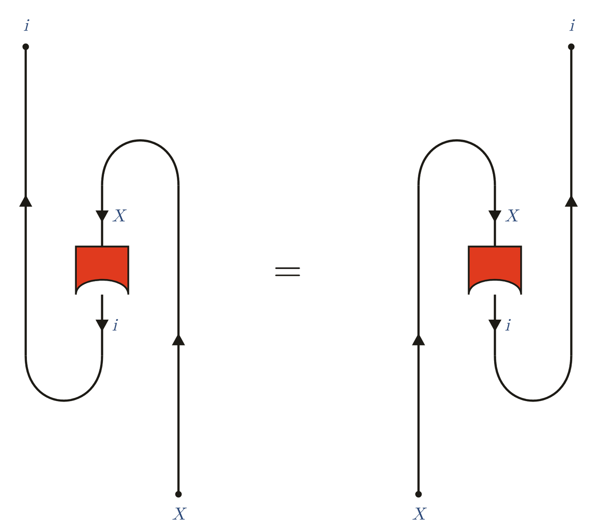
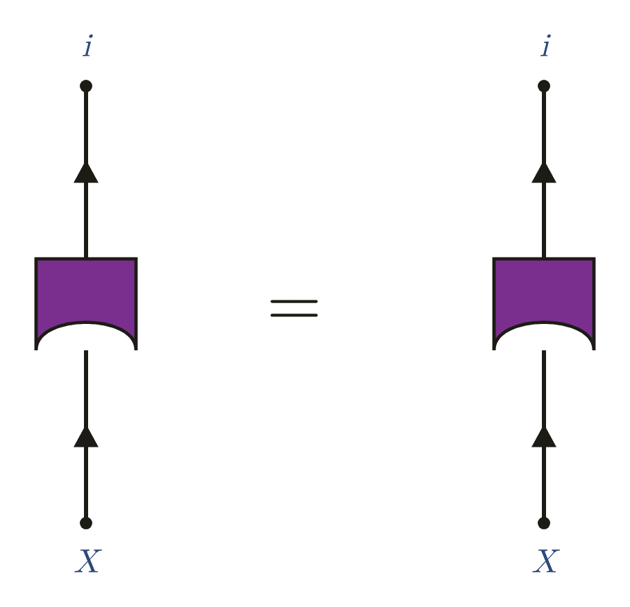

# §4.6.1–4.6.2 Curvilinear boxes

[← Chapter 4 index](README.md)

Let $i$ be simple and let $(p_\alpha : X\to i,\ q_\alpha : i\to X)_{\alpha\in A}$ be an $i$-partition of $X$. A diagram that contains $p_\alpha$ and $q_\alpha$ and is summed over $\alpha$ does not depend on the choice of partition, because the tensor $\sum_\alpha p_\alpha\otimes q_\alpha$ does not. The book therefore draws the pair as two curvilinear boxes: a semi-disk for $p_\alpha$ and a compressed rectangle for $q_\alpha$ (4.6). Pairs may carry several arcs, may be 1-partitions (the $\mathbb 1$-arc is erased), and are painted in different colours.

**In the editor.** Tick *pre-fusion* (duals: X\*) and declare a pair in the signature:

```
simple i
partition α : X → i
```

This gives the boxes `p_α : X → i`, drawn as a semi-disk, and `q_α : i → X`, drawn as a compressed rectangle, in the colour of the pair. `partition β : X* ⊗ Y → 𝟙` declares a 1-partition. An expression is a linear combination: write sums as `∑_i` or `∑_{i∈I}`, and scalars before the morphism, such as `dim_l(i)`, `dim_r(i)`, `N^i_X`, `δ_{i,j}`, `δ_{i°,j}`, `2/3`, or `a_i` after `scalar a`. Powers are written `⁻¹`, and terms are separated by `+` or `−`. In a sum, the pair belongs to the summation variable, as in (4.8). Pair names and summation variables are bound: two expressions that differ only in these names have the same normal form.

**Bent boxes.** By isotopy, a curvilinear box with its arcs bent to the other side is the same as the box drawn with the arcs bent the other way. The editor checks this with the folds of Figure 2.3:

### §4.6.1  a semi-disk with its arcs bent

**Signature and expression** (duals: X\*, *pre-fusion* ticked):

```
simple i
partition α : X → i
```

```
(id_X* ⊗ ev~_i)(id_X* ⊗ p_α ⊗ id_i*)(coev~_X ⊗ id_i*) = (ev_i ⊗ id_X*)(id_i* ⊗ p_α ⊗ id_X*)(id_i* ⊗ coev_X)
```

$$
(\mathrm{id}_{X^{*}} \otimes (\widetilde{\mathrm{ev}}_{i} (p_{\alpha} \otimes \mathrm{id}_{i^{*}}))) (\widetilde{\mathrm{coev}}_{X} \otimes \mathrm{id}_{i^{*}})
$$

$$
=\;((\mathrm{ev}_{i} (\mathrm{id}_{i^{*}} \otimes p_{\alpha})) \otimes \mathrm{id}_{X^{*}}) (\mathrm{id}_{i^{*}} \otimes \mathrm{coev}_{X})
$$



| side | expression | rules Simplify uses |
|---|---|---|
| 1 | $(\mathrm{id}_{X^{*}} \otimes (\widetilde{\mathrm{ev}}_{i} (p_{\alpha} \otimes \mathrm{id}_{i^{*}}))) (\widetilde{\mathrm{coev}}_{X} \otimes \mathrm{id}_{i^{*}})$ | Fig. 2.3 fold (right) |
| 2 | $((\mathrm{ev}_{i} (\mathrm{id}_{i^{*}} \otimes p_{\alpha})) \otimes \mathrm{id}_{X^{*}}) (\mathrm{id}_{i^{*}} \otimes \mathrm{coev}_{X})$ | Fig. 2.3 fold (left) |

Normal form:

$$
p_{\alpha^{*}}
$$



The editor reports: *✓ Both sides reduce to the same normal form, so the equation holds.* · [Open this step in the editor](../../string-diagram-editor.html#ex=83)

### §4.6.1  a compressed rectangle with its arcs bent

**Signature and expression** (duals: X\*, *pre-fusion* ticked):

```
simple i
partition α : X → i
```

```
(id_i* ⊗ ev~_X)(id_i* ⊗ q_α ⊗ id_X*)(coev~_i ⊗ id_X*) = (ev_X ⊗ id_i*)(id_X* ⊗ q_α ⊗ id_i*)(id_X* ⊗ coev_i)
```

$$
(\mathrm{id}_{i^{*}} \otimes (\widetilde{\mathrm{ev}}_{X} (q_{\alpha} \otimes \mathrm{id}_{X^{*}}))) (\widetilde{\mathrm{coev}}_{i} \otimes \mathrm{id}_{X^{*}})
$$

$$
=\;((\mathrm{ev}_{X} (\mathrm{id}_{X^{*}} \otimes q_{\alpha})) \otimes \mathrm{id}_{i^{*}}) (\mathrm{id}_{X^{*}} \otimes \mathrm{coev}_{i})
$$



| side | expression | rules Simplify uses |
|---|---|---|
| 1 | $(\mathrm{id}_{i^{*}} \otimes (\widetilde{\mathrm{ev}}_{X} (q_{\alpha} \otimes \mathrm{id}_{X^{*}}))) (\widetilde{\mathrm{coev}}_{i} \otimes \mathrm{id}_{X^{*}})$ | Fig. 2.3 fold (right) |
| 2 | $((\mathrm{ev}_{X} (\mathrm{id}_{X^{*}} \otimes q_{\alpha})) \otimes \mathrm{id}_{i^{*}}) (\mathrm{id}_{X^{*}} \otimes \mathrm{coev}_{i})$ | Fig. 2.3 fold (left) |

Normal form:

$$
q_{\alpha^{*}}
$$



The editor reports: *✓ Both sides reduce to the same normal form, so the equation holds.* · [Open this step in the editor](../../string-diagram-editor.html#ex=84)

**Example 4.6.2** puts two pairs in one quasi-diagram: a red $i$-partition of $X$ and a blue $j$-partition of $X\otimes Y^*$, together with a box $f : Y\to i\otimes Y$. By definition the quasi-diagram is the double sum over $\alpha$ and $\beta$ of the diagram with these boxes. In the editor, give each pair its own `partition` line, and the colours follow the order of declaration.

---

By Dara O Shayda and Noor Hoshino (星野ヌール) · © Computational Classnotes · CC BY-NC-SA 4.0
