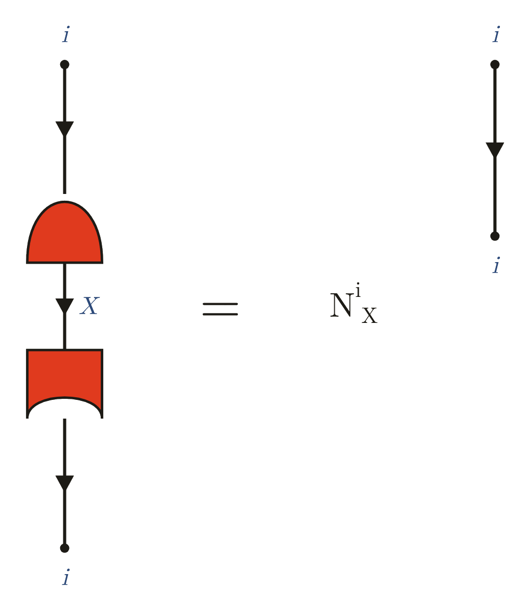
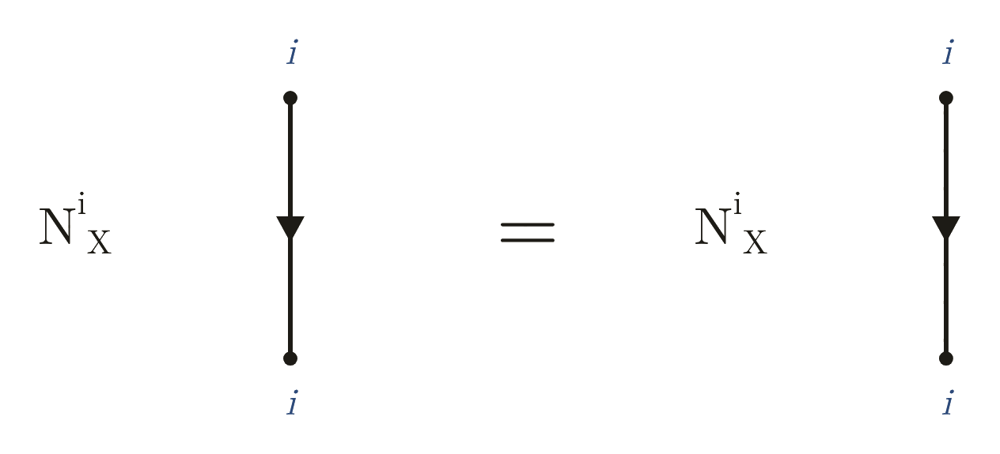
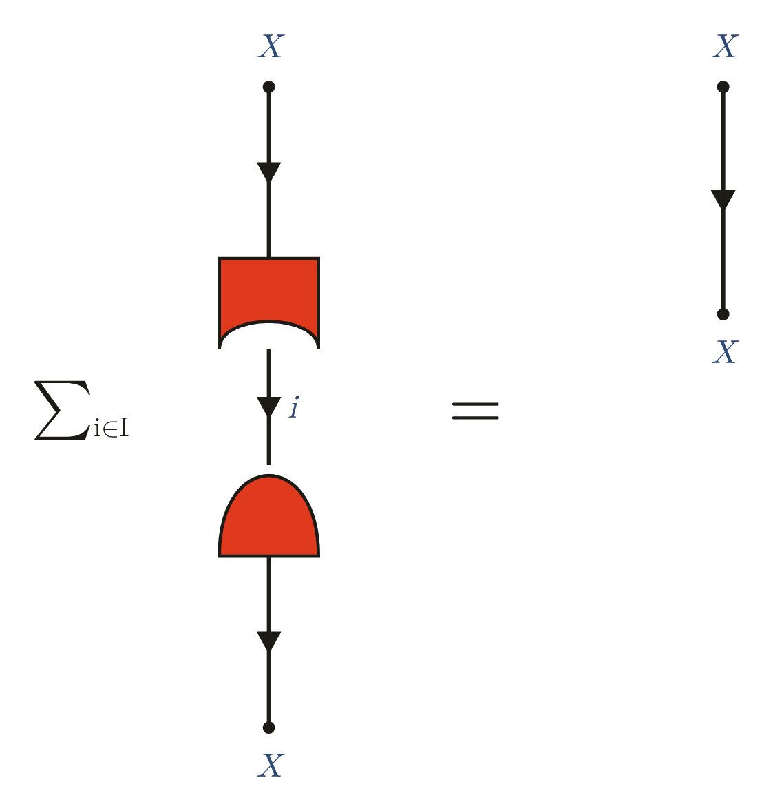
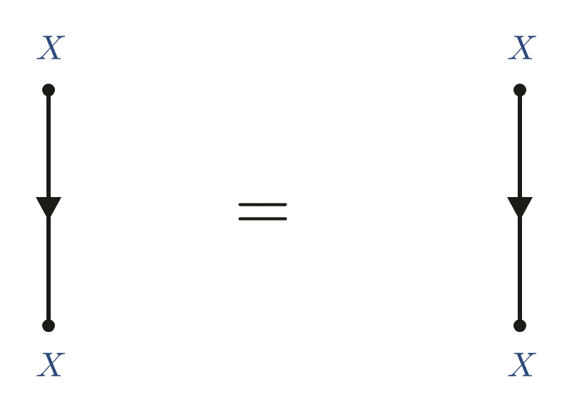
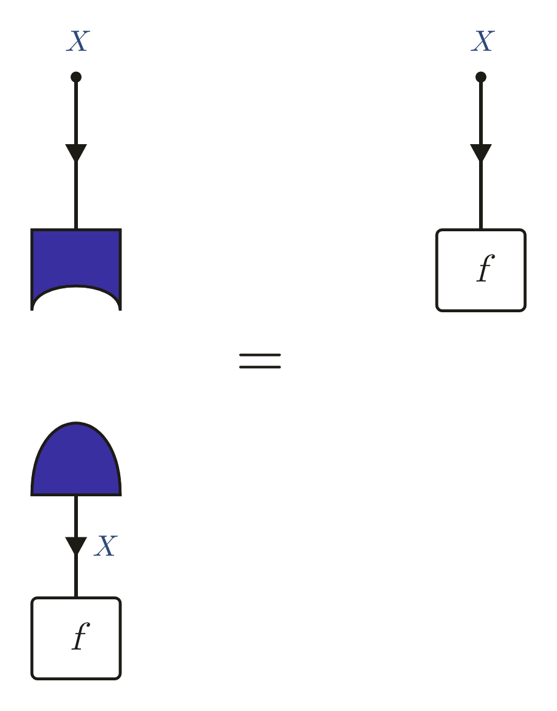
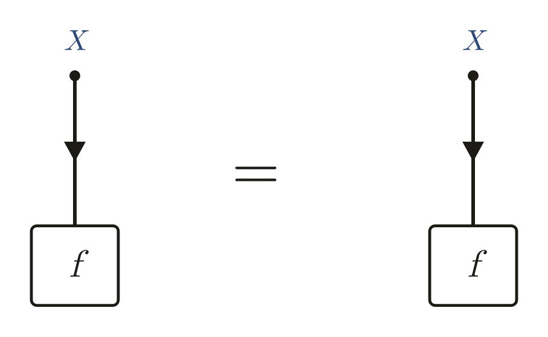
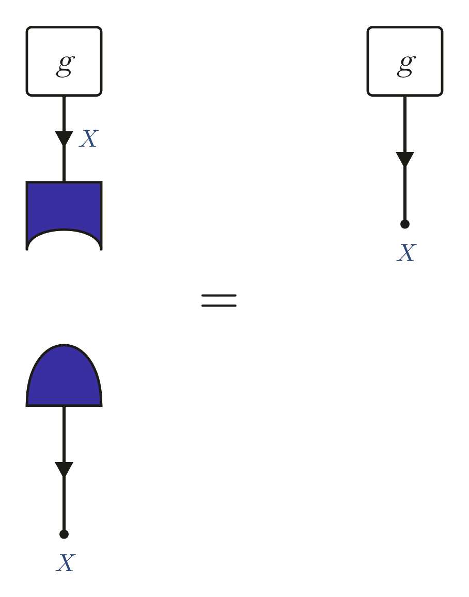
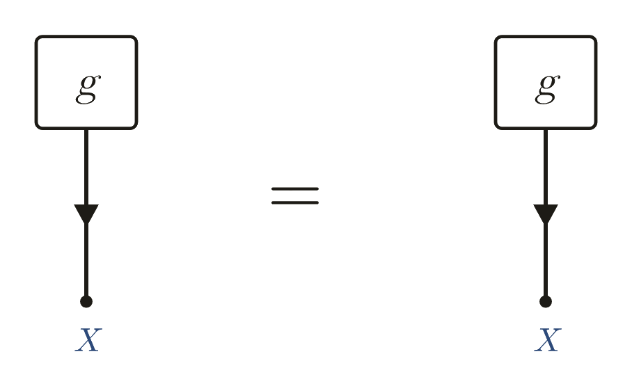
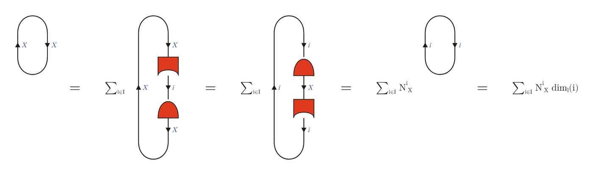
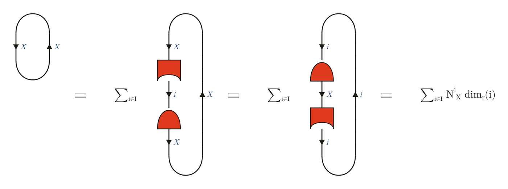

# §4.6.3 Properties (4.7)–(4.10)

[← Chapter 4 index](README.md)

For an object $X$ and a simple object $i$ of a pivotal pre-fusion category:

- **(4.7)** a semi-disk directly on top of its compressed rectangle (the composite $p_\alpha q_\alpha$ on the $i$-line) is $N^i_X\,\mathrm{id}_i$, where $N^i_X$ is the multiplicity of $i$ in $X$;
- **(4.8)** $\sum_{i\in I} q_\alpha p_\alpha = \mathrm{id}_X$, because the $i$-partitions together form an $I$-partition;
- **(4.9)** for a 1-partition, $q_\alpha p_\alpha f = f$ for $f\in\mathrm{Hom}(\mathbb 1, X)$ and $g\, q_\alpha p_\alpha = g$ for $g\in\mathrm{Hom}(X,\mathbb 1)$;
- **(4.10)** $\dim_l(X) = \sum_i \dim_l(i) N^i_X$ and $\dim_r(X) = \sum_i \dim_r(i) N^i_X$.

The rules are named after the formulas. **(4.10)** is also a rule: a circle on an object that is not declared simple becomes $\sum_i \dim(i) N^i_X$, so that every step of the book's derivation of (4.10) can be checked.

### (4.7)  p_α q_α = N^i_X id_i

**Signature and expression** (duals: X\*, *pre-fusion* ticked):

```
simple i
partition α : X → i
partition β : X → 𝟙
f : 𝟙 → X
g : X → 𝟙
```

```
p_α q_α = N^i_X id_i
```

$$
p_{\alpha} q_{\alpha} \;=\; N^{i}_{X}\,\mathrm{id}_{i}
$$



| side | expression | rules Simplify uses |
|---|---|---|
| 1 | $p_{\alpha} q_{\alpha}$ | (4.7) |
| 2 | $N^{i}_{X}\,\mathrm{id}_{i}$ | already in normal form |

Normal form:

$$
N^{i}_{X}\,\mathrm{id}_{i}
$$



The editor reports: *✓ Both sides reduce to the same normal form, so the equation holds.* · [Open this step in the editor](../../string-diagram-editor.html#ex=85)

### (4.8)  ∑_i q_α p_α = id_X

**Signature and expression** (duals: X\*, *pre-fusion* ticked):

```
simple i
partition α : X → i
partition β : X → 𝟙
f : 𝟙 → X
g : X → 𝟙
```

```
∑_i q_α p_α = id_X
```

$$
\sum_{i\in I}\,q_{\alpha} p_{\alpha} \;=\; \mathrm{id}_{X}
$$



| side | expression | rules Simplify uses |
|---|---|---|
| 1 | $\sum_{i\in I}\,q_{\alpha} p_{\alpha}$ | (4.8) |
| 2 | $\mathrm{id}_{X}$ | already in normal form |

Normal form:

$$
\mathrm{id}_{X}
$$



The editor reports: *✓ Both sides reduce to the same normal form, so the equation holds.* · [Open this step in the editor](../../string-diagram-editor.html#ex=86)

### (4.9)  q_β p_β f = f

**Signature and expression** (duals: X\*, *pre-fusion* ticked):

```
simple i
partition α : X → i
partition β : X → 𝟙
f : 𝟙 → X
g : X → 𝟙
```

```
q_β p_β f = f
```

$$
q_{\beta} p_{\beta} f \;=\; f
$$



| side | expression | rules Simplify uses |
|---|---|---|
| 1 | $q_{\beta} p_{\beta} f$ | (4.9) |
| 2 | $f$ | already in normal form |

Normal form:

$$
f
$$



The editor reports: *✓ Both sides reduce to the same normal form, so the equation holds.* · [Open this step in the editor](../../string-diagram-editor.html#ex=87)

### (4.9)  g q_β p_β = g

**Signature and expression** (duals: X\*, *pre-fusion* ticked):

```
simple i
partition α : X → i
partition β : X → 𝟙
f : 𝟙 → X
g : X → 𝟙
```

```
g q_β p_β = g
```

$$
g q_{\beta} p_{\beta} \;=\; g
$$



| side | expression | rules Simplify uses |
|---|---|---|
| 1 | $g q_{\beta} p_{\beta}$ | (4.9) |
| 2 | $g$ | already in normal form |

Normal form:

$$
g
$$



The editor reports: *✓ Both sides reduce to the same normal form, so the equation holds.* · [Open this step in the editor](../../string-diagram-editor.html#ex=88)

**The derivation of (4.10), step by step.** The book's chain $\dim_l(X) = \cdots = \sum_i \dim_l(i)N^i_X$ is typed as one equation with five sides. Each side reduces with the rule the book cites for that step:

| step | book | editor, on the new side |
|---|---|---|
| loop $X$ = $\sum_i$ loop $X$ with $q_\alpha p_\alpha$ | (4.8) | (4.8) |
| = $\sum_i$ loop $i$ with $p_\alpha q_\alpha$ | isotopy | (4.7) applies to the turned loop |
| = $\sum_i N^i_X$ loop $i$ | (4.7) | dim\_l(i), dim\_r(i) of a simple object |
| = $\sum_i \dim_l(i) N^i_X$ | definition of $\dim_l$ | — |

### (4.10)  dim_l(X) = ∑_i dim_l(i) N^i_X, step by step

**Signature and expression** (duals: X\*, *pre-fusion* ticked):

```
simple i
partition α : X → i
partition β : X → 𝟙
f : 𝟙 → X
g : X → 𝟙
```

```
ev_X coev~_X = ∑_i ev_X(id_X* ⊗ q_α p_α)coev~_X = ∑_i ev_i(id_i* ⊗ p_α q_α)coev~_i = ∑_i N^i_X ev_i coev~_i = ∑_i dim_l(i) N^i_X
```

$$
\mathrm{ev}_{X} \widetilde{\mathrm{coev}}_{X}
$$

$$
=\;\sum_{i\in I}\,\mathrm{ev}_{X} (\mathrm{id}_{X^{*}} \otimes (q_{\alpha} p_{\alpha})) \widetilde{\mathrm{coev}}_{X}
$$

$$
=\;\sum_{i\in I}\,\mathrm{ev}_{i} (\mathrm{id}_{i^{*}} \otimes (p_{\alpha} q_{\alpha})) \widetilde{\mathrm{coev}}_{i}
$$

$$
=\;\sum_{i\in I}\,N^{i}_{X}\,\mathrm{ev}_{i} \widetilde{\mathrm{coev}}_{i}
$$

$$
=\;\sum_{i\in I}\,N^{i}_{X}\,\dim_l(i)
$$



| side | expression | rules Simplify uses |
|---|---|---|
| 1 | $\mathrm{ev}_{X} \widetilde{\mathrm{coev}}_{X}$ | (4.10) |
| 2 | $\sum_{i\in I}\,\mathrm{ev}_{X} (\mathrm{id}_{X^{*}} \otimes (q_{\alpha} p_{\alpha})) \widetilde{\mathrm{coev}}_{X}$ | (4.8) → (4.10) |
| 3 | $\sum_{i\in I}\,\mathrm{ev}_{i} (\mathrm{id}_{i^{*}} \otimes (p_{\alpha} q_{\alpha})) \widetilde{\mathrm{coev}}_{i}$ | (4.7) → dim\_l(i), dim\_r(i) of a simple object |
| 4 | $\sum_{i\in I}\,N^{i}_{X}\,\mathrm{ev}_{i} \widetilde{\mathrm{coev}}_{i}$ | dim\_l(i), dim\_r(i) of a simple object |
| 5 | $\sum_{i\in I}\,N^{i}_{X}\,\dim_l(i)$ | already in normal form |

Normal form:

$$
\sum_{j\in I}\,N^{j}_{X}\,\dim_l(j)
$$

The editor reports: *✓ Both sides reduce to the same normal form, so the equation holds.* · [Open this step in the editor](../../string-diagram-editor.html#ex=89)

### (4.10)  dim_r(X) = ∑_i dim_r(i) N^i_X

**Signature and expression** (duals: X\*, *pre-fusion* ticked):

```
simple i
partition α : X → i
partition β : X → 𝟙
f : 𝟙 → X
g : X → 𝟙
```

```
ev~_X coev_X = ∑_i ev~_X(q_α p_α ⊗ id_X*)coev_X = ∑_i ev~_i(p_α q_α ⊗ id_i*)coev_i = ∑_i dim_r(i) N^i_X
```

$$
\widetilde{\mathrm{ev}}_{X} \mathrm{coev}_{X}
$$

$$
=\;\sum_{i\in I}\,\widetilde{\mathrm{ev}}_{X} ((q_{\alpha} p_{\alpha}) \otimes \mathrm{id}_{X^{*}}) \mathrm{coev}_{X}
$$

$$
=\;\sum_{i\in I}\,\widetilde{\mathrm{ev}}_{i} ((p_{\alpha} q_{\alpha}) \otimes \mathrm{id}_{i^{*}}) \mathrm{coev}_{i}
$$

$$
=\;\sum_{i\in I}\,N^{i}_{X}\,\dim_r(i)
$$



| side | expression | rules Simplify uses |
|---|---|---|
| 1 | $\widetilde{\mathrm{ev}}_{X} \mathrm{coev}_{X}$ | (4.10) |
| 2 | $\sum_{i\in I}\,\widetilde{\mathrm{ev}}_{X} ((q_{\alpha} p_{\alpha}) \otimes \mathrm{id}_{X^{*}}) \mathrm{coev}_{X}$ | (4.8) → (4.10) |
| 3 | $\sum_{i\in I}\,\widetilde{\mathrm{ev}}_{i} ((p_{\alpha} q_{\alpha}) \otimes \mathrm{id}_{i^{*}}) \mathrm{coev}_{i}$ | (4.7) → dim\_l(i), dim\_r(i) of a simple object |
| 4 | $\sum_{i\in I}\,N^{i}_{X}\,\dim_r(i)$ | already in normal form |

Normal form:

$$
\sum_{j\in I}\,N^{j}_{X}\,\dim_r(j)
$$

The editor reports: *✓ Both sides reduce to the same normal form, so the equation holds.* · [Open this step in the editor](../../string-diagram-editor.html#ex=90)

The notebook `graphical-calculus-4.nb` (sections 70–79, code in `fusion-4.wl`), section 74 (`props463`), checks (4.7)–(4.10), and each link of the chain, in matrices.

---

By Dara O Shayda and Noor Hoshino (星野ヌール) · © Computational Classnotes · CC BY-NC-SA 4.0
