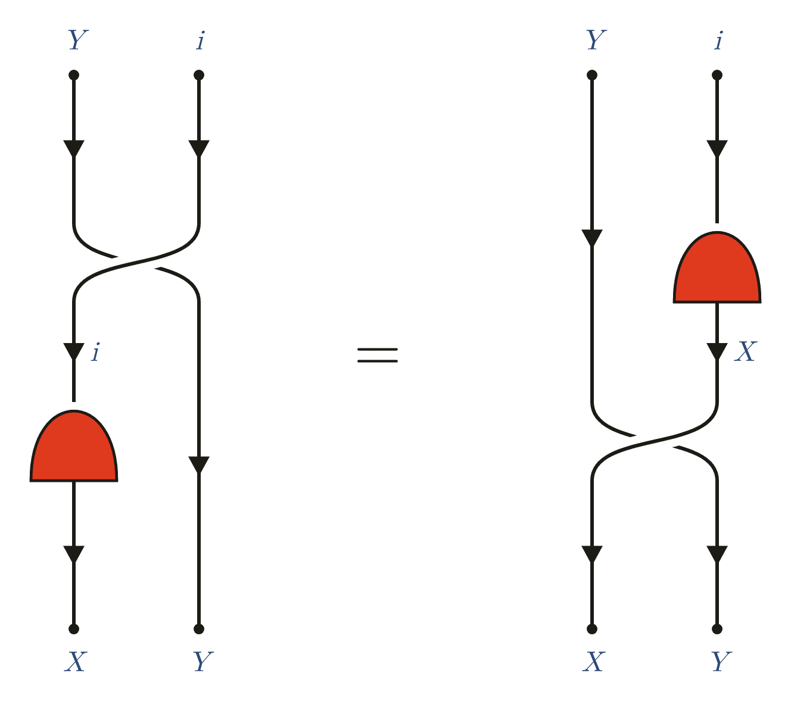
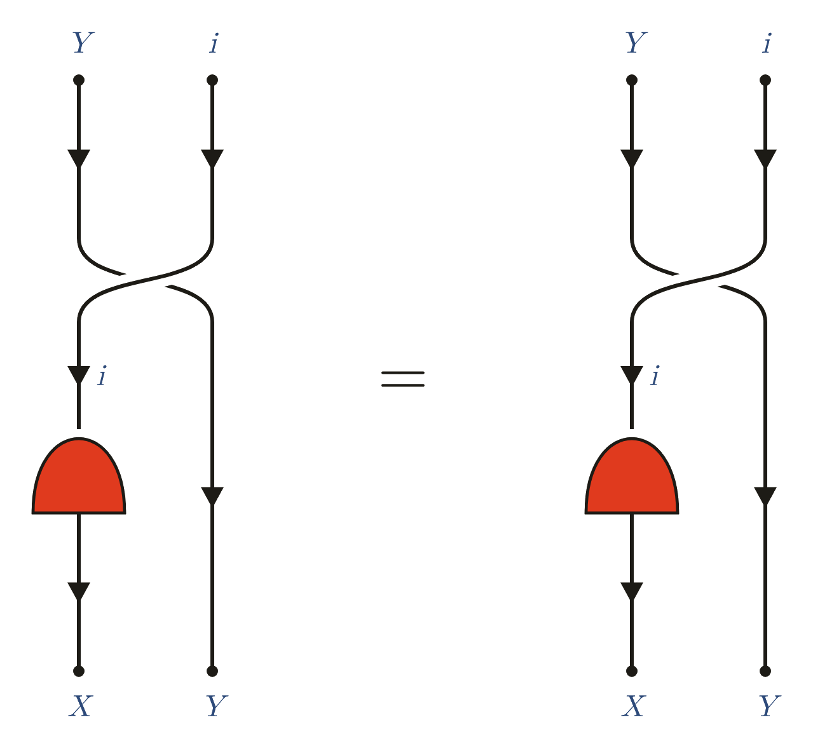

# §4.6.4 Curvilinear boxes in braided categories

[← Chapter 4 index](README.md)

In a braided pivotal pre-fusion category, naturality of the braiding lets a curvilinear box pass under or over a strand. The editor's R4/R5 rule moves a one-line box through a crossing, and it treats `p_α` and `q_α` like any other box:

### §4.6.4  a semi-disk passes under a strand

**Signature and expression** (duals: X\*, *pre-fusion* ticked):

```
simple i
partition α : X → i
```

```
τ_{i,Y}(p_α ⊗ id_Y) = (id_Y ⊗ p_α)τ_{X,Y}
```

$$
\tau_{i,Y} (p_{\alpha} \otimes \mathrm{id}_{Y}) \;=\; (\mathrm{id}_{Y} \otimes p_{\alpha}) \tau_{X,Y}
$$



| side | expression | rules Simplify uses |
|---|---|---|
| 1 | $\tau_{i,Y} (p_{\alpha} \otimes \mathrm{id}_{Y})$ | already in normal form |
| 2 | $(\mathrm{id}_{Y} \otimes p_{\alpha}) \tau_{X,Y}$ | R4, R5: naturality of τ |

Normal form:

$$
\tau_{i,Y} (p_{\alpha} \otimes \mathrm{id}_{Y})
$$



The editor reports: *✓ Both sides reduce to the same normal form, so the equation holds.* · [Open this step in the editor](../../string-diagram-editor.html#ex=101)

Moving boxes with several arcs through a bundle of crossings is not in the editor.

---

By Dara O Shayda and Noor Hoshino (星野ヌール) · © Computational Classnotes · CC BY-NC-SA 4.0
