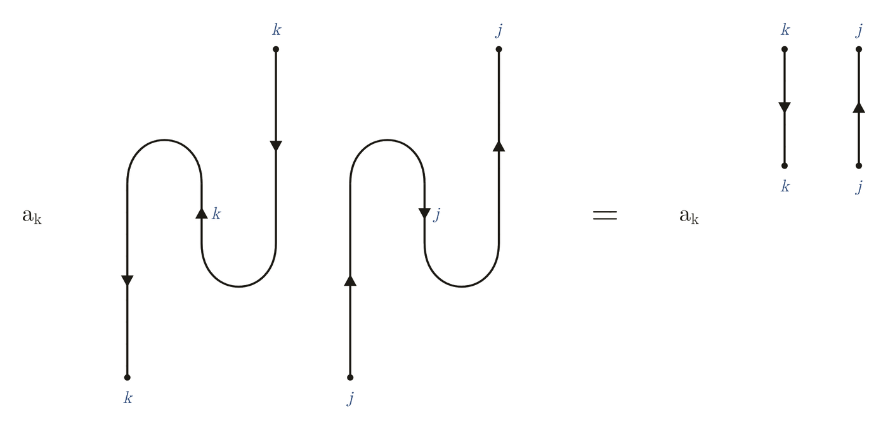
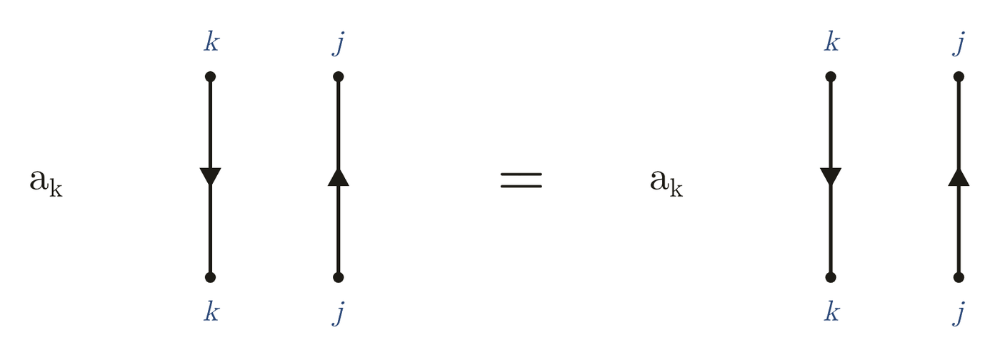
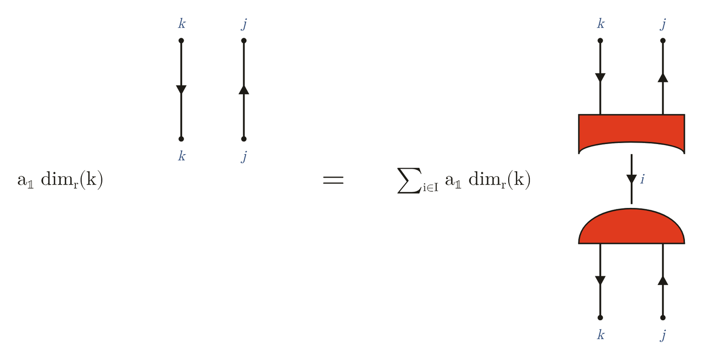
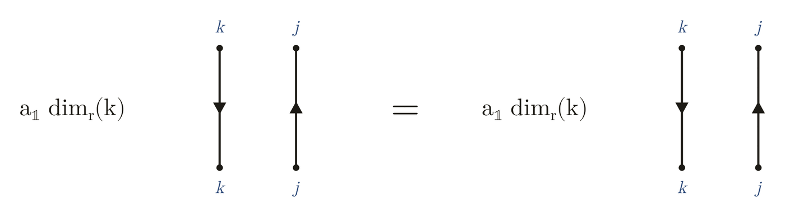
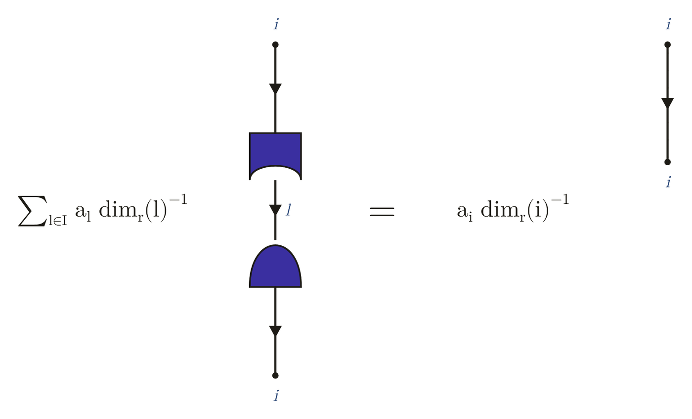
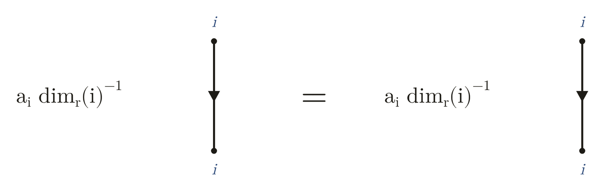

# Lemma 4.10 Which scalars make f = g

[← Chapter 4 index](README.md)

**Lemma 4.10.** Let $(a_i)_{i\in I}$ be scalars, $f_{j,k} = a_k\,\widetilde{\mathrm{coev}}_k\,\mathrm{ev}_j$, and $g_{j,k} = \sum_i a_i\,(q_\alpha^*\otimes p_\alpha)(\mathrm{id}_{j^*}\otimes\widetilde{\mathrm{coev}}_i\otimes\mathrm{id}_j)$ for a $k$-partition $(p_\alpha, q_\alpha)$ of $i\otimes j$. Then $f_{j,k} = g_{j,k}$ for all $j,k\in I$ if and only if $a_i = a_{\mathbb 1}\dim_r(i)$ for all $i$.

**The proof, step by step.**

| step | book | checked by |
|---|---|---|
| bend $f$ and $g$ (duality): $f_{j,k}$ becomes $a_k\,\mathrm{id}_{k\otimes j^*}$ | duality | editor: the (2.1) zigzags |
| the bent $g_{j,k}$ is $\sum_i a_i\frac{\dim_r(k)}{\dim_r(i)}\, q_\rho p_\rho$, an $i$-partition of $k\otimes j^*$ | Lemma 4.9(e) | notebook, matrices |
| so $f = g$ iff (4.12): $a_k\,\mathrm{id}_{k\otimes j^*} = \sum_i a_i\frac{\dim_r(k)}{\dim_r(i)} q_\rho p_\rho$ | | |
| if $a_i = a_{\mathbb 1}\dim_r(i)$ then (4.12) holds | (4.8) | editor: (4.8) |
| conversely, (4.12) at $k = \mathbb 1$, $j = i^*$ gives $a_{\mathbb 1} = a_i\dim_r(i)^{-1}$ | Lemma 4.9(a) | editor: Lemma 4.9(a), δ |

### Lemma 4.10  by duality, f_{j,k} becomes a_k id_{k ⊗ j*}

**Signature and expression** (duals: X\*, *pre-fusion* ticked):

```
simple i j k
scalar a
partition ρ : k ⊗ j* → i
partition σ : i → l
```

```
a_k (ev~_k ⊗ id_k ⊗ id_j*)(id_k ⊗ coev~_k ev_j ⊗ id_j*)(id_k ⊗ id_j* ⊗ coev_j) = a_k id_k ⊗ id_j*
```

$$
a_{k}\,((\widetilde{\mathrm{ev}}_{k} \otimes \mathrm{id}_{k}) (\mathrm{id}_{k} \otimes \widetilde{\mathrm{coev}}_{k})) \otimes ((\mathrm{ev}_{j} \otimes \mathrm{id}_{j^{*}}) (\mathrm{id}_{j^{*}} \otimes \mathrm{coev}_{j}))
$$

$$
=\;a_{k}\,\mathrm{id}_{k \otimes j^{*}}
$$



| side | expression | rules Simplify uses |
|---|---|---|
| 1 | $a_{k}\,((\widetilde{\mathrm{ev}}_{k} \otimes \mathrm{id}_{k}) (\mathrm{id}_{k} \otimes \widetilde{\mathrm{coev}}_{k})) \otimes ((\mathrm{ev}_{j} \otimes \mathrm{id}_{j^{*}}) (\mathrm{id}_{j^{*}} \otimes \mathrm{coev}_{j}))$ | (2.1) right zigzag → (2.1) right zigzag |
| 2 | $a_{k}\,\mathrm{id}_{k \otimes j^{*}}$ | already in normal form |

Normal form:

$$
a_{k}\,\mathrm{id}_{k \otimes j^{*}}
$$



The editor reports: *✓ Both sides reduce to the same normal form, so the equation holds.* · [Open this step in the editor](../../string-diagram-editor.html#ex=98)

### Lemma 4.10  (4.12) holds when a_i = a_𝟙 dim_r(i)

**Signature and expression** (duals: X\*, *pre-fusion* ticked):

```
simple i j k
scalar a
partition ρ : k ⊗ j* → i
partition σ : i → l
```

```
a_𝟙 dim_r(k) id_k ⊗ id_j* = ∑_i a_𝟙 dim_r(i) dim_r(k) dim_r(i)⁻¹ q_ρ p_ρ
```

$$
a_{\mathrm{𝟙}}\,\dim_r(k)\,\mathrm{id}_{k \otimes j^{*}} \;=\; \sum_{i\in I}\,a_{\mathrm{𝟙}}\,\dim_r(k)\,q_{\rho} p_{\rho}
$$



| side | expression | rules Simplify uses |
|---|---|---|
| 1 | $a_{\mathrm{𝟙}}\,\dim_r(k)\,\mathrm{id}_{k \otimes j^{*}}$ | already in normal form |
| 2 | $\sum_{i\in I}\,a_{\mathrm{𝟙}}\,\dim_r(k)\,q_{\rho} p_{\rho}$ | (4.8) |

Normal form:

$$
a_{\mathrm{𝟙}}\,\dim_r(k)\,\mathrm{id}_{k \otimes j^{*}}
$$



The editor reports: *✓ Both sides reduce to the same normal form, so the equation holds.* · [Open this step in the editor](../../string-diagram-editor.html#ex=99)

### Lemma 4.10  (4.12) at k = 𝟙, j = i*

**Signature and expression** (duals: X\*, *pre-fusion* ticked):

```
simple i j k
scalar a
partition ρ : k ⊗ j* → i
partition σ : i → l
```

```
∑_l a_l dim_r(l)⁻¹ q_σ p_σ = a_i dim_r(i)⁻¹ id_i
```

$$
\sum_{l\in I}\,a_{l}\,\dim_r(l)^{-1}\,q_{\sigma} p_{\sigma} \;=\; a_{i}\,\dim_r(i)^{-1}\,\mathrm{id}_{i}
$$



| side | expression | rules Simplify uses |
|---|---|---|
| 1 | $\sum_{l\in I}\,a_{l}\,\dim_r(l)^{-1}\,q_{\sigma} p_{\sigma}$ | Lemma 4.9(a) |
| 2 | $a_{i}\,\dim_r(i)^{-1}\,\mathrm{id}_{i}$ | already in normal form |

Normal form:

$$
a_{i}\,\dim_r(i)^{-1}\,\mathrm{id}_{i}
$$



The editor reports: *✓ Both sides reduce to the same normal form, so the equation holds.* · [Open this step in the editor](../../string-diagram-editor.html#ex=100)

The notebook `graphical-calculus-4.nb` (sections 70–79, code in `fusion-4.wl`), section 77 (`lemma410`, `chk410`), checks the whole lemma in matrices for all $j,k$ in $\{k_{-1}, k_1, k_2\}$: $f = g$ holds when $a_i = a_{\mathbb 1}\dim_r(i)$, fails for $a_i = a_{\mathbb 1}\dim_l(i)$ and for random $a_i$, and the duality step and the Lemma 4.9(e) step hold for any $a_i$.

---

By Dara O Shayda and Noor Hoshino (星野ヌール) · © Computational Classnotes · CC BY-NC-SA 4.0
