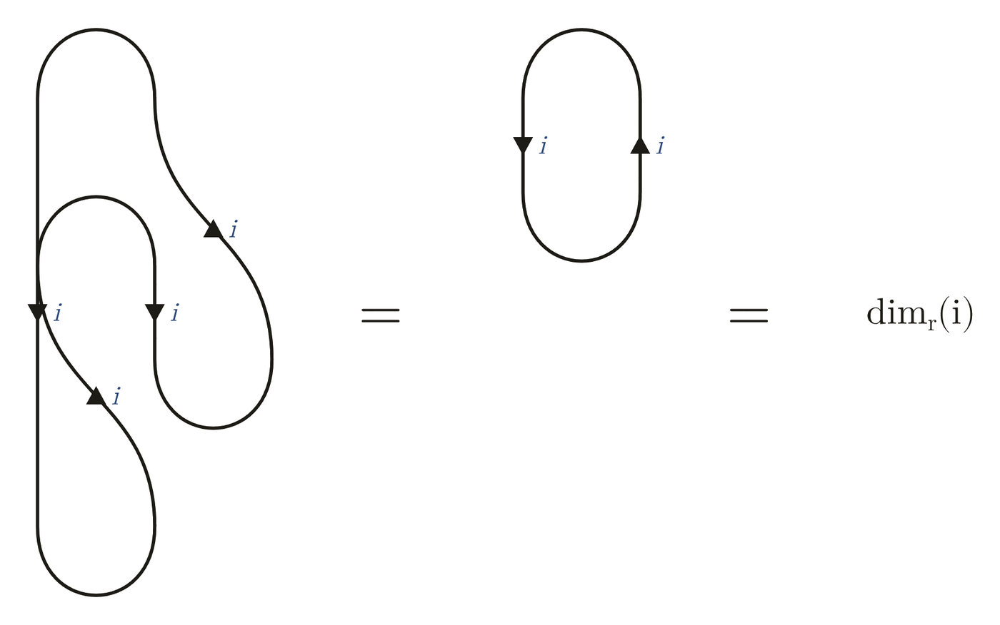
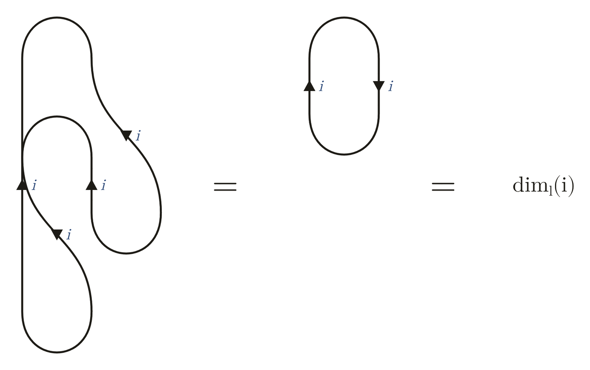
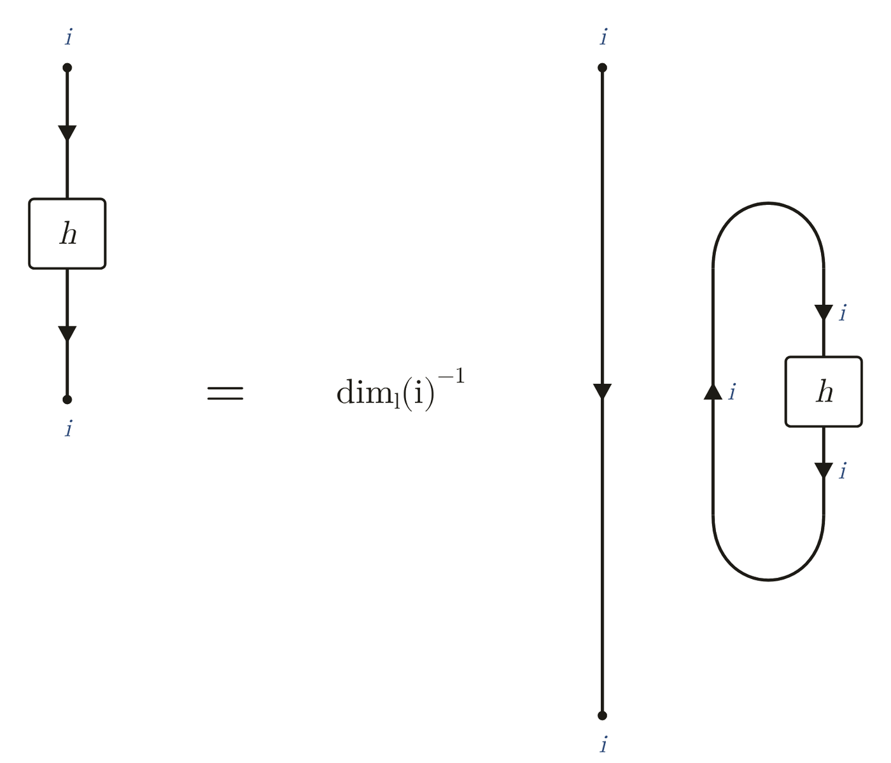
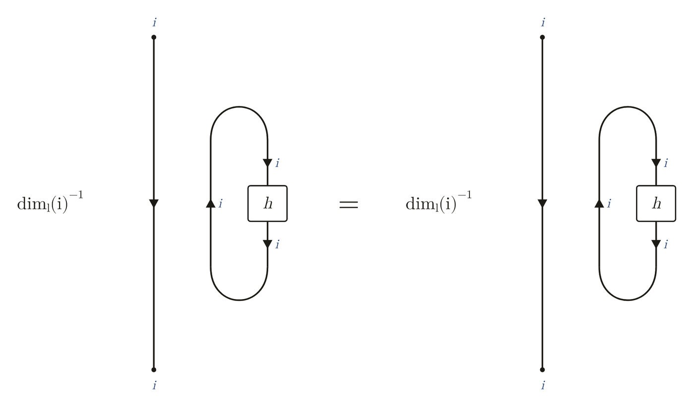
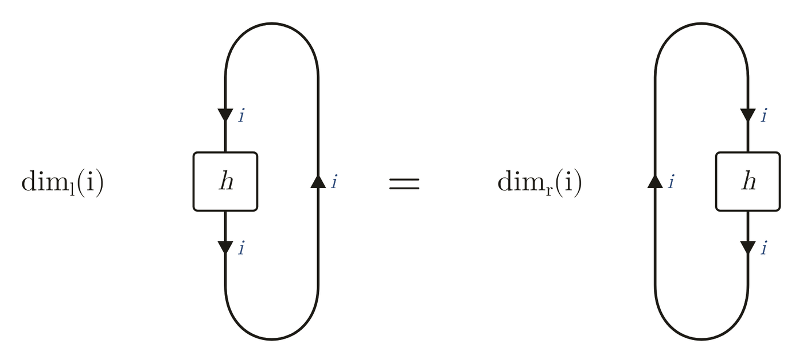
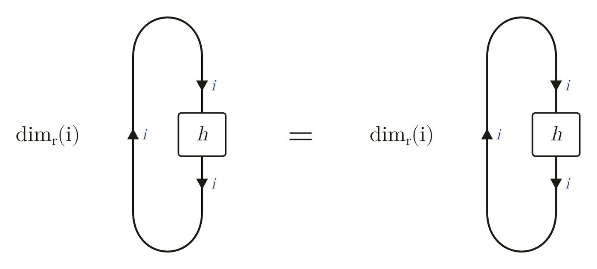

# Lemma 4.2 Dimensions of simple objects

[← Chapter 4 index](README.md)

**Lemma 4.2.** In a non-degenerate pivotal $\Bbbk$-category: (a) the dimensions $\dim_l(i)$ and $\dim_r(i)$ of a simple object $i$ are invertible; (b) every endomorphism $f$ of a simple $i$ is $f = \dim_l(i)^{-1}\,\mathrm{tr}_l(f)\,\mathrm{id}_i = \dim_r(i)^{-1}\,\mathrm{tr}_r(f)\,\mathrm{id}_i$. It follows that $\dim_l(i)\,\mathrm{tr}_r(f) = \dim_r(i)\,\mathrm{tr}_l(f)$, formula (4.2).

**Proof of (a), step by step.** With $S = ((i,+),(i,-))$, $\mathrm{coev}_i$ spans $\mathrm{Hom}(\mathbb 1, i\otimes i^*)$, and the $1\times 1$ matrix of $\omega_S$ is $\omega_S(\mathrm{coev}_i\otimes\mathrm{coev}_i)$. The book draws it, straightens it to a circle, and reads off $\dim_r(i)$:

| step | book | editor |
|---|---|---|
| $\omega_S(\mathrm{coev}_i\otimes\mathrm{coev}_i)$ = the circle | isotopy | (2.1) left zigzag |
| the circle = $\dim_r(i)$ | definition of $\dim_r$ | dim\_l(i), dim\_r(i) of a simple object |

### Lemma 4.2(a)  ω_S(coev_i ⊗ coev_i) = dim_r(i)

**Signature and expression** (duals: X\*, *pre-fusion* ticked):

```
simple i
h : i → i
```

```
ev~_i(id_i ⊗ ev_i ⊗ id_i*)(coev_i ⊗ coev_i) = ev~_i coev_i = dim_r(i)
```

$$
\widetilde{\mathrm{ev}}_{i} (\mathrm{id}_{i} \otimes ((\mathrm{ev}_{i} \otimes \mathrm{id}_{i^{*}}) (\mathrm{id}_{i^{*}} \otimes \mathrm{coev}_{i}))) \mathrm{coev}_{i}
$$

$$
=\;\widetilde{\mathrm{ev}}_{i} \mathrm{coev}_{i}
$$

$$
=\;\dim_r(i)
$$



| side | expression | rules Simplify uses |
|---|---|---|
| 1 | $\widetilde{\mathrm{ev}}_{i} (\mathrm{id}_{i} \otimes ((\mathrm{ev}_{i} \otimes \mathrm{id}_{i^{*}}) (\mathrm{id}_{i^{*}} \otimes \mathrm{coev}_{i}))) \mathrm{coev}_{i}$ | (2.1) left zigzag → dim\_l(i), dim\_r(i) of a simple object |
| 2 | $\widetilde{\mathrm{ev}}_{i} \mathrm{coev}_{i}$ | dim\_l(i), dim\_r(i) of a simple object |
| 3 | $\dim_r(i)$ | already in normal form |

Normal form:

$$
\dim_r(i)
$$

The editor reports: *✓ Both sides reduce to the same normal form, so the equation holds.* · [Open this step in the editor](../../string-diagram-editor.html#ex=79)

### Lemma 4.2(a)  S = ((i,−),(i,+)) gives dim_l(i)

The same with $S = ((i,-),(i,+))$ gives $\dim_l(i)$.

**Signature and expression** (duals: X\*, *pre-fusion* ticked):

```
simple i
h : i → i
```

```
ev_i(id_i* ⊗ ev~_i ⊗ id_i)(coev~_i ⊗ coev~_i) = ev_i coev~_i = dim_l(i)
```

$$
\mathrm{ev}_{i} (\mathrm{id}_{i^{*}} \otimes ((\widetilde{\mathrm{ev}}_{i} \otimes \mathrm{id}_{i}) (\mathrm{id}_{i} \otimes \widetilde{\mathrm{coev}}_{i}))) \widetilde{\mathrm{coev}}_{i}
$$

$$
=\;\mathrm{ev}_{i} \widetilde{\mathrm{coev}}_{i}
$$

$$
=\;\dim_l(i)
$$



| side | expression | rules Simplify uses |
|---|---|---|
| 1 | $\mathrm{ev}_{i} (\mathrm{id}_{i^{*}} \otimes ((\widetilde{\mathrm{ev}}_{i} \otimes \mathrm{id}_{i}) (\mathrm{id}_{i} \otimes \widetilde{\mathrm{coev}}_{i}))) \widetilde{\mathrm{coev}}_{i}$ | (2.1) left zigzag → dim\_l(i), dim\_r(i) of a simple object |
| 2 | $\mathrm{ev}_{i} \widetilde{\mathrm{coev}}_{i}$ | dim\_l(i), dim\_r(i) of a simple object |
| 3 | $\dim_l(i)$ | already in normal form |

Normal form:

$$
\dim_l(i)
$$

The editor reports: *✓ Both sides reduce to the same normal form, so the equation holds.* · [Open this step in the editor](../../string-diagram-editor.html#ex=80)

**Part (b).** Declaring `simple i` lets the rule **Lemma 4.2(b)** replace an endomorphism $h$ of $i$ by $\dim_l(i)^{-1}\,\mathrm{tr}_l(h)\,\mathrm{id}_i$. A box that already sits alone on a loop is left alone, so the rule stops.

### Lemma 4.2(b)  f = dim_l(i)⁻¹ tr_l(f) id_i

**Signature and expression** (duals: X\*, *pre-fusion* ticked):

```
simple i
h : i → i
```

```
h = dim_l(i)⁻¹ (id_i ⊗ ev_i(id_i* ⊗ h)coev~_i)
```

$$
h \;=\; \dim_l(i)^{-1}\,\mathrm{id}_{i} \otimes (\mathrm{ev}_{i} (\mathrm{id}_{i^{*}} \otimes h) \widetilde{\mathrm{coev}}_{i})
$$



| side | expression | rules Simplify uses |
|---|---|---|
| 1 | $h$ | Lemma 4.2(b) |
| 2 | $\dim_l(i)^{-1}\,\mathrm{id}_{i} \otimes (\mathrm{ev}_{i} (\mathrm{id}_{i^{*}} \otimes h) \widetilde{\mathrm{coev}}_{i})$ | already in normal form |

Normal form:

$$
\dim_l(i)^{-1}\,\mathrm{id}_{i} \otimes (\mathrm{ev}_{i} (\mathrm{id}_{i^{*}} \otimes h) \widetilde{\mathrm{coev}}_{i})
$$



The editor reports: *✓ Both sides reduce to the same normal form, so the equation holds.* · [Open this step in the editor](../../string-diagram-editor.html#ex=81)

### (4.2)  dim_l(i) tr_r(f) = dim_r(i) tr_l(f)

**(4.2).** The rule **(4.2)** turns a right trace of an endomorphism of a simple object into $\dim_l(i)^{-1}\dim_r(i)$ times its left trace.

**Signature and expression** (duals: X\*, *pre-fusion* ticked):

```
simple i
h : i → i
```

```
dim_l(i) ev~_i(h ⊗ id_i*)coev_i = dim_r(i) ev_i(id_i* ⊗ h)coev~_i
```

$$
\dim_l(i)\,\widetilde{\mathrm{ev}}_{i} (h \otimes \mathrm{id}_{i^{*}}) \mathrm{coev}_{i}
$$

$$
=\;\dim_r(i)\,\mathrm{ev}_{i} (\mathrm{id}_{i^{*}} \otimes h) \widetilde{\mathrm{coev}}_{i}
$$



| side | expression | rules Simplify uses |
|---|---|---|
| 1 | $\dim_l(i)\,\widetilde{\mathrm{ev}}_{i} (h \otimes \mathrm{id}_{i^{*}}) \mathrm{coev}_{i}$ | (4.2) |
| 2 | $\dim_r(i)\,\mathrm{ev}_{i} (\mathrm{id}_{i^{*}} \otimes h) \widetilde{\mathrm{coev}}_{i}$ | already in normal form |

Normal form:

$$
\dim_r(i)\,\mathrm{ev}_{i} (\mathrm{id}_{i^{*}} \otimes h) \widetilde{\mathrm{coev}}_{i}
$$



The editor reports: *✓ Both sides reduce to the same normal form, so the equation holds.* · [Open this step in the editor](../../string-diagram-editor.html#ex=82)

In the notebook `graphical-calculus-4.nb` (sections 70–79, code in `fusion-4.wl`), section 73 checks (a), both forms of (b), and (4.2) in matrices (`lemma42`).

---

By Dara O Shayda and Noor Hoshino (星野ヌール) · © Computational Classnotes · CC BY-NC-SA 4.0
