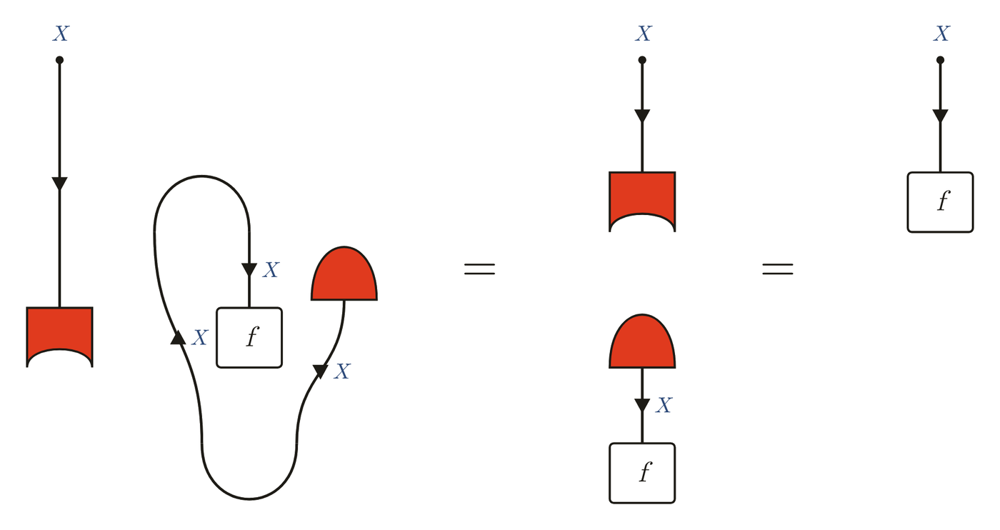
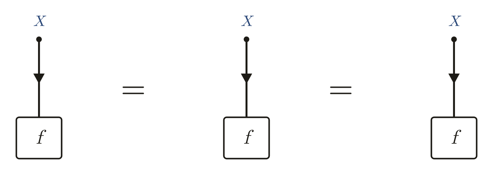
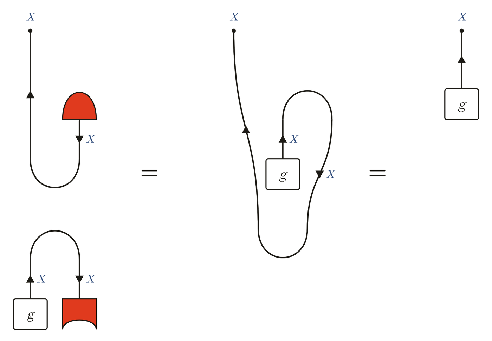
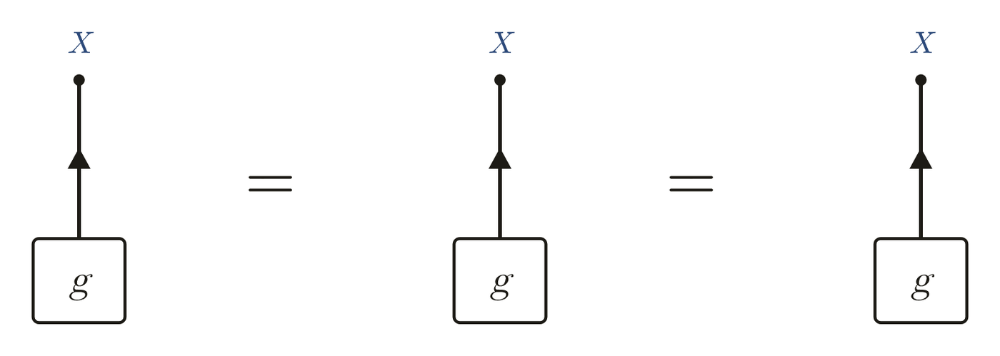

# Lemma 4.8 The contraction vector of a pairing

[← Chapter 4 index](README.md)

**Lemma 4.8.** The contraction vector of $\omega_S$ is $\ast_{\omega_S} = q_\alpha\otimes_\Bbbk(\text{the semi-disk with its arcs bent up})$, for a 1-partition $(p_\alpha, q_\alpha)$ of $X_S$ (4.11). The proof checks the two zigzag identities of a contraction vector, each in three steps. The editor follows the steps for $S = (X,+)$:

| step | book | editor |
|---|---|---|
| (i) $(\mathrm{id}\otimes\omega_S)(\ast_S\otimes f)$ = diagram | definitions | — (typed as the first side) |
| (ii) = $q_\alpha p_\alpha f$ | isotopy | isotopy: straightening (Theorem 2.6) |
| (iii) = $f$ | (4.9) | (4.9) |

### Lemma 4.8  (id_E ⊗ ω_S)(∗_S ⊗ f) = f

**Signature and expression** (duals: X\*, *pre-fusion* ticked):

```
partition β : X → 𝟙
f : 𝟙 → X
g : 𝟙 → X*
```

```
q_β ⊗ ev_X(((id_X* ⊗ p_β)coev~_X) ⊗ f) = q_β p_β f = f
```

$$
q_{\beta} \otimes (((\mathrm{ev}_{X} (\mathrm{id}_{X^{*}} \otimes f)) \otimes p_{\beta}) \widetilde{\mathrm{coev}}_{X}) \;=\; q_{\beta} p_{\beta} f \;=\; f
$$



| side | expression | rules Simplify uses |
|---|---|---|
| 1 | $q_{\beta} \otimes (((\mathrm{ev}_{X} (\mathrm{id}_{X^{*}} \otimes f)) \otimes p_{\beta}) \widetilde{\mathrm{coev}}_{X})$ | isotopy: straightening (Theorem 2.6) → (4.9) |
| 2 | $q_{\beta} p_{\beta} f$ | (4.9) |
| 3 | $f$ | already in normal form |

Normal form:

$$
f
$$



The editor reports: *✓ Both sides reduce to the same normal form, so the equation holds.* · [Open this step in the editor](../../string-diagram-editor.html#ex=91)

The second identity uses (4.9) first and then isotopy, in the book's order:

| step | book | editor |
|---|---|---|
| (i) $(\omega_S\otimes\mathrm{id})(g\otimes\ast_S)$ = diagram | definitions | — |
| (ii) = $g$ with its arc bent | (4.9) | (4.9) |
| (iii) = $g$ | isotopy | isotopy: straightening (Theorem 2.6) |

### Lemma 4.8  (ω_S ⊗ id_F)(g ⊗ ∗_S) = g

**Signature and expression** (duals: X\*, *pre-fusion* ticked):

```
partition β : X → 𝟙
f : 𝟙 → X
g : 𝟙 → X*
```

```
ev_X(g ⊗ q_β) ⊗ ((id_X* ⊗ p_β)coev~_X) = (id_X* ⊗ ev_X(g ⊗ id_X))coev~_X = g
```

$$
(\mathrm{id}_{X^{*}} \otimes p_{\beta}) \widetilde{\mathrm{coev}}_{X} \mathrm{ev}_{X} (g \otimes q_{\beta})
$$

$$
=\;(\mathrm{id}_{X^{*}} \otimes (\mathrm{ev}_{X} (g \otimes \mathrm{id}_{X}))) \widetilde{\mathrm{coev}}_{X}
$$

$$
=\;g
$$



| side | expression | rules Simplify uses |
|---|---|---|
| 1 | $(\mathrm{id}_{X^{*}} \otimes p_{\beta}) \widetilde{\mathrm{coev}}_{X} \mathrm{ev}_{X} (g \otimes q_{\beta})$ | (4.9) → isotopy: straightening (Theorem 2.6) |
| 2 | $(\mathrm{id}_{X^{*}} \otimes (\mathrm{ev}_{X} (g \otimes \mathrm{id}_{X}))) \widetilde{\mathrm{coev}}_{X}$ | isotopy: straightening (Theorem 2.6) |
| 3 | $g$ | already in normal form |

Normal form:

$$
g
$$



The editor reports: *✓ Both sides reduce to the same normal form, so the equation holds.* · [Open this step in the editor](../../string-diagram-editor.html#ex=92)

For tuples $S$ with several arcs, such as $S = ((X,+),(Y,-))$, the lemma is checked in matrices in `graphical-calculus-4.nb` (sections 70–79, code in `fusion-4.wl`), section 75 (`lemma48`).

---

By Dara O Shayda and Noor Hoshino (星野ヌール) · © Computational Classnotes · CC BY-NC-SA 4.0
