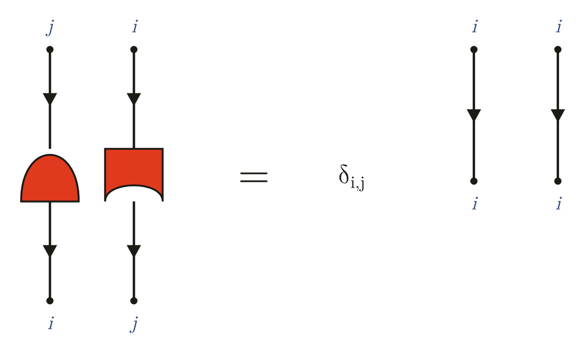
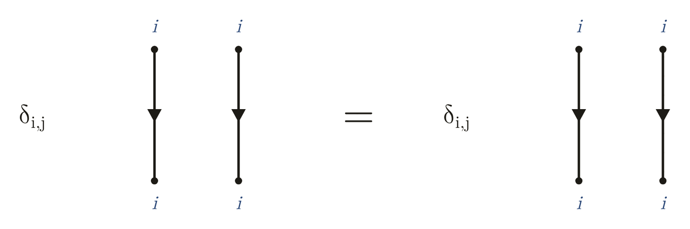
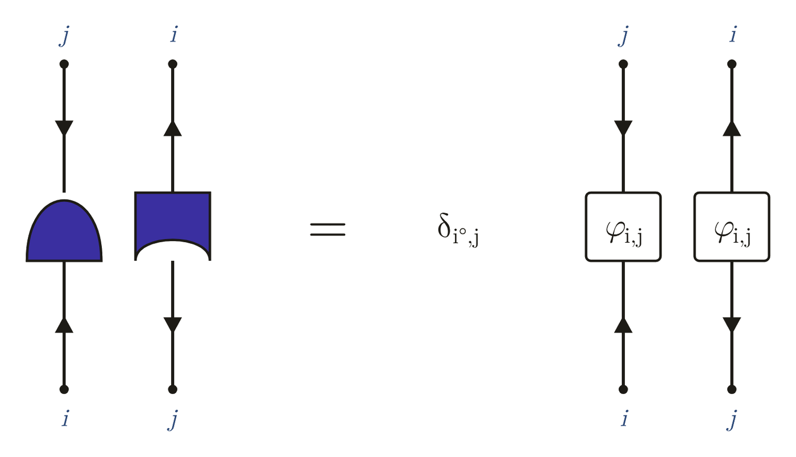
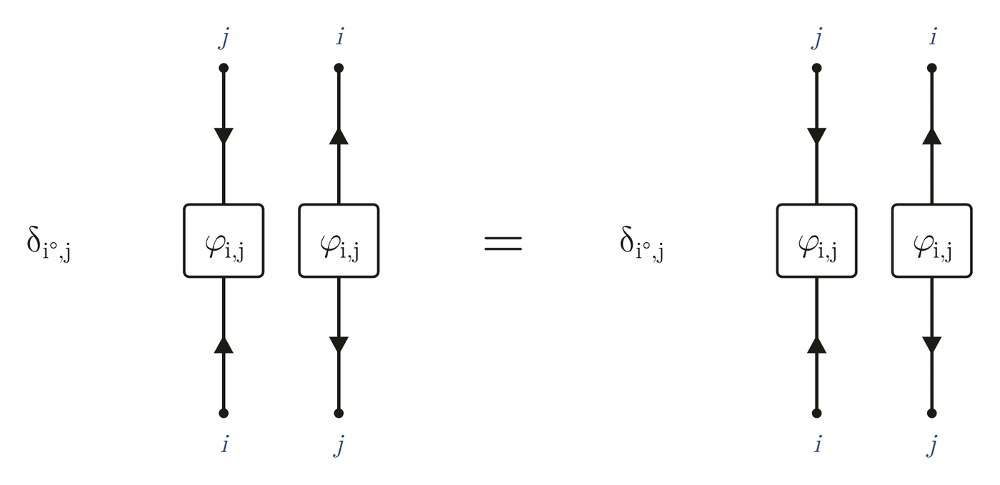
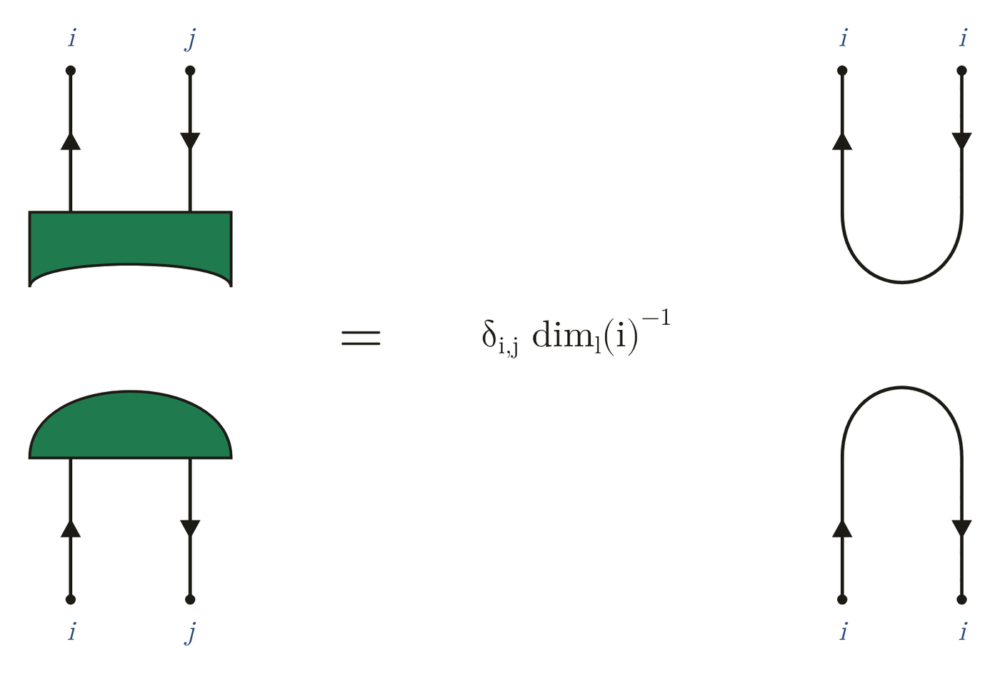
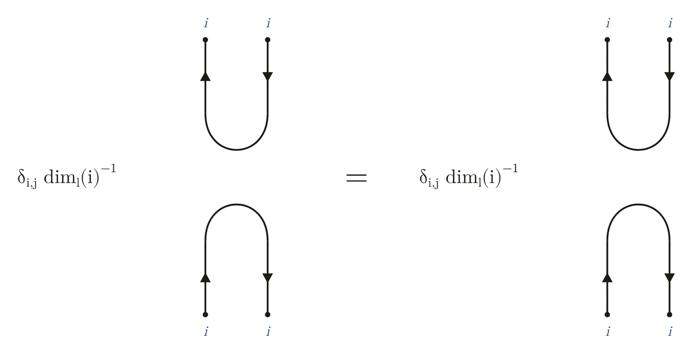
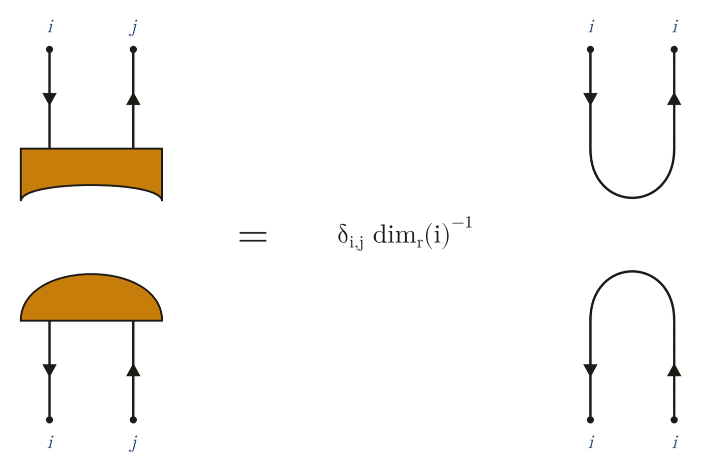
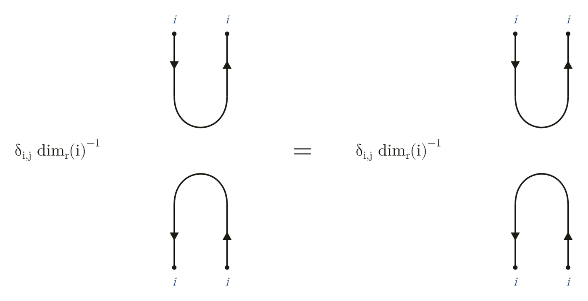
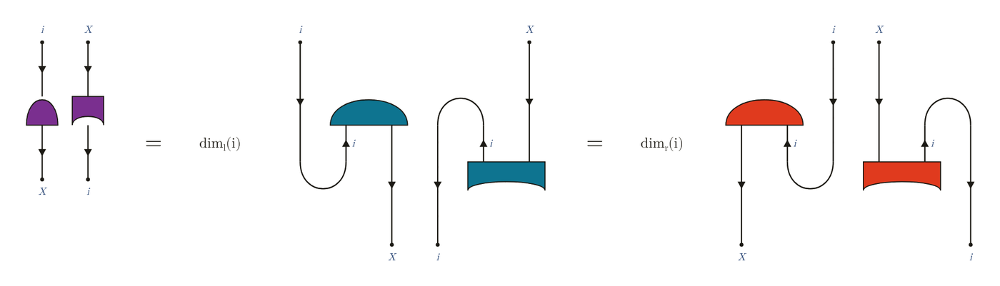
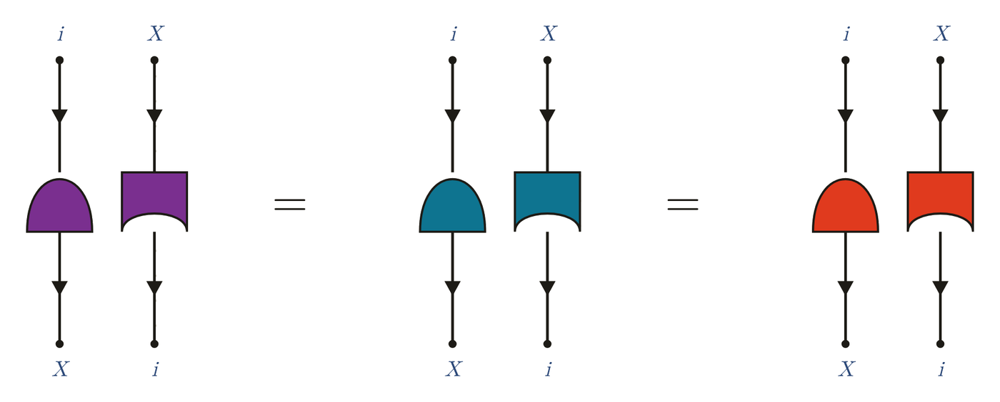

# Lemma 4.9 Computations with curvilinear boxes

[← Chapter 4 index](README.md)

**Lemma 4.9** lists seven identities that hold inside any diagram (the 'gray area'). In the editor the gray area is everything else in the expression; the examples put the two boxes side by side. Parts (a)–(d) are editor rules named after the lemma. Parts (e)–(g) are checked in matrices.

**(a)** A $j$-partition of a simple $i$ is $\delta_{i,j}$ times $(\mathrm{id}_i, \mathrm{id}_i)$. A $j$-partition of $i^*$ is $\delta_{i^\circ,j}$ times $(\varphi_{i,j}, \varphi_{i,j}^{-1})$ for an isomorphism $\varphi_{i,j} : i^*\to j$, typed `φ_{i,j}`. With $\delta_{i,j}$ the editor renames $j$ to $i$ in the term. In a sum over $j$, the sum collapses (**δ substitution**).

### Lemma 4.9(a)  a j-partition of i is δ_{i,j}(id_i, id_i)

**Signature and expression** (duals: X\*, *pre-fusion* ticked):

```
simple i j
partition β : i → j
partition γ : i* → j
partition δ : i* ⊗ j → 𝟙
partition ε : i ⊗ j* → 𝟙
partition α : X → i
partition ζ : i* ⊗ X → 𝟙
partition η : X ⊗ i* → 𝟙
```

```
p_β ⊗ q_β = δ_{i,j} id_i ⊗ id_i
```

$$
p_{\beta} \otimes q_{\beta} \;=\; \delta_{i,j}\,\mathrm{id}_{i \otimes i}
$$



| side | expression | rules Simplify uses |
|---|---|---|
| 1 | $p_{\beta} \otimes q_{\beta}$ | Lemma 4.9(a) |
| 2 | $\delta_{i,j}\,\mathrm{id}_{i \otimes i}$ | already in normal form |

Normal form:

$$
\delta_{i,j}\,\mathrm{id}_{i \otimes i}
$$



The editor reports: *✓ Both sides reduce to the same normal form, so the equation holds.* · [Open this step in the editor](../../string-diagram-editor.html#ex=93)

### Lemma 4.9(a)  a j-partition of i* is δ_{i°,j}(φ_{i,j}, φ⁻¹_{i,j})

**Signature and expression** (duals: X\*, *pre-fusion* ticked):

```
simple i j
partition β : i → j
partition γ : i* → j
partition δ : i* ⊗ j → 𝟙
partition ε : i ⊗ j* → 𝟙
partition α : X → i
partition ζ : i* ⊗ X → 𝟙
partition η : X ⊗ i* → 𝟙
```

```
p_γ ⊗ q_γ = δ_{i°,j} φ_{i,j} ⊗ φ⁻¹_{i,j}
```

$$
p_{\gamma} \otimes q_{\gamma} \;=\; \delta_{i^{\circ},j}\,\varphi_{i,j} \otimes \varphi^{-1}_{i,j}
$$



| side | expression | rules Simplify uses |
|---|---|---|
| 1 | $p_{\gamma} \otimes q_{\gamma}$ | Lemma 4.9(a) |
| 2 | $\delta_{i^{\circ},j}\,\varphi_{i,j} \otimes \varphi^{-1}_{i,j}$ | already in normal form |

Normal form:

$$
\delta_{i^{\circ},j}\,\varphi_{i,j} \otimes \varphi^{-1}_{i,j}
$$



The editor reports: *✓ Both sides reduce to the same normal form, so the equation holds.* · [Open this step in the editor](../../string-diagram-editor.html#ex=94)

**(b), (c)** A 1-partition of $i^*\otimes j$ is $\delta_{i,j}\dim_l(i)^{-1}(\mathrm{ev}_i, \widetilde{\mathrm{coev}}_i)$. A 1-partition of $i\otimes j^*$ is $\delta_{i,j}\dim_r(i)^{-1}(\widetilde{\mathrm{ev}}_i, \mathrm{coev}_i)$.

### Lemma 4.9(b)  a 1-partition of i* ⊗ j

**Signature and expression** (duals: X\*, *pre-fusion* ticked):

```
simple i j
partition β : i → j
partition γ : i* → j
partition δ : i* ⊗ j → 𝟙
partition ε : i ⊗ j* → 𝟙
partition α : X → i
partition ζ : i* ⊗ X → 𝟙
partition η : X ⊗ i* → 𝟙
```

```
p_δ ⊗ q_δ = δ_{i,j} dim_l(i)⁻¹ ev_i ⊗ coev~_i
```

$$
q_{\delta} p_{\delta} \;=\; \delta_{i,j}\,\dim_l(i)^{-1}\,\widetilde{\mathrm{coev}}_{i} \mathrm{ev}_{i}
$$



| side | expression | rules Simplify uses |
|---|---|---|
| 1 | $q_{\delta} p_{\delta}$ | Lemma 4.9(b) |
| 2 | $\delta_{i,j}\,\dim_l(i)^{-1}\,\widetilde{\mathrm{coev}}_{i} \mathrm{ev}_{i}$ | already in normal form |

Normal form:

$$
\delta_{i,j}\,\dim_l(i)^{-1}\,\widetilde{\mathrm{coev}}_{i} \mathrm{ev}_{i}
$$



The editor reports: *✓ Both sides reduce to the same normal form, so the equation holds.* · [Open this step in the editor](../../string-diagram-editor.html#ex=95)

### Lemma 4.9(c)  a 1-partition of i ⊗ j*

**Signature and expression** (duals: X\*, *pre-fusion* ticked):

```
simple i j
partition β : i → j
partition γ : i* → j
partition δ : i* ⊗ j → 𝟙
partition ε : i ⊗ j* → 𝟙
partition α : X → i
partition ζ : i* ⊗ X → 𝟙
partition η : X ⊗ i* → 𝟙
```

```
p_ε ⊗ q_ε = δ_{i,j} dim_r(i)⁻¹ ev~_i ⊗ coev_i
```

$$
q_{\varepsilon} p_{\varepsilon} \;=\; \delta_{i,j}\,\dim_r(i)^{-1}\,\mathrm{coev}_{i} \widetilde{\mathrm{ev}}_{i}
$$



| side | expression | rules Simplify uses |
|---|---|---|
| 1 | $q_{\varepsilon} p_{\varepsilon}$ | Lemma 4.9(c) |
| 2 | $\delta_{i,j}\,\dim_r(i)^{-1}\,\mathrm{coev}_{i} \widetilde{\mathrm{ev}}_{i}$ | already in normal form |

Normal form:

$$
\delta_{i,j}\,\dim_r(i)^{-1}\,\mathrm{coev}_{i} \widetilde{\mathrm{ev}}_{i}
$$



The editor reports: *✓ Both sides reduce to the same normal form, so the equation holds.* · [Open this step in the editor](../../string-diagram-editor.html#ex=96)

**(d)** An $i$-partition of $X$ equals $\dim_l(i)$ times a 1-partition of $i^*\otimes X$ with the $i$-arc bent, and also $\dim_r(i)$ times a 1-partition of $X\otimes i^*$. The rule **Lemma 4.9(d)** rewrites a 1-partition of $i^*\otimes X$ (or of $X\otimes i^*$) as $\dim_l(i)^{-1}$ (or $\dim_r(i)^{-1}$) times a new $i$-partition of $X$ with a cap and a cup. The zigzags then straighten the bends:

### Lemma 4.9(d)  an i-partition of X, bent

**Signature and expression** (duals: X\*, *pre-fusion* ticked):

```
simple i j
partition β : i → j
partition γ : i* → j
partition δ : i* ⊗ j → 𝟙
partition ε : i ⊗ j* → 𝟙
partition α : X → i
partition ζ : i* ⊗ X → 𝟙
partition η : X ⊗ i* → 𝟙
```

```
p_α ⊗ q_α = dim_l(i) ((id_i ⊗ p_ζ)(coev_i ⊗ id_X)) ⊗ ((ev~_i ⊗ id_X)(id_i ⊗ q_ζ)) = dim_r(i) ((p_η ⊗ id_i)(id_X ⊗ coev~_i)) ⊗ ((id_X ⊗ ev_i)(q_η ⊗ id_i))
```

$$
p_{\alpha} \otimes q_{\alpha}
$$

$$
=\;\dim_l(i)\,((\mathrm{id}_{i} \otimes p_{\zeta}) (\mathrm{coev}_{i} \otimes \mathrm{id}_{X})) \otimes ((\widetilde{\mathrm{ev}}_{i} \otimes \mathrm{id}_{X}) (\mathrm{id}_{i} \otimes q_{\zeta}))
$$

$$
=\;\dim_r(i)\,((p_{\eta} \otimes \mathrm{id}_{i}) (\mathrm{id}_{X} \otimes \widetilde{\mathrm{coev}}_{i})) \otimes ((\mathrm{id}_{X} \otimes \mathrm{ev}_{i}) (q_{\eta} \otimes \mathrm{id}_{i}))
$$



| side | expression | rules Simplify uses |
|---|---|---|
| 1 | $p_{\alpha} \otimes q_{\alpha}$ | already in normal form |
| 2 | $\dim_l(i)\,((\mathrm{id}_{i} \otimes p_{\zeta}) (\mathrm{coev}_{i} \otimes \mathrm{id}_{X})) \otimes ((\widetilde{\mathrm{ev}}_{i} \otimes \mathrm{id}_{X}) (\mathrm{id}_{i} \otimes q_{\zeta}))$ | Lemma 4.9(d) → (2.1) left zigzag → (2.1) right zigzag |
| 3 | $\dim_r(i)\,((p_{\eta} \otimes \mathrm{id}_{i}) (\mathrm{id}_{X} \otimes \widetilde{\mathrm{coev}}_{i})) \otimes ((\mathrm{id}_{X} \otimes \mathrm{ev}_{i}) (q_{\eta} \otimes \mathrm{id}_{i}))$ | Lemma 4.9(d) → (2.1) left zigzag → (2.1) right zigzag |

Normal form:

$$
p_{\alpha} \otimes q_{\alpha}
$$



The editor reports: *✓ Both sides reduce to the same normal form, so the equation holds.* · [Open this step in the editor](../../string-diagram-editor.html#ex=97)

**(e), (f), (g)** relate partitions whose arcs are bent in more complicated ways:

- (e): an $i$-partition of $k^*\otimes j\otimes X^*$ with its $k$- and $X$-arcs bent equals $\frac{\dim_r(i)\dim_r(k)}{\dim_r(j)\dim_l(k)}$ times a $j$-partition of $k\otimes i\otimes X$;
- (f): the mirror image, with factor $\frac{\dim_l(i)\dim_l(k)}{\dim_l(j)\dim_r(k)}$;
- (g): $\sum_j$ (an $i$-partition of $j\otimes Y$ on top of a $j$-partition of $X$) = an $i$-partition of $X\otimes Y$ = $\sum_j$ (an $i$-partition of $X\otimes j$ on top of a $j$-partition of $Y$).

These are checked in matrices in `graphical-calculus-4.nb` (sections 70–79, code in `fusion-4.wl`), section 76 (`lemma49`), in a pivotal category that is not spherical ($w(g) = 2^g$). There $\dim_l\neq\dim_r$, so the factors in (e) and (f) are really tested. The walkthrough shows that the book's factor in (e) is right and that the symmetric guess $\dim_l(i)/\dim_l(j)$ is wrong. The editor does not have rules for (e)–(g) yet.

---

By Dara O Shayda and Noor Hoshino (星野ヌール) · © Computational Classnotes · CC BY-NC-SA 4.0
